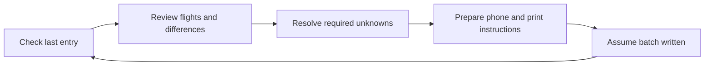
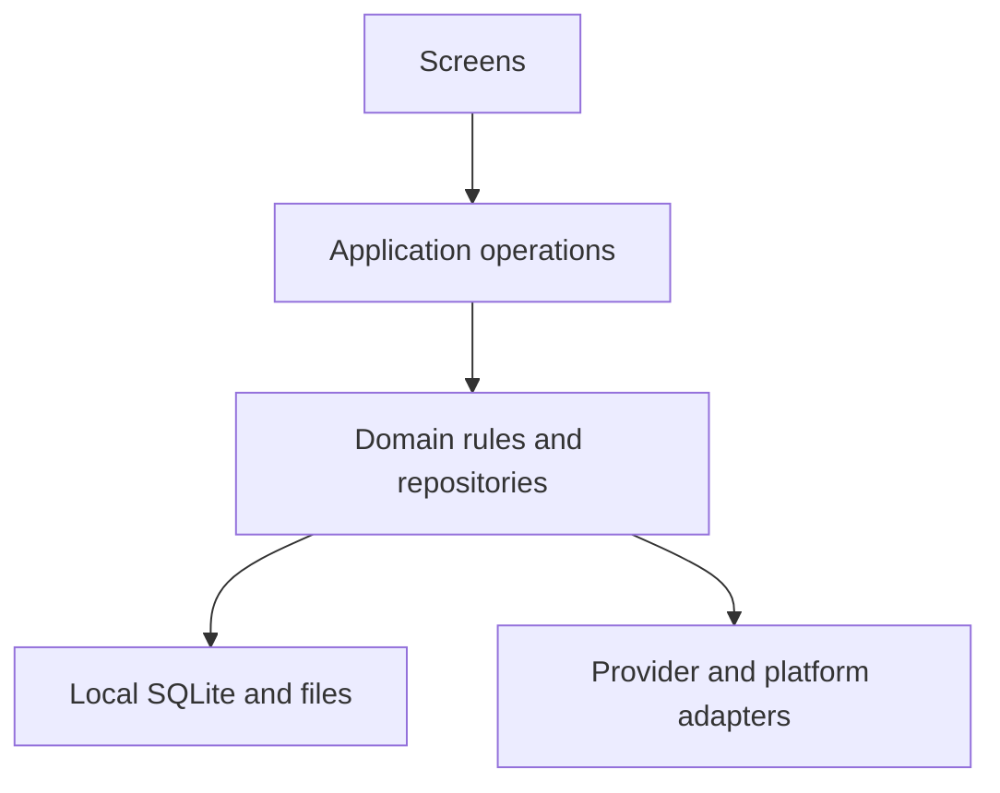

# MoFlight

**25 October Sync/backup release:** [Download APK ZIP — source `bf60089`](https://github.com/MomoRC-tech/MoFlight-App-framework/releases/download/sync-target-backup-2026-10-25-bf60089/MoFlight-Android-bf60089.zip). Clear Sync attention and Details, separate session/receipt evidence, and provisional annual duty-hour targets in backup v3. Older v1/v2 restores preserve existing targets. [Verification and limits](docs/verification/2026-10-25-sync-and-target-backup.md).

<p align="center">
  <picture>
    <source media="(prefers-color-scheme: dark)" srcset="docs/assets/branding/moflight-ai-logo-dark.png">
    
  </picture>
</p>

MoFlight is a mobile app in development for glider pilots, students and instructors. It brings saved flight history, season comparisons and supported club information together, with offline local data. Paper-logbook assistance is a later journey; Android is the current focus and iOS runtime acceptance remains deferred.

## Current delivery

Source `bf600898109d561d58d2fcb4d0add6a1ba152d53` adds Sync clarity and annual-target backup v3 to the existing phone-usability, aircraft/launch and populated-update safeguards. [Download APK ZIP](https://github.com/MomoRC-tech/MoFlight-App-framework/releases/download/sync-target-backup-2026-10-25-bf60089/MoFlight-Android-bf60089.zip) and [evidence/limits](docs/verification/2026-10-25-sync-and-target-backup.md). Extract the ZIP and install `app-release.apk`. Development-signed standalone lab build; no new physical-phone or iOS runtime acceptance. AI requests remain disabled in the ordinary app. Earlier releases retain their source-specific evidence.

**Startup investigation concluded for now:** a subsequent synthetic offline-restart trial of this APK hit a released SQLite handle and showed unreadable flights. Explicit local retry recovered the saved data in that trial. [#89](https://github.com/MomoRC-tech/MoFlight-App-framework/issues/89) is closed at Manuel’s direction after bounded follow-up runs did not reproduce it; revisit only on recurrence or concrete new evidence. No root-cause fix is claimed; [the reliability report](docs/verification/2026-10-25-reliability-continuation.md) separates successful local/export checks from this failed startup acceptance.

The approved dark Compact Cockpit is the current visual baseline. Ordinary saved flights, compact filters/details, Statistics and supported club sources work offline after capture. Sync remains one explicit header action; independent optional-source failures do not erase saved flights.

| Delivered within recorded scope | Still incomplete or unaccepted |
| --- | --- |
| Account-scoped flights, compact list/filter/detail and saved-local Statistics | Broader fresh-login/second-account/source coverage and populated phone responsiveness |
| Combined flights/Medical/duties/calendar/documents/work/tasks capture | Positive-source/completeness cases and current physical/iOS acceptance |
| Aggregate backup v3 including local AI chats/drafts and annual targets; bounded populated update/recovery proof | Complete settings inventory and ordinary external same-install restore; identify/test the selected first-beta update baseline. Replacement-device/system restore is separate |
| Local AI screen, tools/history and disabled service foundations | Ordinary end-to-end service integration and approved actual model evaluation |
| Synthetic book/format/writing proofs under Development | Real paper setup, assignments, photo-to-writing and cloud accounts/sync |

This is a development delivery, not full product/beta acceptance. [Current review and next packages](docs/project-plan.md#next-executable-packages) distinguish delivered filter/chat/Sync refinements and target backup from remaining core reliability/preservation work. This release does not activate AI or other services. Earlier release/decision records remain in the [planning archive](docs/archive/planning/2026-10-25-superseded-continuation.md) and their linked verification reports.

## Find the right document

| Need | Source of truth |
| --- | --- |
| Priorities, milestones and next work | [Project plan](docs/project-plan.md#next-executable-packages) |
| Work contracts and open decisions | [GitHub Issues](https://github.com/MomoRC-tech/MoFlight-App-framework/issues) |
| Current screens, symbols and visual rules | [UI design handbook](docs/product/design/README.md) |
| Documentation map and historical archive | [Documentation index](docs/README.md), [archive](docs/archive/README.md) |
| Product behavior and longer-term journeys | [Product index](docs/product/README.md) |
| Run, build and verify | [Lab runbook](apps/platform-lab/README.md), [verification workflow](docs/development/verification-workflow.md) |
| What was actually tested | [Modern UI report](docs/verification/2026-10-22-alternative-ui.md), [retrieval/main continuation report](docs/verification/2026-10-21-simple-flight-loading.md) |

Earlier release announcements remain in those dated reports and [the pre-restructure README](https://github.com/MomoRC-tech/MoFlight-App-framework/blob/a47f56178da1e6d9dd0475bb95216d4106cfdd97/README.md). Their APKs and test counts are historical, not competing current delivery instructions.

<details>
<summary><strong>🧭 Product vision & user journeys</strong></summary>

## Products and Phase 1 boundaries

MoFlight is intended for students, instructors and pilots with overlapping roles. A shared start screen connects personal flying, paper-book tasks and relevant club information. Initial logbook work focuses on gliding; ultralight and powered-aircraft formats are later requirements. One account can own multiple books, including successive volumes of the same format.

The [reviewed journey map](docs/product/2026-10-13-journey-information-map.md) records the selected content and open questions. Exact launch scope, role-specific behavior and release packaging remain to be decided.

The [first-use journey added on 18 October](docs/product/2026-10-13-journey-information-map.md#first-use--guided-start-and-trust) covers a brief welcome, guidance before Vereinsflieger login, a suggested explicit retrieval, highlights for tiles with usable changed data, and help when first opening an area. Skippable contextual help is the proposed presentation. [#22](https://github.com/MomoRC-tech/MoFlight-App-framework/issues/22) tracks review and future implementation; this extends product discovery and does not claim an implemented onboarding flow.

### Your flying, at a glance

The selected Start shows compact current/prior-calendar-year time/start metrics, one compact latest-flight row and a labelled **Statistik** entry. That entry opens a saved-local overlay for year/all/custom periods, coverage-aware annual/monthly comparisons, aircraft registrations and reported-duration bands. Startarten stays unavailable until its source mapping is verified. The latest-flight row opens its saved detail; the overlay opens exact contributing saved flights. Broader person/role, launch mapping and platform acceptance gates remain under #9.

Unknown durations stay unknown. Incomplete history is shown as incomplete; a partial year must not look like a complete lifetime record.

## Flight-logbook product workflow

The writing template's primary benefit is adding **new paper-logbook entries**; checking older written entries is secondary and optional. The intended catch-up journey starts with the remembered last written entry. Confirm it for the named book, or enter the running number of your actual last written flight. Provide details/a current photo when that number or required continuation information cannot be resolved. Review proposed flights and resolve required missing information before preparing an adjustable page-sized batch.



*Intended journey; real photo recognition and end-to-end writing remain future work.*

Flight takeoff/landing times are saved and documented in **UTC**; original source values remain preserved, and an unknown source time zone must be clarified before conversion. See the [UTC requirement](docs/product/2026-10-13-journey-information-map.md#flight-clock-times--utc-requirement).

Vereinsflieger is authoritative for provider-backed flight data, including recorded flight duration. Statistics group by its recorded flight date; monthly comparisons use matching cutoffs; the season rings show saved calendar-year totals with coverage limits, as specified in the current design contract. Later source corrections update the saved app flight and receive an orange label/dot; the marker clears only after explicit acknowledgement, while paper evidence and frozen instructions remain separate. Incorrect source records should be corrected in Vereinsflieger through the club administrator/responsible personnel. [Product decision and remaining marker rules](docs/product/2026-10-13-journey-information-map.md#authoritative-provider-data-and-changed-flight-indication), [#30](https://github.com/MomoRC-tech/MoFlight-App-framework/issues/30).

A pilot may accept a historical paper-total discrepancy. A persistent, book-specific [totals adjustment](docs/product/2026-10-13-journey-information-map.md#paper-total-adjustments) carries it into future writing templates: accepted paper carryover plus new Vereinsflieger durations. Provider flight facts and app statistics remain unchanged. Later source corrections can be accepted through revised adjustments while paper entries stay unchanged. Evidenced affected flights retain a deviation dot/label in lists/details, including accepted deviations; acknowledging a source update does not hide an ongoing deviation.

Assumed writing progress stays separate from confirmed paper evidence. The next session checks the remembered entry, accepts the actual last written book number or uses a photo when clarification is needed; there is no mandatory post-writing completion prompt. Existing lab confirmation tests predate this revised requirement. Historical gaps and decisions to leave discrepancies unchanged remain visible and revisitable.

### Club information and costs

- **Duties:** own assignments and all permitted club duty types through the following week's weekend, preserving club-defined names and including multi-day duties whose periods overlap that window. Show each assignment once with its full period; own duties also have a later preview of the next three assignments. For each own assignment, show all other people assigned to the same duty name in the same club on that day, supporting club-specific names and multiple people.
- **Club essentials:** work-hour progress, own tasks, upcoming events excluding birthdays, and notices for new news/documents. Own reservations and license/training information belong in details.
- **Costs:** yearly flying costs separately from membership/other charges, then totals per aircraft. Billing interpretation and retrieval still need investigation; account balances are distinct from costs.

See [product scope](docs/product/moflight-feature-scope.md), [writing presentation](docs/product/writing-template-presentation.md) and [provider discovery](docs/product/vereinsflieger-information-discovery.md) for definitions and gates.

</details>

<details>
<summary><strong>🚧 Development status & roadmap</strong></summary>

## Status and source of truth

**The [project plan](docs/project-plan.md) controls priorities, milestone status and acceptance.** Issues track work, product specifications explain behavior, and verification reports record what was actually checked.

| Area | Where it stands |
| --- | --- |
| User journeys | Reviewed; detailed UI/application contracts remain open |
| UI design | Modern alternative selected as the main baseline on 22 October: compact ASK-21 header, season rings, single-row paired-year chart and retained five-tab navigation; scoped device evidence is in the design report |
| Native foundation | Expo/React Native lab with local SQLite, backup and bounded Android evidence |
| Vereinsflieger access | Verified account-scoped own-flight storage and ordinary Flüge delivered within bounded Android evidence; broader source/account/platform gates remain open |
| Statistics and books | Approved saved-local Meine Saison overlay is committed; complete host checks and platform exports pass. [Package contract/evidence](docs/product/2026-10-13-journey-information-map.md#statistics-overlay-plan--23-october-2026); committed-source native/release and broader source-mapping acceptance remain open under #9. Real book assignment is deferred; multi-book proofs remain synthetic |
| Photo-to-writing | Product journey and format work exist; real recognition and full phone/print acceptance remain open |
| iOS | Intended platform, currently deferred; exports do not establish runtime acceptance |

The earlier Figma transfer encountered a Starter tool-call limit; it is historical design-workflow evidence, not a prerequisite for the current native UI. No upgrade or spending change was made. See the [initial wireframe record](docs/archive/design/2026-10-13-rough-figma-wireframes.md) and [dark concept review](docs/archive/design/2026-10-13-dark-concept-review.md).

## Phase 1 execution plan and Issues

| Milestone | Focus | Status |
| --- | --- | --- |
| M0 | Consolidate documentation | Complete for that scope |
| M1 | Native UI and application contracts | Bounded native shell implemented and tested; full contracts/acceptance remain open |
| M2 | Reliable retrieval boundary | Scoped Android re-login, recovery, capture/reference/repeat/cancel evidence exists; production identity/semantics, clean-profile clearing/re-login, real second-account and iOS gates remain open |
| M3 | Account-owned saved live history | Bounded Android foundation and ordinary Flüge delivered; broader preservation/platform/book gates open |
| M4 | Reviewed initial analytics | Real-library Start slice implemented; broader measures, presentation and native acceptance open |
| M5 | Writing expansion and further features | Deferred |

Writing assistance has immediate product value but is outside the selected flight-library-first beta; production paper books and writing need later format and release decisions under #11/#7.

## Next action and unresolved decisions

The [25 October bounded continuation](docs/verification/2026-10-17-current-status-and-open-issues.md#25-october-bounded-continuation--sync-and-preservation) adds sync-return and aggregate-backup regression coverage and inventories settings gaps. Later packages delivered Sync presentation and duty-target backup. Manuel selected one signed first-beta build as the supported update starting point and same-install manual JSON restore for that beta; the exact baseline and ordinary populated acceptance are still open under [#34](https://github.com/MomoRC-tech/MoFlight-App-framework/issues/34) and [#29](https://github.com/MomoRC-tech/MoFlight-App-framework/issues/29).

Follow the [current next actions](docs/project-plan.md#next-executable-packages) and [complete issue map](docs/project-plan.md#complete-ordered-issue-map). Fresh authenticated phone retrieval, populated app-switch responsiveness and complete supported-source coverage remain open. The supported-user archive extends backup coverage within the selected same-install scope; replacement-device/system restore and supported beta upgrades retain separate acceptance gates. Main adoption is selected; it does not establish those untested outcomes.

Superseded prototype comparisons and design-review instructions are in the [documentation archive](docs/archive/README.md). Current appearance is governed by the [design handbook](docs/product/design/README.md).

Deferred ideas include [Activities live — #14](https://github.com/MomoRC-tech/MoFlight-App-framework/issues/14), [in-app chat — #13](https://github.com/MomoRC-tech/MoFlight-App-framework/issues/13), possible SPL tutoring and weather integration. The v0.26 Wetter tab is a selected navigation placeholder only; weather content/provider/integration remain deferred. Billing discovery was added to the basic retrieval checkpoint on 19 October; cost analytics implementation still needs its source contract. No release date is promised.

</details>

<details>
<summary><strong>🧩 Architecture & data principles</strong></summary>

## Current architecture proposal

The approved development baseline is **Expo + React Native + strict TypeScript**, in a pnpm workspace, with **expo-sqlite as the single native database writer**. Local storage comes first. Supabase Cloud Free is selected for a separate first cloud trial; cloud integration, detailed sync and production schemas remain gated.



*Agreed target boundary. The current lab still has some UI/provider orchestration to extract.*

## Data and API invariants

- Keep source facts, photo observations, effective user choices, confirmed paper evidence and assumed progress distinct.
- Scope paper state, photos, decisions and snapshots to the account and book; shared flight evidence does not mean shared paper progress.
- Preserve time basis, units, identities, coverage and original evidence. Unknown values are not zeros.
- Repeated retrieval must not duplicate flights. Partial failures preserve prior usable history and recovery state.
- Keep MoFlight identity separate from Vereinsflieger authorization; device secrets do not belong in Git or backups.

## AI, RAG and logbook behavior

AI may suggest handwriting transcriptions, matches and explanations. Deterministic code owns flight minutes, roles, counts, numbering and totals. AI suggestions cannot silently become confirmed facts. A bounded, approved handwriting evaluation is required before the real photo-to-writing journey is accepted; model evaluation/production acceptance and paid execution remain open.

On 24 October, Manuel selected the [first AI-chat requirements](docs/architecture/logbook-chat-discovery.md#first-version-product-decisions--24-october-2026): saved-flight/statistics questions, on-demand flight-data reviews and flying-progress summaries, aviation-term explanations, supporting-record navigation, separate local chats with backup, manual sending after offline drafts, OpenRouter and a EUR 1/calendar-month personal planning ceiling. Keep at most 50 chats; creating another automatically removes the least recently active. The first evaluation candidate is GPT-6 Luna with explicit Max reasoning and zero-retention inference. Training coaching follows verified source meanings; photos and web lookup are outside the first version. Local AI implementation was subsequently authorized according to the execution plan, beginning with vendor-free contracts/frozen fixtures and flight-only context/projection/local tool adapters; app/relay runtime remains unintegrated M5. The [technical closure package](docs/architecture/logbook-chat-discovery.md#technical-closure-proposal--24-october-2026) supplies the selected local defaults, with runtime/quality acceptance still open. The ceiling does not authorize spending.

Initial personal access uses Manuel's OpenRouter account. A [benchmark against Mistral Small and two strong low-cost Chinese model candidates](docs/architecture/logbook-chat-discovery.md#requested-four-model-benchmark--24-october-2026) is requested; the closure proposal names DeepSeek V4.1 Flash 1017 and MiniMax M3.1 Flash and proposes a synthetic pilot inside the existing EUR 1 monthly allowance. The [selected usage identifier](docs/architecture/logbook-chat-discovery.md#verified-vereinsflieger-id-usage-attribution--selected-24-october-2026) is the verified Vereinsflieger account ID, with no email capture or additional sign-in; gateway proof/access protection remains open. Existing OpenRouter reporting and a small app budget view remain proposed. Local implementation is authorized; exact benchmark candidates, pilot funding and actual live acceptance remain open. No benchmark has run.

Manuel also requires [centralized live AI configuration](docs/architecture/logbook-chat-discovery.md#centralized-live-ai-configuration--requested-24-october-2026) for all users: model, reasoning, app system prompt, features and essential limits enforced by the gateway ([#72](https://github.com/MomoRC-tech/MoFlight-App-framework/issues/72)). Each message keeps one config version; emergency disable blocks further model calls. Initial management uses the protected backend dashboard. The SDK-backed Responses baseline is selected after the [15-check synthetic comparison](docs/verification/2026-10-24-ai-harness-comparison.md); its server-only SDK foundation is implemented locally, with the local relay/coordinator now implemented; live/backend and broader native acceptance remain open.

The [AI implementation plan](docs/development/ai-chat-implementation-plan.md) is authorized for local execution, with package dependencies, acceptance checks, historical-ID trust limits and bounded Luna Max assignments. [Implementation evidence](docs/verification/2026-10-24-ai-chat-implementation.md) records contracts, bounded local source tools and owner-local chat/draft storage with supported backup v2. Manuel selected SDK Responses/short relay and the saved ID from any prior successful Vereinsflieger login, without pairing or fresh sign-in. AI04 adds the login receipt hook, validated saved-binding seeding and a server-only SDK/allowlist foundation tested with synthetic transport. AI05/AI06 add locally verified protected policy and atomic budget SQL/RPC foundations with disabled defaults. AI07/AI08 now implement sealed continuity, bounded phone orchestration, real owner-local chat UI, evidence navigation and session-only enablement. The server composition and receipt lookup use synthetic transports; the ordinary app has no configured live client and no relay endpoint is deployed. AI09 has an offline structural scorer, with semantic review and actual model evaluation still required. Service setup and funded live evaluation remain separately gated; AI is not enabled in the app.

Read [ADR 0002: approved lab stack](docs/adr/0002-phase1-technology-proposal.md), [ADR 0007: proposed book/format architecture](docs/adr/0007-multiple-logbooks-and-formats.md), [ADR 0008: evidence/AI boundary](docs/adr/0008-logbook-ai-and-deterministic-boundary.md), [import contract](docs/architecture/vereinsflieger-import-contract.md) and [state/query semantics](docs/product/flight-logbook-state-and-queries.md).

## Proposed repository layout

| Location | Purpose |
| --- | --- |
| [apps/platform-lab](apps/platform-lab/README.md) | Native development lab; not a released product |
| `packages/flight-logbook/`, `packages/local-data/` | Domain calculations and local-data boundaries |
| `pocs/`, `tests/`, `scripts/` | Bounded trials, synthetic fixtures, checks and tooling |
| [docs/product](docs/product/README.md) | Journeys, requirements and design records |
| `docs/adr/`, `docs/architecture/`, `docs/verification/` | Decisions, contracts and evidence |

Additional product shells and infrastructure are proposals, not empty directories to create in advance. Final release packaging remains open.

</details>

<details>
<summary><strong>🛠️ Run the development lab</strong></summary>

## Development tools and environment

This repository is for development, not an app-store installation. Use Node 24 and the pinned pnpm version in [package.json](package.json). Android native work needs the configured SDK/JDK; iOS native work needs compatible macOS/Xcode tooling. The [Windows setup guide](docs/development/windows-local-setup.md) covers local builds, emulator isolation and Windows path-length handling.

## Runnable first milestone

```bash
npm install --global pnpm@11.25.0
pnpm install --frozen-lockfile
pnpm check
pnpm lab
```

`pnpm check` runs types, TypeScript/SQLite tests, Python tests and fixture parity without model calls. It prints a compact summary and saves full logs under ignored `build/host-checks/`; see the [workflow](docs/development/verification-workflow.md#local-checks-without-model-calls). Individual and focused checks remain available.

Every implementation assesses existing coverage and adds useful automated regression tests in the same package, preferably without inference calls; see the [standing test rule](docs/development/verification-workflow.md#assess-and-implement-useful-tests). The [acceptance map](docs/project-plan.md#21-acceptance-traceability) links selected requirements and journey scenarios to tests, evidence and remaining gates.

The [platform-lab runbook](apps/platform-lab/README.md) is the source for native launch/build commands, fixtures, backup/restore and provider trials. Development builds normally need Metro; offline restart verification uses an appropriate standalone build with embedded JavaScript. Do not assume a successful bundle proves native behavior.

Use synthetic data for development. Keep authenticated provider-session emulators separate from **MoFlight_Synthetic_API37**, the designated emulator for destructive synthetic smoke tests. Never reset an unrelated session or dirty build checkout.

Changes go directly to `main` with traceable commits and existing Issues, following [AGENTS.md](AGENTS.md). No PR workflow is required. App-specific checks depend on the slice being changed.

**Development default, approved 17 October 2026:** [logic-first, risk-based verification](docs/development/verification-workflow.md). Use relevant tests and TypeScript during iteration; batch committed-source Release/native checks at integration acceptance. No routine visual verification for logic-only work; inspect affected UI for small visual changes and use the size matrix for substantial layout/navigation/typography changes. No routine subagents for small tasks; keep one concise package/evidence summary. Documentation changes need links/consistency checks only.

The separately authorized [18 October UI-agent comparison](docs/verification/2026-10-18-ui-agent-experiment.md#sol-61--low-comparison--18-october-2026) supported 8/8 scoped checks with Sol 6.1/Low in 257.73 s versus Luna/Max's 7/8 in 721.50 s. This pair favors Sol/Low for further evaluation, with operating-limit qualifications and preserved state. Token savings, repeatability and routine delegation remain unestablished under #6.

Manuel subsequently authorized the [bounded Sol 6.1/Low UI workflow](docs/development/ui-agent.md). Say **“Run a UI test with Sol Low”** and name a screen/scenario if needed. The local `pnpm ui:agent` controller enforces UI-action/capture/time limits and holds automatic display cleanup; Codex launches the fresh subagent. Use it for requested/relevant synthetic UI checks, not routine screenshots for logic-only changes. No API calls, dependencies or app-data clearing.

</details>

<details>
<summary><strong>🔒 Privacy, reliability & verification</strong></summary>

## Security, testing and operating limits

Personal flight exports, photos, databases, credentials and private roster rows must not be committed. Account/book isolation, foreign-object references, backup/migrations, session expiry and offline recovery require their own checks. Local encryption and cross-device synchronization are not accepted merely because SQLite or cloud policies exist.

Other members' name display, abbreviation, retention and sharing remain a deferred [privacy task — #15](https://github.com/MomoRC-tech/MoFlight-App-framework/issues/15). Abbreviated names are not necessarily anonymous. Concepts use fictional people and flights.

The [18 October GDPR/DSGVO readiness review](docs/verification/2026-10-18-gdpr-readiness-review.md) records current storage/backup gaps and proposed release checks under [#21](https://github.com/MomoRC-tech/MoFlight-App-framework/issues/21). Operator/legal bases, retention/erasure, notices and optional Medical/cloud/AI gates remain open; the review does not approve implementation or establish compliance.

Manuel's [approved privacy evaluation guideline](docs/verification/2026-10-18-gdpr-readiness-review.md#approved-evaluation-method) applies proportionate effort to each requirement's actual risk and benefit. He may accept a specific documented remaining risk when further mitigation is disproportionate; legal compliance, practical risk and owner acceptance stay distinct. No individual gap is accepted by this guideline.

Use documented local checks, committed-source builds and relevant native trials for scoped acceptance. Hosted execution is optional. The authorized 18 October handover enables automatic fast checks on main pushes/PRs; Android builds and UI checks remain manual. No paid CI, billing changes or spending-limit increases are authorized. See [ADR 0009](docs/adr/0009-local-android-development-and-checkpoint-ci.md) and the [portable CI runbook](docs/development/portable-ci.md).

**Evidence is scoped, not a blanket guarantee:** Android proofs, synthetic calculations, live raw capture and complete product journeys are separate achievements. iOS, full live import, real handwriting, costs and club-information integration still have open gates.

Recent evidence: [provider reset/recovery and remaining gates](docs/verification/2026-10-12-local-validation-and-provider-gates.md), [book/backup/capture proofs](docs/verification/2026-10-11-recovery-books-and-capture.md), [journey consolidation](docs/verification/2026-10-13-journey-consolidation.md).

</details>

<details>
<summary><strong>📋 Requirements & acceptance evidence</strong></summary>

## Requirements and evidence

This is the requirement register, not a claim that all requirements are delivered. The [roadmap feature register](docs/project-plan.md#2-feature-register) tracks current implementation/acceptance; the [dated audit register](docs/verification/2026-10-11-project-audit-register.md) retains provenance.

| ID | Requirement | Evidence needed |
| --- | --- | --- |
| R01 | Android and iOS | Platform-specific native runtime evidence |
| R02 | Multiple flight-related features | Reviewed scope and release packaging |
| R03 | Shared account identity | Verified ownership/session behavior across selected features |
| R04 | Offline reads and writes | Airplane-mode restart/recovery without data loss |
| R05 | Cross-device data | Two-device convergence and conflict handling |
| R06 | User isolation | Negative API, sync, storage, job and account-switch checks |
| R07 | Reusable modules | Domain independence from vendor/platform SDKs |
| R08 | Server-side AI | Authenticated validation, budget and measured usage |
| R09 | Private file processing | Retryable lifecycle, ownership and output verification |
| R10 | Agent-assisted development | Reproducible setup and actual check evidence |
| R11 | Commercial extensibility | Source rights, export/deletion and release requirements |
| R12 | Own Vereinsflieger flights | Authorized retrieval, source comparison and session/repeat behavior |
| R13 | Measurable RAG | Separate retrieval, citations, missing-evidence, latency/cost evaluation |
| R14 | Further aircraft-category logbooks | Format/field/rule evidence before activation |
| R15 | Multiple books and extensible formats | Independent state, migrations and format-extension proof |

For feature-level criteria, see [flight-logbook stories](docs/product/flight-logbook-user-stories.md), [phone/print presentation](docs/product/writing-template-presentation.md) and [requirements reconciliation](docs/architecture/phase1-reconciliation.md).

</details>

<details>
<summary><strong>💶 Costs, hosting & later services</strong></summary>

## Cost and effort status

Supabase Cloud Free is selected for the first cloud feasibility trial, not a prerequisite for local flight analytics. Free-tier quotas, idle behavior, email delivery and recovery need verification. No paid AI, hosted CI or subscription is authorized by the current roadmap.

Earlier person-day and tariff estimates are historical planning inputs, not a delivery promise or measured current cost. The initial aim is a small local-first footprint; no claim of unlimited free operation is made.

## Low-usage availability and approval choices

Cloud/sync, tutor/RAG, chat and weather are later work. A service that wakes automatically and one requiring owner recovery have different usability implications. [Backend/idle comparison](docs/architecture/low-usage-backend-comparison.md) and [ADR 0003](docs/adr/0003-low-usage-backend-proposal.md) retain the alternatives and approval boundaries. PowerSync and export-worker infrastructure remain deferred.

</details>

<details>
<summary><strong>📚 Documentation, decisions & development history</strong></summary>

Start with the [project plan](docs/project-plan.md) for order and the [reviewed journey map](docs/product/2026-10-13-journey-information-map.md) for behavior. Then follow the [product index](docs/product/README.md), [architecture decisions](docs/adr/0001-project-workflow.md) and [development runbook](apps/platform-lab/README.md).

- [Current visual direction](docs/product/design/README.md): selected modern UI and maintained component/layout rules. The [13 October concept review](docs/archive/design/2026-10-13-dark-concept-review.md) is historical.
- [Source access investigation](docs/architecture/vereinsflieger-access-investigation.md): observed access, permissions and open retrieval questions.
- [Provider preservation/recovery contract](docs/architecture/vereinsflieger-view-preservation.md): keep existing preferences and captures recoverable.
- [Book/format proposal](docs/adr/0007-multiple-logbooks-and-formats.md): production architecture remains proposed.
- [Complete pre-refactor README](docs/reference/2026-10-13-readme-development-history.md): preserved dated development notes, requirements, comparisons and evidence links; historical, not current operating instructions.
- [Original project draft](docs/reference/Segelflug_Plattform_Architektur_Phase1.md): retained source provenance.
- [Issues](https://github.com/MomoRC-tech/MoFlight-App-framework/issues): actionable work, open decisions and deferred ideas.

This entry point summarizes the project. Detailed specifications and dated verification reports carry the engineering evidence, so the front page can remain readable as the project grows.

</details>

<details>
<summary><strong>💼 Ownership & commercial licensing</strong></summary>

MoFlight's original code, documentation and artwork are **proprietary — all rights reserved**, as stated in [LICENSE](LICENSE). Manuel intends to retain control and market the app commercially; this repository does not grant public rights to reuse, modify or resell its original materials.

The package declaration `UNLICENSED` means no open-source license is granted; it is not the public-domain **Unlicense**. Third-party components retain their own licenses. Distribution obligations and end-user terms for selling the finished app must be reviewed separately before release.

</details>
