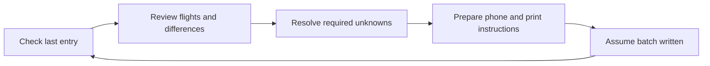
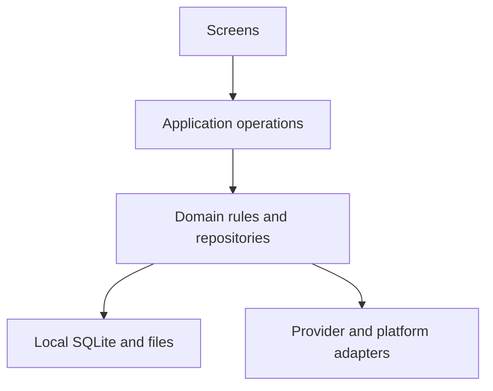

# MoFlight

**3 November current checkpoint:** full-reference financial retrieval now resumes durable batches after cancellation/restart and publishes raw receipts atomically. [Scoped host/native evidence](docs/verification/2026-10-30-financials-completion.md#full-coverage-resumable-batches--3-november-2026) · [current APK ZIP](https://github.com/MomoRC-tech/MoFlight-App-framework/releases/download/lab-financial-batches-2026-11-03-9718291/MoFlight-Financial-Batches-9718291.zip), actual application source `971829131d370305d7c9553a10e86f3eb887b6b6`. Actual101-reference completion, saved28-contributor Costs and exact fully-offline fresh-process readback pass. AI remains disabled/preparation-only; no paid calls or speedup/beta claim.

**Task-selector recovery follow-up (#56):** scoped restoration is implemented on641aad3 with passing host checks, normal Android Release and a separate synthetic native process-restart proof. [Evidence and remaining live provider/WebView gate](docs/verification/2026-10-21-simple-flight-loading.md#task-selector-restart-recovery--3-november-2026). This source checkpoint does not replace the verified financial APK above.

**3 November cache recovery and diagnostics:** damaged disposable Start-cache files can warm again after verification; temporary locks preserve data. Sync/provider traces retain their initiating operation and same-process Continue links. [Checks and native limits](docs/verification/2026-10-21-simple-flight-loading.md#disposable-start-cache-recovery--3-november-2026) · [APK ZIP](https://github.com/MomoRC-tech/MoFlight-App-framework/releases/download/lab-local-cache-diagnostics-2026-11-03-8a1e022/MoFlight-Local-Cache-Diagnostics-8a1e022.zip), actual source 8a1e022cdc882e01894b63e6fd0b55b2e02949ac. Host5/5, both exports, Release and10 native cache checks pass; AI stays preparation-only/disabled.

**3 November backend readiness (#1/#72/#76/#77):** Personal Free Frankfurt project, initial disabled AI policy/budget schema and separate Windows DPAPI database credential are verified. Hosted private-table/role/policy rollback checks pass; AI dispatch and funding remain off. [Evidence and remaining service/model gates](docs/verification/2026-10-24-ai-chat-implementation.md#supabase-readiness-and-local-credential-storage--3-november-2026). No private flight upload or model call.

**3 November financial recovery (#101):** verified sign-in-required and changed-account failures now retain specific recovery guidance; unknown provider errors remain generic. [Source-specific checks and limits](docs/verification/2026-10-30-financials-completion.md#recovery-reasons--3-november-2026) · [APK ZIP](https://github.com/MomoRC-tech/MoFlight-App-framework/releases/download/lab-financial-recovery-2026-11-03-af24c92/MoFlight-Financial-Recovery-af24c92.zip), actual source af24c92cb2ad37af9a0ec1e01c57b7acb34726b7. Focused checks/types/lint, both exports and committed-source Release pass. Supabase Cloud Free readiness is resumed for the live-AI requirement; no paid inference is enabled.

**2 November source review (#30/#94):** compact change markers, exact comparison and explicit local “Gesehen”; busy actions now explain when to retry. [Source-specific checks and limits](docs/verification/2026-11-02-flight-source-review.md#persistence-and-action-feedback-continuation) · [APK ZIP](https://github.com/MomoRC-tech/MoFlight-App-framework/releases/download/lab-source-review-2026-11-02-c7a7393/MoFlight-Source-Review-c7a7393.zip), actual source c7a7393c262cfac08ab09df2ea314fa87b78a96f. The follow-up passes42 focused checks, types/lint, Release and synthetic native helper persistence/restart/isolation. Earlier host/export/layout evidence retains its source limits. At that checkpoint Supabase was parked; the 3 November Free AI resumption below supersedes that deferral. Start is unchanged.

**2 November Android exit diagnostics (#48):** local prior-session crash/ANR/normal-exit categories, without telemetry or exported markers. Host5/5, Release/both exports and five actual synthetic Android checks pass. [Evidence and limits](docs/verification/2026-10-21-diagnostics.md#categorical-android-process-exit-adapter--2-november-2026-48) · [APK ZIP](https://github.com/MomoRC-tech/MoFlight-App-framework/releases/download/lab-process-exit-2026-11-02-b391ae1/MoFlight-Process-Exit-b391ae1.zip), actual source b391ae18d61fcb1ac8bc35170f27eac84339d61f. The [durable/backup inventory](docs/architecture/local-first-implementation-plan.md#durable-data-and-portable-backup-inventory--22-october-2026) is reconciled with current v1–v5 code; remaining restore/beta decisions stay open.

**2 November backlog package (#24/#123):** corrected compact Action font/viewport label paint and shared identical control geometry. Backup evidence reconciled under #29/#34; owner confirmed removal of obsolete #1/#9 criteria; both issues resumed. [Source-specific checks/limits](docs/verification/2026-11-02-backlog-execution.md) · [APK ZIP](https://github.com/MomoRC-tech/MoFlight-App-framework/releases/download/lab-backlog-2026-11-02-8501e71/MoFlight-Backlog-8501e71.zip), actual source `8501e715e798757352650b5eb5216bcba249ef92`. Other issues remain open where criteria are unmet.

**2 November selected UI package (#116/#122):** bare Start chart with merged header, compact Verein task menu and three local Assistant draft starters. Owner selected only Verein + starters from the experiment; five navigation destinations/current colors remain. [Evidence and limits](docs/verification/2026-11-02-selected-experiment-adoption.md) · [APK ZIP](https://github.com/MomoRC-tech/MoFlight-App-framework/releases/download/lab-selected-ui-2026-11-02-dbed486/MoFlight-Selected-UI-dbed486.zip), actual source `dbed486fe307dc66ad6a793379ec040442d0c748`.

**2 November compact monthly Start (#122):** cool cyan/blue accents, short paired monthly time/count bars, smaller shared controls and corrected preview caller return. Upper season layout and lean tiles retained. [Source-specific evidence/limits](docs/verification/2026-11-02-compact-monthly-start.md); [APK ZIP](https://github.com/MomoRC-tech/MoFlight-App-framework/releases/download/lab-compact-monthly-2026-11-02-0a510da/MoFlight-Compact-Monthly-0a510da.zip), actual application source `0a510da5f51779941d5e7f4b763c03b771fd4280`.

**2 November Start restoration (#121):** restores the rollback season-card layout and metric strip while retaining lean tiles, current colors and modern charts. [Source-specific checks and limits](docs/verification/2026-11-02-start-restoration.md); [APK ZIP](https://github.com/MomoRC-tech/MoFlight-App-framework/releases/download/lab-start-restored-2026-11-02-6c898a3/MoFlight-Start-Restored-6c898a3.zip), actual application source `6c898a3b124c59d3d72d16065dffbd4bd9c17673`. The [21-item experiment review](docs/product/design/pilot-experiment-adoption-review.md) records the original recommendations; the owner later selected only Verein and local starters under #116.

**2 November modern charts (Issue120):** true vector area trends, crisp role donuts, time/count switch and tap-to-inspect guides replace the rectangle plots. Costs shares the full-year trend. Native-found legend/role/preview Back issues corrected; affected host and dark MAIN/MIN/WIDE checks pass within [source-specific evidence](docs/verification/2026-11-02-modern-charts.md). [Download APK ZIP](https://github.com/MomoRC-tech/MoFlight-App-framework/releases/download/lab-modern-charts-2026-11-02-8ca43fc/MoFlight-Modern-Charts-8ca43fc.zip), actual source `8ca43fcf8b435d43683bc7d210380e2595e6a82f`. Existing phone/iOS/light/service gates remain separate.

**2 November visual redesign (Issue119):** implemented graphite/violet/apricot/mint palette, composed role orbit/time/work summary, seasonal traces/count markers, denser controls/cards and shorter copy. Five tabs including Flugbuch remain. [Implementation, screenshots and source-specific checks](docs/verification/2026-11-02-graphite-ui.md). [Download graphite APK ZIP](https://github.com/MomoRC-tech/MoFlight-App-framework/releases/download/lab-graphite-2026-11-02-bf2c619/MoFlight-Graphite-bf2c619.zip), actual application source `bf2c619c418133fb0dc7ab27eb680c3b1074ceb8`. Physical/iOS/light and broader feature gates remain separate.

**2 November review/refactor:** [coordinated logic, testing and user-journey review](docs/verification/2026-11-02-whole-app-refactor.md) under #114/#115. The [pre-review rollback release](https://github.com/MomoRC-tech/MoFlight-App-framework/releases/tag/rollback-2026-11-02-eeda7a0) pins actual source eeda7a0; subsequent work is tracked in small commits. The local review/refactor is complete: simplified reads, proportionate tests, clearer charts/Costs/Club and corrected offline Costs navigation are implemented and checked; remaining product/platform gates stay explicit in the report.

**29 October Statistics refresh:** implemented compact Start information, shared offline charts and simplified Statistics filters. [Contract](docs/product/design/compact-cockpit.md#hybrid-season-and-statistics--authorized-29-october-2026) · [source-specific checks and limits](docs/verification/2026-10-20-real-flight-statistics.md#hybrid-chart-package--29-october-2026). Application source `58851de`; download below.

<p align="center">
  <picture>
    <source media="(prefers-color-scheme: dark)" srcset="docs/assets/branding/moflight-ai-logo-dark.png">
    
  </picture>
</p>

MoFlight is a mobile app in development for glider pilots, students and instructors. It brings saved flight history, season comparisons and supported club information together, with offline local data. Paper-logbook assistance is a later journey; Android is the current focus and iOS runtime acceptance remains deferred.

**Earlier 29 October bug closeout:** 49 issues were open at that checkpoint, with no bug-labelled issues. #93 cancellation/recovery and #45 resume retention were verified; #9's previous Statistics/role scope was accepted. #9 is now reopened for this separate hybrid chart package. [Analysis and residual ownership](docs/verification/2026-10-17-current-status-and-open-issues.md#29-october-completed-bug-and-statistics-closeout). #94 retains unfinished U4/U5 work; [#107](https://github.com/MomoRC-tech/MoFlight-App-framework/issues/107) keeps owner-phone checks. This is scoped delivery, not broad beta acceptance.

**Start preview (#105):** account-checked local summary/card data appears before full validation without automatic provider Sync. Ordinary populated native preview/reconciliation evidence is retained; [3 November native damage/rewarm/isolation and five matched data-read observations](docs/verification/2026-10-21-simple-flight-loading.md#disposable-start-cache-recovery--3-november-2026) complete its cache engineering checkpoint. Ordinary account-switch UI, presented-frame/phone/iOS gates remain separately tracked; no phone speedup is claimed.

**Shared local reads:** the phone report exposed a temporary-session identity mismatch in detail navigation. The corrected APK passes real-registry host and synthetic Android restart checks; Manuel confirms detail opening works; a subsequent phone report records successful Sync.

**Runtime performance history:** [maintained phone/emulator charts and all retained timing samples](docs/verification/performance/README.md) separate actual observations from controlled comparisons. Future gathered measurements are appended under #90; current phone speed and populated Start-preview acceptance remain open.

**Included in this delivery:** [exact pre-write validation reuse](docs/verification/2026-10-21-simple-flight-loading.md#exact-pre-write-validation-reuse--26-october-2026) avoids repeating a full history replay when the same handle freshly rereads identical validated data. Full post-write checks remain. No new phone-speed acceptance is claimed here.

## Current delivery

**Resumable financial batches: [download current APK ZIP](https://github.com/MomoRC-tech/MoFlight-App-framework/releases/download/lab-financial-batches-2026-11-03-9718291/MoFlight-Financial-Batches-9718291.zip)**, actual source `971829131d370305d7c9553a10e86f3eb887b6b6`. [Host/native evidence](docs/verification/2026-11-03-financial-batches.json) · [fresh download/hash/inventory proof](docs/verification/2026-11-03-financial-batches-release.json). Cancel20/101 → fresh-process resume20/101 → complete101/101/save →28eligible contributors and exact fully-offline readback pass. Host groups pass with the recorded focused typecheck correction; both exports and Release pass. Start is preserved and AI stays disabled. Phone/iOS-runtime, broad source/account/preservation and beta gates remain; no controlled speedup claim.

**Rollback — financial diagnostics:** [b330b4e APK ZIP](https://github.com/MomoRC-tech/MoFlight-App-framework/releases/download/lab-financial-diagnostics-2026-11-03-b330b4e/MoFlight-Financial-Diagnostics-b330b4e.zip), actual source `b330b4e86fd35a0d3d495238eeeafbd591ab12e6`. Its full-reference timeout remains historical; the current batch implementation above supersedes it.

**Rollback — cache recovery and diagnostics:** [8a1e022 APK ZIP](https://github.com/MomoRC-tech/MoFlight-App-framework/releases/download/lab-local-cache-diagnostics-2026-11-03-8a1e022/MoFlight-Local-Cache-Diagnostics-8a1e022.zip), actual source 8a1e022cdc882e01894b63e6fd0b55b2e02949ac. [Source-specific evidence](docs/verification/2026-11-03-local-cache-diagnostics.json) · [download/hash proof](docs/verification/2026-11-03-local-cache-diagnostics-release.json).

**Earlier financial recovery: [download APK ZIP](https://github.com/MomoRC-tech/MoFlight-App-framework/releases/download/lab-financial-recovery-2026-11-03-af24c92/MoFlight-Financial-Recovery-af24c92.zip)**, actual source af24c92cb2ad37af9a0ec1e01c57b7acb34726b7. [Source-specific report](docs/verification/2026-10-30-financials-completion.md#recovery-reasons--3-november-2026); [fresh download/source/hash verification](docs/verification/2026-11-03-financial-recovery-release.json). Fixed recovery reasons, focused financial/controller/combined-load/Costs checks, types/lint, Android/iOS exports and normal Release pass. Unknown live-refusal cause, successful live retry, actual provider/phone/iOS-runtime/beta gates remain open. No new native or visual trial was run for this classification/copy path.

**Earlier source review with retry feedback: [download APK ZIP](https://github.com/MomoRC-tech/MoFlight-App-framework/releases/download/lab-source-review-2026-11-02-c7a7393/MoFlight-Source-Review-c7a7393.zip)**, actual application source c7a7393c262cfac08ab09df2ea314fa87b78a96f. [Final source-specific checkpoint](docs/verification/2026-11-02-flight-source-review.md#persistence-and-action-feedback-continuation). The follow-up passes42 affected hook/reader/store checks, types/lint and committed-source Release; actual Android helper save/read, process restart and two synthetic targets pass. Reuses cd20291 full host/export and5e27983 layout evidence within their source limits. Ordinary changed-flight/account UI, injected write failure, WIDE expanded, phone/iOS and paper-workflow gates remain open. ZIP download, inventory, normal APK hash and embedded full source are verified.

**Earlier enlarged-text preview correction:** [5e27983 APK ZIP](https://github.com/MomoRC-tech/MoFlight-App-framework/releases/download/lab-source-review-2026-11-02-5e27983/MoFlight-Source-Review-5e27983.zip). Its [MIN comparison and Back evidence](docs/verification/2026-11-02-flight-source-review.md#narrow-preview-controls-correction--94) is retained; no ordinary persistence claim follows from that nonpersisting preview.

**Earlier saved source review: [download APK ZIP](https://github.com/MomoRC-tech/MoFlight-App-framework/releases/download/lab-source-review-2026-11-02-cd20291/MoFlight-Source-Review-cd20291.zip)**, sourcecd20291d9444f5763ff9b924a93d083b29cfc934. Includes earlier reader/preview fixes. [Host, native presentation and preservation limits](docs/verification/2026-11-02-flight-source-review.md#committed-source-android-delivery). Actual account acknowledgment persistence, complete MIN/WIDE, phone/iOS and independent paper workflow acceptance remain open.

**Earlier local preview/Help checkpoint: [download APK ZIP](https://github.com/MomoRC-tech/MoFlight-App-framework/releases/download/lab-local-acceptance-2026-11-02-295e02a/MoFlight-Local-295e02a.zip)**, actual application source295e02af735be70cdba723e028a21e53583f5416. Fifteen focused adapter tests, types/lint, Android Release and both exports pass; ordinary populated offline native checks pass within the documented attempt/source limits. [Evidence](docs/verification/2026-10-21-simple-flight-loading.md#ordinary-populated-offline-checkpoint--2-november-2026). No new full-suite, native failure-path, matched speed, phone or iOS-runtime acceptance.

**Earlier local Android exit diagnostics: [download APK ZIP](https://github.com/MomoRC-tech/MoFlight-App-framework/releases/download/lab-process-exit-2026-11-02-b391ae1/MoFlight-Process-Exit-b391ae1.zip)**, source b391ae18d61fcb1ac8bc35170f27eac84339d61f. [Checks and limits](docs/verification/2026-10-21-diagnostics.md#categorical-android-process-exit-adapter--2-november-2026-48).

**Earlier backlog fixes: [download APK ZIP](https://github.com/MomoRC-tech/MoFlight-App-framework/releases/download/lab-backlog-2026-11-02-8501e71/MoFlight-Backlog-8501e71.zip)**, source `8501e715e798757352650b5eb5216bcba249ef92`. [Evidence](docs/verification/2026-11-02-backlog-execution.md).

**Earlier selected UI: [download APK ZIP](https://github.com/MomoRC-tech/MoFlight-App-framework/releases/download/lab-selected-ui-2026-11-02-dbed486/MoFlight-Selected-UI-dbed486.zip)**, actual source `dbed486fe307dc66ad6a793379ec040442d0c748`. [Checks/remaining limits](docs/verification/2026-11-02-selected-experiment-adoption.md).

**Earlier compact monthly Start: [download APK ZIP](https://github.com/MomoRC-tech/MoFlight-App-framework/releases/download/lab-compact-monthly-2026-11-02-0a510da/MoFlight-Compact-Monthly-0a510da.zip)**, actual source `0a510da5f51779941d5e7f4b763c03b771fd4280`. [Verification](docs/verification/2026-11-02-compact-monthly-start.md).

**Earlier restored Start, lean tiles: [download APK ZIP](https://github.com/MomoRC-tech/MoFlight-App-framework/releases/download/lab-start-restored-2026-11-02-6c898a3/MoFlight-Start-Restored-6c898a3.zip)**, actual source `6c898a3b124c59d3d72d16065dffbd4bd9c17673`. [Checks and remaining gates](docs/verification/2026-11-02-start-restoration.md).

**Earlier modern-charts package: [download APK ZIP](https://github.com/MomoRC-tech/MoFlight-App-framework/releases/download/lab-modern-charts-2026-11-02-8ca43fc/MoFlight-Modern-Charts-8ca43fc.zip)**, actual source `8ca43fcf8b435d43683bc7d210380e2595e6a82f`. [Screenshots/checks](docs/verification/2026-11-02-modern-charts.md). Download, embedded source, APK/ZIP hashes and exact two-file inventory verified.

**Earlier graphite UI: [download APK ZIP](https://github.com/MomoRC-tech/MoFlight-App-framework/releases/download/lab-graphite-2026-11-02-bf2c619/MoFlight-Graphite-bf2c619.zip)**, actual source `bf2c619c418133fb0dc7ab27eb680c3b1074ceb8`. [Screenshots, checks and explicit limits](docs/verification/2026-11-02-graphite-ui.md). Published ZIP download, source, hashes and two-file inventory verified.

**Earlier 2 November review: [download final Release ZIP](https://github.com/MomoRC-tech/MoFlight-App-framework/releases/download/lab-refactor-complete-2026-11-02-7c42598/MoFlight-Review-7c42598.zip)**, actual application source `7c425980ed216167bebc4dd07707b8400dfec788`. [Verification and remaining gates](docs/verification/2026-11-02-whole-app-refactor.md#completed-review-and-final-delivery--2-november): shared host5/5, focused regression checks, Android Release/iOS export, affected dark native layouts and actual saved-Costs offline restart. Physical/iOS runtime, live retry and broader beta gates remain separate. [Pre-review rollback ZIP](https://github.com/MomoRC-tech/MoFlight-App-framework/releases/download/rollback-2026-11-02-eeda7a0/MoFlight-Rollback-eeda7a0.zip), source eeda7a0. The earlier d15fd23 candidate remains published. ZIPs contain only APK and sanitized metadata.

**Earlier 29 October APK: [annual Pflicht target Release ZIP](https://github.com/MomoRC-tech/MoFlight-App-framework/releases/download/duty-target-2026-10-29-0f1cd53/MoFlight-Duty-Target-0f1cd53.zip)**, actual application source `0f1cd53ed10b2a06b808d6d5323bc42a43914147`. Adds the selected calculated annual target, retained last calculation, manual override/reset and 30-hour fallback; includes the delivered Medical/Statistics changes. Development-signed standalone Release, embedded JavaScript; only APK and sanitized metadata. [Source-specific verification and backup limits](docs/verification/2026-10-25-flight-classification.md#calculated-duty-target--29-october-2026): 45 focused checks, shared host5/5, both exports and an actual Android synthetic editor/manual/reset check pass. Native persisted-memo behavior is host-adapter evidence; live-provider unequal-source, physical/iOS acceptance remains untested.

[Statistics package evidence](docs/verification/2026-10-20-real-flight-statistics.md#hybrid-chart-package--29-october-2026) records 38 focused tests, all five host checks, Android/iOS exports and source-specific synthetic Android presentation checks. [Populated offline follow-up](docs/verification/2026-10-20-real-flight-statistics.md#hybrid-populated-offline-follow-up--29-october-2026) now passes ordinary chart/contributor/detail/Back, custom keyboard/Apply/Cancel, calendar scrolling and offline reopen. Native Start preferences/account switching, owner-phone and iOS acceptance stay open. Earlier [Sync/retention closeout](docs/verification/2026-10-26-sync-recovery.md#authenticated-interruption-and-cancel-closeout--29-october-2026) remains evidence for its unchanged source scope; keep the app visible during Sync. Live AI inference remains disabled.

**Backup repeat-save fix (#106):** corrected `cc22902` passes two consecutive saves, folder cancellation and a third successful save/readback. All supported exported content matches the pre-fix original (four existing books; empty real-flight graph). [Evidence and preservation limits](docs/verification/2026-10-26-material-settings.md#repeated-backup-fix--29-october-2026). Valid native restore activation remains separate.


**Financial implementation:** ordinary saved Costs now uses the selected captured-subtotal policy, trusted own invoice/ledger links and compatible v5 financial archives. The [financial completion report](docs/verification/2026-10-30-financials-completion.md) and [current review](docs/verification/2026-11-02-whole-app-refactor.md) distinguish actual source/native preservation from remaining retry/coverage/phone/iOS gates. Full billed prices use booking dates; payment, complete-period and annual totals are not invented. [Superseded implementation-next-action notes](docs/archive/planning/2026-11-02-superseded-financial-next-actions.md) retain provenance. Live AI remains disabled until its existing service/input/funding gates are met.

**Startup investigation concluded for now:** a synthetic offline-restart trial of the earlier `bf60089` APK hit a released SQLite handle and showed unreadable flights. Explicit local retry recovered the saved data in that trial. [#89](https://github.com/MomoRC-tech/MoFlight-App-framework/issues/89) is closed at Manuel’s direction after bounded follow-up runs did not reproduce it; revisit only on recurrence or concrete new evidence. No root-cause fix is claimed; [the reliability report](docs/verification/2026-10-25-reliability-continuation.md) separates successful local/export checks from this failed startup acceptance.

The approved dark Compact Cockpit is the current visual baseline. Ordinary saved flights, compact filters/details, Statistics and supported club sources work offline after capture. Sync remains one explicit header action; independent optional-source failures do not erase saved flights.

| Delivered within recorded scope | Still incomplete or unaccepted |
| --- | --- |
| Account-scoped flights, compact list/filter/detail and saved-local Statistics | Broader fresh-login/second-account/source coverage and populated phone responsiveness |
| Combined flights/Medical/duties/calendar/documents/work/tasks capture | Positive-source/completeness cases and current physical/iOS acceptance |
| Aggregate backup v5 including financial sections, local AI chats/drafts and annual targets; bounded populated update/recovery proof | Complete settings inventory and broader restore cases; identify/test the selected first-beta update baseline. Replacement-device/system restore is separate |
| Searchable offline Help, contextual PIC/first-flight guidance and global on/off setting | Ordinary populated-flight Help handoff, named content review and wider platform/accessibility checks under #31 |
| Local AI screen, tools/history and disabled service foundations | Ordinary end-to-end service integration and approved actual model evaluation |
| Synthetic book/format/writing proofs under Development | Real paper setup, assignments, photo-to-writing and cloud accounts/sync |

This is a development delivery; the expanded beta feature inventory still needs its scoped acceptance. [Current review and next packages](docs/project-plan.md#next-executable-packages) distinguish implemented native features, requested expenses and remaining acceptance/service decisions. This release does not activate AI or other services. Earlier release/decision records remain in the [planning archive](docs/archive/planning/2026-10-25-superseded-continuation.md) and their linked verification reports.

## Find the right document

| Need | Source of truth |
| --- | --- |
| Priorities, milestones and next work | [Project plan](docs/project-plan.md#next-executable-packages) |
| Work contracts and open decisions | [GitHub Issues](https://github.com/MomoRC-tech/MoFlight-App-framework/issues) |
| Current screens, symbols and visual rules | [UI design handbook](docs/product/design/README.md) |
| Documentation map and historical archive | [Documentation index](docs/README.md), [archive](docs/archive/README.md) |
| Product behavior and longer-term journeys | [Product index](docs/product/README.md) |
| Run, build and verify | [Lab runbook](apps/platform-lab/README.md), [verification workflow](docs/development/verification-workflow.md) |
| What was actually tested | [Modern UI report](docs/verification/2026-10-22-alternative-ui.md), [retrieval/main continuation report](docs/verification/2026-10-21-simple-flight-loading.md) |

Earlier release announcements remain in those dated reports and [the pre-restructure README](https://github.com/MomoRC-tech/MoFlight-App-framework/blob/a47f56178da1e6d9dd0475bb95216d4106cfdd97/README.md). Their APKs and test counts are historical, not competing current delivery instructions.

<details>
<summary><strong>🧭 Product vision & user journeys</strong></summary>

## Products and Phase 1 boundaries

MoFlight is intended for students, instructors and pilots with overlapping roles. A shared start screen connects personal flying, paper-book tasks and relevant club information. Initial logbook work focuses on gliding; ultralight and powered-aircraft formats are later requirements. One account can own multiple books, including successive volumes of the same format.

The [reviewed journey map](docs/product/2026-10-13-journey-information-map.md) records the selected content and open questions. One app is selected. The [28 October beta inventory](docs/project-plan.md#beta-feature-boundary--selected-28-october-2026) includes existing user-facing native capabilities; later production book/format behavior retains separate decisions.

The [first-use journey added on 18 October](docs/product/2026-10-13-journey-information-map.md#first-use--guided-start-and-trust) covers a brief welcome, guidance before Vereinsflieger login, a suggested explicit retrieval, highlights for tiles with usable changed data, and help when first opening an area. Bounded #22 first-use/empty/recovery guidance and the selected [offline Help slice](docs/product/help-system-concept.md) under #31 are implemented in source. Profile can turn contextual hints and Info actions off or on globally while keeping manual Help available; [Help evidence and remaining native/content gates](docs/verification/2026-10-25-offline-help.md) keep broader onboarding acceptance open.

### Your flying, at a glance

The selected Start shows compact current/prior-calendar-year time/start metrics, one compact latest-flight row and a labelled **Statistik** entry. That entry opens a saved-local child page for year/all/custom periods, coverage-aware annual/monthly comparisons, aircraft registrations, duration bands and supported classification/role groups. Unknown or conflicting source facts stay explicit. The latest-flight row opens its saved detail; Statistics opens exact contributing saved flights and returns through its own Back path to the unchanged Start. Broader source semantics and platform acceptance gates remain under #9 and the [Material route amendment](docs/product/design/material-system-proposal.md#statistics-route-amendment--selected-26-october-2026).

Unknown durations stay unknown. Incomplete history is shown as incomplete; a partial year must not look like a complete lifetime record.

## Flight-logbook product workflow

The writing template's primary benefit is adding **new paper-logbook entries**; checking older written entries is secondary and optional. The intended catch-up journey starts with the remembered last written entry. Confirm it for the named book, or enter the running number of your actual last written flight. Provide details/a current photo when that number or required continuation information cannot be resolved. Review proposed flights and resolve required missing information before preparing an adjustable page-sized batch.



*Intended journey; real photo recognition and end-to-end writing remain future work.*

Flight takeoff/landing times are saved and documented in **UTC**; original source values remain preserved, and an unknown source time zone must be clarified before conversion. See the [UTC requirement](docs/product/2026-10-13-journey-information-map.md#flight-clock-times--utc-requirement).

Vereinsflieger is authoritative for provider-backed flight data, including recorded flight duration. Statistics group by its recorded flight date; monthly comparisons use matching cutoffs; the season rings show saved calendar-year totals with coverage limits, as specified in the current design contract. Later source corrections update the saved app flight and receive an orange label/dot; the marker clears only after explicit acknowledgement, while paper evidence and frozen instructions remain separate. Incorrect source records should be corrected in Vereinsflieger through the club administrator/responsible personnel. [Product decision and remaining marker rules](docs/product/2026-10-13-journey-information-map.md#authoritative-provider-data-and-changed-flight-indication), [#30](https://github.com/MomoRC-tech/MoFlight-App-framework/issues/30).

A pilot may accept a historical paper-total discrepancy. A persistent, book-specific [totals adjustment](docs/product/2026-10-13-journey-information-map.md#paper-total-adjustments) carries it into future writing templates: accepted paper carryover plus new Vereinsflieger durations. Provider flight facts and app statistics remain unchanged. Later source corrections can be accepted through revised adjustments while paper entries stay unchanged. Evidenced affected flights retain a deviation dot/label in lists/details, including accepted deviations; acknowledging a source update does not hide an ongoing deviation.

Assumed writing progress stays separate from confirmed paper evidence. The next session checks the remembered entry, accepts the actual last written book number or uses a photo when clarification is needed; there is no mandatory post-writing completion prompt. Existing lab confirmation tests predate this revised requirement. Historical gaps and decisions to leave discrepancies unchanged remain visible and revisitable.

### Club information and costs

- **Duties:** own assignments and all permitted club duty types through the following week's weekend, preserving club-defined names and including multi-day duties whose periods overlap that window. Show each assignment once with its full period; own duties also have a later preview of the next three assignments. For each own assignment, show all other people assigned to the same duty name in the same club on that day, supporting club-specific names and multiple people.
- **Club essentials:** work-hour progress, own tasks, upcoming events excluding birthdays, and notices for new news/documents. Own reservations and license/training information belong in details.
- **Costs:** yearly flying costs separately from membership/other charges, then totals per aircraft. Billing interpretation and retrieval still need investigation; account balances are distinct from costs.

See [product scope](docs/product/moflight-feature-scope.md), [writing presentation](docs/product/writing-template-presentation.md) and [provider discovery](docs/product/vereinsflieger-information-discovery.md) for definitions and gates.

</details>

<details>
<summary><strong>🚧 Development status & roadmap</strong></summary>

## Status and source of truth

**The [project plan](docs/project-plan.md) controls priorities, milestone status and acceptance.** Issues track work, product specifications explain behavior, and verification reports record what was actually checked.

| Area | Where it stands |
| --- | --- |
| User journeys | Reviewed; detailed UI/application contracts remain open |
| UI design | Modern alternative selected as the main baseline on 22 October: compact ASK-21 header, season rings, single-row paired-year chart and retained five-tab navigation; scoped device evidence is in the design report |
| Native foundation | Expo/React Native lab with local SQLite, backup and bounded Android evidence |
| Vereinsflieger access | Verified account-scoped own-flight storage and ordinary Flüge delivered within bounded Android evidence; broader source/account/platform gates remain open |
| Statistics and books | Approved saved-local Meine Saison overlay is committed; complete host checks and platform exports pass. [Package contract/evidence](docs/product/2026-10-13-journey-information-map.md#statistics-overlay-plan--23-october-2026); committed-source native/release and broader source-mapping acceptance remain open under #9. Real book assignment is deferred; multi-book proofs remain synthetic |
| Photo-to-writing | Product journey and format work exist; real recognition and full phone/print acceptance remain open |
| iOS | Intended platform, currently deferred; exports do not establish runtime acceptance |

The earlier Figma transfer encountered a Starter tool-call limit; it is historical design-workflow evidence, not a prerequisite for the current native UI. No upgrade or spending change was made. See the [initial wireframe record](docs/archive/design/2026-10-13-rough-figma-wireframes.md) and [dark concept review](docs/archive/design/2026-10-13-dark-concept-review.md).

## Phase 1 execution plan and Issues

| Milestone | Focus | Status |
| --- | --- | --- |
| M0 | Consolidate documentation | Complete for that scope |
| M1 | Native UI and application contracts | Bounded native shell implemented and tested; full contracts/acceptance remain open |
| M2 | Reliable retrieval boundary | Scoped Android re-login, recovery, capture/reference/repeat/cancel evidence exists; production identity/semantics, clean-profile clearing/re-login, real second-account and iOS gates remain open |
| M3 | Account-owned saved live history | Bounded Android foundation and ordinary Flüge delivered; broader preservation/platform/book gates open |
| M4 | Reviewed initial analytics | Real-library Start slice implemented; broader measures, presentation and native acceptance open |
| M5 | Writing expansion and further features | Deferred |

Production paper books and writing need later format and release decisions under #11/#7. The expanded beta includes existing native features; existing synthetic paper tools remain clearly labelled proofs and do not establish a real photo-to-writing journey.

## Next action and unresolved decisions

The [25 October bounded continuation](docs/verification/2026-10-17-current-status-and-open-issues.md#25-october-bounded-continuation--sync-and-preservation) adds sync-return and aggregate-backup regression coverage and inventories settings gaps. Later packages delivered Sync presentation and duty-target backup. Manuel selected one signed first-beta build as the supported update starting point and same-install manual JSON restore for that beta; the exact baseline and ordinary populated acceptance are still open under [#34](https://github.com/MomoRC-tech/MoFlight-App-framework/issues/34) and [#29](https://github.com/MomoRC-tech/MoFlight-App-framework/issues/29).

Follow the [current next actions](docs/project-plan.md#next-executable-packages) and [complete issue map](docs/project-plan.md#complete-ordered-issue-map). Fresh authenticated phone retrieval, populated app-switch responsiveness and complete supported-source coverage remain open. The supported-user archive extends backup coverage within the selected same-install scope; replacement-device/system restore and supported beta upgrades retain separate acceptance gates. Main adoption is selected; it does not establish those untested outcomes.

Superseded prototype comparisons and design-review instructions are in the [documentation archive](docs/archive/README.md). Current appearance is governed by the [design handbook](docs/product/design/README.md).

Deferred ideas include [Activities live — #14](https://github.com/MomoRC-tech/MoFlight-App-framework/issues/14), [in-app chat — #13](https://github.com/MomoRC-tech/MoFlight-App-framework/issues/13), possible SPL tutoring and weather integration. The v0.26 Wetter tab is a selected navigation placeholder only; weather content/provider/integration remain deferred. Billing discovery was added to the basic retrieval checkpoint on 19 October; cost analytics implementation still needs its source contract. No release date is promised.

</details>

<details>
<summary><strong>🧩 Architecture & data principles</strong></summary>

## Current architecture proposal

The approved development baseline is **Expo + React Native + strict TypeScript**, in a pnpm workspace, with **expo-sqlite as the single native database writer**. Local storage comes first. The owner resumed Supabase Cloud Free on 3 November for the existing AI relay: Frankfurt project and disabled policy/budget SQL are verified. General cloud sync and product Auth remain separate; no paid inference is enabled.



*Agreed target boundary. The current lab still has some UI/provider orchestration to extract.*

## Data and API invariants

- Keep source facts, photo observations, effective user choices, confirmed paper evidence and assumed progress distinct.
- Scope paper state, photos, decisions and snapshots to the account and book; shared flight evidence does not mean shared paper progress.
- Preserve time basis, units, identities, coverage and original evidence. Unknown values are not zeros.
- Repeated retrieval must not duplicate flights. Partial failures preserve prior usable history and recovery state.
- Keep MoFlight identity separate from Vereinsflieger authorization; device secrets do not belong in Git or backups.

## AI, RAG and logbook behavior

AI may suggest handwriting transcriptions, matches and explanations. Deterministic code owns flight minutes, roles, counts, numbering and totals. AI suggestions cannot silently become confirmed facts. A bounded, approved handwriting evaluation is required before the real photo-to-writing journey is accepted; model evaluation/production acceptance and paid execution remain open.

On 24 October, Manuel selected the [first AI-chat requirements](docs/architecture/logbook-chat-discovery.md#first-version-product-decisions--24-october-2026): saved-flight/statistics questions, on-demand flight-data reviews and flying-progress summaries, aviation-term explanations, supporting-record navigation, separate local chats with backup, manual sending after offline drafts, OpenRouter and a EUR 1/calendar-month personal planning ceiling. Keep at most 50 chats; creating another automatically removes the least recently active. The first evaluation candidate is GPT-6 Luna with explicit Max reasoning and zero-retention inference. Training coaching follows verified source meanings; photos and web lookup are outside the first version. Local AI implementation was subsequently authorized according to the execution plan, beginning with vendor-free contracts/frozen fixtures and flight-only context/projection/local tool adapters; app/relay runtime remains unintegrated M5. The [technical closure package](docs/architecture/logbook-chat-discovery.md#technical-closure-proposal--24-october-2026) supplies the selected local defaults, with runtime/quality acceptance still open. The ceiling does not authorize spending.

Initial personal access uses Manuel's OpenRouter account. A [benchmark against Mistral Small and two strong low-cost Chinese model candidates](docs/architecture/logbook-chat-discovery.md#requested-four-model-benchmark--24-october-2026) is requested; the closure proposal names DeepSeek V4.1 Flash 1017 and MiniMax M3.1 Flash and proposes a synthetic pilot inside the existing EUR 1 monthly allowance. The [selected usage identifier](docs/architecture/logbook-chat-discovery.md#verified-vereinsflieger-id-usage-attribution--selected-24-october-2026) is the verified Vereinsflieger account ID, with no email capture or additional sign-in; gateway proof/access protection remains open. Existing OpenRouter reporting and a small app budget view remain proposed. Local implementation is authorized; exact benchmark candidates, pilot funding and actual live acceptance remain open. No benchmark has run.

Manuel also requires [centralized live AI configuration](docs/architecture/logbook-chat-discovery.md#centralized-live-ai-configuration--requested-24-october-2026) for all users: model, reasoning, app system prompt, features and essential limits enforced by the gateway ([#72](https://github.com/MomoRC-tech/MoFlight-App-framework/issues/72)). Each message keeps one config version; emergency disable blocks further model calls. Initial management uses the protected backend dashboard. The SDK-backed Responses baseline is selected after the [15-check synthetic comparison](docs/verification/2026-10-24-ai-harness-comparison.md); its server-only SDK foundation is implemented locally, with the local relay/coordinator now implemented; live/backend and broader native acceptance remain open.

The [AI implementation plan](docs/development/ai-chat-implementation-plan.md) is authorized for local execution, with package dependencies, acceptance checks, historical-ID trust limits and bounded Luna Max assignments. [Implementation evidence](docs/verification/2026-10-24-ai-chat-implementation.md) records contracts, bounded local source tools and owner-local chat/draft storage with supported backup v2. Manuel selected SDK Responses/short relay and the saved ID from any prior successful Vereinsflieger login, without pairing or fresh sign-in. AI04 adds the login receipt hook, validated saved-binding seeding and a server-only SDK/allowlist foundation tested with synthetic transport. AI05/AI06 add locally verified protected policy and atomic budget SQL/RPC foundations with disabled defaults. AI07/AI08 now implement sealed continuity, bounded phone orchestration, real owner-local chat UI, evidence navigation and session-only enablement. The server composition and receipt lookup use synthetic transports; the ordinary app has no configured live client and no relay endpoint is deployed. AI09 has an offline structural scorer, with semantic review and actual model evaluation still required. Service setup and funded live evaluation remain separately gated; AI is not enabled in the app.

Read [ADR 0002: approved lab stack](docs/adr/0002-phase1-technology-proposal.md), [ADR 0007: proposed book/format architecture](docs/adr/0007-multiple-logbooks-and-formats.md), [ADR 0008: evidence/AI boundary](docs/adr/0008-logbook-ai-and-deterministic-boundary.md), [import contract](docs/architecture/vereinsflieger-import-contract.md) and [state/query semantics](docs/product/flight-logbook-state-and-queries.md).

## Proposed repository layout

| Location | Purpose |
| --- | --- |
| [apps/platform-lab](apps/platform-lab/README.md) | Native development lab; not a released product |
| `packages/flight-logbook/`, `packages/local-data/` | Domain calculations and local-data boundaries |
| `pocs/`, `tests/`, `scripts/` | Bounded trials, synthetic fixtures, checks and tooling |
| [docs/product](docs/product/README.md) | Journeys, requirements and design records |
| `docs/adr/`, `docs/architecture/`, `docs/verification/` | Decisions, contracts and evidence |

Additional product shells and infrastructure are proposals, not empty directories to create in advance. Final release packaging remains open.

</details>

<details>
<summary><strong>🛠️ Run the development lab</strong></summary>

## Development tools and environment

[API Anything research tooling](pocs/vereinsflieger-api-anything/README.md) is installed as a pinned project-local CLI/MCP tool under #10. `pnpm vf:login` securely consumes the existing desktop credential; `pnpm vf:learn` uses high-level learning, `pnpm vf:discover` inspects intercepted requests, and `pnpm vf:study` retains the comparison baseline. Live plain-HTTP/MCP list/detail checks pass with validated extraction; requested-window/paging/account/platform acceptance remains separate.

The approved [mobile one-detail HTTP PoC](docs/verification/2026-10-30-mobile-detail-http-poc.md) has 20/20 exact live Android fields and 15 native synthetic cases. The owner also reports 20/20 on the phone after signing in through ordinary Sync. [Updated experimental APK ZIP](https://github.com/MomoRC-tech/MoFlight-App-framework/releases/download/lab-detail-http-signin-2026-10-30/MoFlight-detail-http-signin-a765430.zip), actual source `a765430`, fixes the missing-session message with verified Sync recovery (#111). Source-specific evidence and timing limits remain explicit. Production Sync, broader phone/iOS, expiry/account and full-window acceptance stay separate.

This repository is for development, not an app-store installation. Use Node 24 and the pinned pnpm version in [package.json](package.json). Android native work needs the configured SDK/JDK; iOS native work needs compatible macOS/Xcode tooling. The [Windows setup guide](docs/development/windows-local-setup.md) covers local builds, emulator isolation and Windows path-length handling.

The approved staged own-flight migration [#112](https://github.com/MomoRC-tech/MoFlight-App-framework/issues/112) now has an [experimental ordinary-Sync Android candidate ZIP](https://github.com/MomoRC-tech/MoFlight-App-framework/releases/download/lab-flight-http-candidate-2026-10-30/MoFlight-flight-http-candidate-ff37ca9.zip), actual source `ff37ca9`. Guarded HTTP page reads retain existing UI configuration/restoration, complete-scope/save checks and safe DOM fallback; iOS stays DOM. [Verification](docs/verification/2026-10-30-mobile-detail-http-poc.md#candidate-verification-and-remaining-live-gate): complete host checkpoint, 30 native fixtures and desktop year/month/empty parity pass. [Owner acceptance](docs/verification/2026-10-30-mobile-detail-http-poc.md#owner-acceptance--30-october-2026) confirms ordinary Sync and offline reopening; the paired report corroborates accepted HTTP retrieval and successful save/restoration. The bounded Android stage is accepted; real >500-row pagination, real second-account/expiry and iOS gates remain separate. No speedup is claimed.

## Runnable first milestone

The [Sync verification optimization and 36-family runtime-check review](docs/verification/2026-10-30-sync-verification-review.md) under [#113](https://github.com/MomoRC-tech/MoFlight-App-framework/issues/113) replaces repeated validation of identical history/command content with bounded reuse during one Sync. Fresh ownership, database reads, recovery and post-write verification remain. Five matched native synthetic pairs at `e4fb675` reduce median local processing from 11.77 to 6.62 seconds (43.7% less elapsed), with identical final records/receipts. The latest [Android update ZIP](https://github.com/MomoRC-tech/MoFlight-App-framework/releases/download/lab-sync-login-2026-10-30-c2f29a4/MoFlight-Sync-Login-c2f29a4.zip), actual source `c2f29a4`, also joins login verification, bounded local preparation and flight retrieval into one owned handoff, removing the redundant second pre-retrieval profile request for a valid returning session. Separate preparation/progress timing and v10 hint invalidation are implemented. Clean committed-source host checks, both exports and a bounded native offline failure/retry-cancel/reopen checkpoint pass. Actual authenticated phone Sync/populated offline acceptance and iOS remain pending; neither the earlier local benchmark nor the handoff tests establish a whole-Sync/login phone speedup.

```bash
npm install --global pnpm@11.25.0
pnpm install --frozen-lockfile
pnpm check
pnpm lab
```

`pnpm check` runs types, TypeScript/SQLite tests, Python tests and fixture parity without model calls. It prints a compact summary and saves full logs under ignored `build/host-checks/`; see the [workflow](docs/development/verification-workflow.md#local-checks-without-model-calls). Individual and focused checks remain available.

Every implementation assesses existing coverage and adds useful automated regression tests in the same package, preferably without inference calls; see the [standing test rule](docs/development/verification-workflow.md#assess-and-implement-useful-tests). The [acceptance map](docs/project-plan.md#21-acceptance-traceability) links selected requirements and journey scenarios to tests, evidence and remaining gates.

The [platform-lab runbook](apps/platform-lab/README.md) is the source for native launch/build commands, fixtures, backup/restore and provider trials. Development builds normally need Metro; offline restart verification uses an appropriate standalone build with embedded JavaScript. Do not assume a successful bundle proves native behavior.

Use synthetic data for development. Keep authenticated provider-session emulators separate from **MoFlight_Synthetic_API37**, the designated emulator for destructive synthetic smoke tests. Never reset an unrelated session or dirty build checkout.

Changes go directly to `main` with traceable commits and existing Issues, following [AGENTS.md](AGENTS.md). No PR workflow is required. App-specific checks depend on the slice being changed.

**Development default, approved 17 October 2026:** [logic-first, risk-based verification](docs/development/verification-workflow.md). Use relevant tests and TypeScript during iteration; batch committed-source Release/native checks at integration acceptance. No routine visual verification for logic-only work; inspect affected UI for small visual changes and use the size matrix for substantial layout/navigation/typography changes. No routine subagents for small tasks; keep one concise package/evidence summary. Documentation changes need links/consistency checks only.

The separately authorized [18 October UI-agent comparison](docs/verification/2026-10-18-ui-agent-experiment.md#sol-61--low-comparison--18-october-2026) supported 8/8 scoped checks with Sol 6.1/Low in 257.73 s versus Luna/Max's 7/8 in 721.50 s. This pair favors Sol/Low for further evaluation, with operating-limit qualifications and preserved state. Token savings, repeatability and routine delegation remain unestablished under #6.

Manuel subsequently authorized the [bounded Sol 6.1/Low UI workflow](docs/development/ui-agent.md). Say **“Run a UI test with Sol Low”** and name a screen/scenario if needed. The local `pnpm ui:agent` controller enforces UI-action/capture/time limits and holds automatic display cleanup; Codex launches the fresh subagent. Use it for requested/relevant synthetic UI checks, not routine screenshots for logic-only changes. No API calls, dependencies or app-data clearing.

</details>

<details>
<summary><strong>🔒 Privacy, reliability & verification</strong></summary>

## Security, testing and operating limits

Personal flight exports, photos, databases, credentials and private roster rows must not be committed. Account/book isolation, foreign-object references, backup/migrations, session expiry and offline recovery require their own checks. Local encryption and cross-device synchronization are not accepted merely because SQLite or cloud policies exist.

Privacy tracking uses [parent #21](https://github.com/MomoRC-tech/MoFlight-App-framework/issues/21) with direct sub-issues [#15 — member-data policy](https://github.com/MomoRC-tech/MoFlight-App-framework/issues/15), [#97 — privacy notice](https://github.com/MomoRC-tech/MoFlight-App-framework/issues/97) and [#98 — Impressum](https://github.com/MomoRC-tech/MoFlight-App-framework/issues/98). Shared audience/operator/channel and disclosure-location decisions stay in #21; release/publication logistics stay in #8. #96 is superseded. Existing bounded duty/name safeguards remain implemented; broader permission, display, retention and sharing decisions remain open under #15. Abbreviated names are not necessarily anonymous. Concepts use fictional people and flights.

The [18 October GDPR/DSGVO readiness review](docs/verification/2026-10-18-gdpr-readiness-review.md) records current storage/backup gaps and proposed release checks under [#21](https://github.com/MomoRC-tech/MoFlight-App-framework/issues/21). Operator/legal bases, retention/erasure, notices and optional Medical/cloud/AI gates remain open; the review does not approve implementation or establish compliance.

Manuel's [approved privacy evaluation guideline](docs/verification/2026-10-18-gdpr-readiness-review.md#approved-evaluation-method) applies proportionate effort to each requirement's actual risk and benefit. He may accept a specific documented remaining risk when further mitigation is disproportionate; legal compliance, practical risk and owner acceptance stay distinct. No individual gap is accepted by this guideline.

Use documented local checks, committed-source builds and relevant native trials for scoped acceptance. Hosted execution is optional. The authorized 18 October handover enables automatic fast checks on main pushes/PRs; Android builds and UI checks remain manual. No paid CI, billing changes or spending-limit increases are authorized. See [ADR 0009](docs/adr/0009-local-android-development-and-checkpoint-ci.md) and the [portable CI runbook](docs/development/portable-ci.md).

**Evidence is scoped, not a blanket guarantee:** Android proofs, synthetic calculations, live raw capture and complete product journeys are separate achievements. iOS, full live import, real handwriting, costs and club-information integration still have open gates.

Recent evidence: [provider reset/recovery and remaining gates](docs/verification/2026-10-12-local-validation-and-provider-gates.md), [book/backup/capture proofs](docs/verification/2026-10-11-recovery-books-and-capture.md), [journey consolidation](docs/verification/2026-10-13-journey-consolidation.md).

</details>

<details>
<summary><strong>📋 Requirements & acceptance evidence</strong></summary>

## Requirements and evidence

This is the requirement register, not a claim that all requirements are delivered. The [roadmap feature register](docs/project-plan.md#2-feature-register) tracks current implementation/acceptance; the [dated audit register](docs/verification/2026-10-11-project-audit-register.md) retains provenance.

| ID | Requirement | Evidence needed |
| --- | --- | --- |
| R01 | Android and iOS | Platform-specific native runtime evidence |
| R02 | Multiple flight-related features | Reviewed scope and release packaging |
| R03 | Shared account identity | Verified ownership/session behavior across selected features |
| R04 | Offline reads and writes | Airplane-mode restart/recovery without data loss |
| R05 | Cross-device data | Two-device convergence and conflict handling |
| R06 | User isolation | Negative API, sync, storage, job and account-switch checks |
| R07 | Reusable modules | Domain independence from vendor/platform SDKs |
| R08 | Server-side AI | Authenticated validation, budget and measured usage |
| R09 | Private file processing | Retryable lifecycle, ownership and output verification |
| R10 | Agent-assisted development | Reproducible setup and actual check evidence |
| R11 | Commercial extensibility | Source rights, export/deletion and release requirements |
| R12 | Own Vereinsflieger flights | Authorized retrieval, source comparison and session/repeat behavior |
| R13 | Measurable RAG | Separate retrieval, citations, missing-evidence, latency/cost evaluation |
| R14 | Further aircraft-category logbooks | Format/field/rule evidence before activation |
| R15 | Multiple books and extensible formats | Independent state, migrations and format-extension proof |

For feature-level criteria, see [flight-logbook stories](docs/product/flight-logbook-user-stories.md), [phone/print presentation](docs/product/writing-template-presentation.md) and [requirements reconciliation](docs/architecture/phase1-reconciliation.md).

</details>

<details>
<summary><strong>💶 Costs, hosting & later services</strong></summary>

## Cost and effort status

The 2 November park was superseded on 3 November for the existing live-AI path. The owner-created Supabase Free Frankfurt project has verified disabled policy/budget SQL and project-scoped local DPAPI operator access. [Current reservation/runtime evidence](docs/verification/2026-10-24-ai-chat-implementation.md#conservative-context-reservation--3-november-2026): approved full-context reservation with EUR0.50 question/review ceilings, unchanged EUR1 personal/global monthly caps, and a real default-closed Edge bootstrap. The additive migration and deployed closed503 smoke now pass; dashboard JWT verification remains ON. Owner accepted account/global quotas and per-IP deferral for the invited pilot; preparation only/no paid calls. Enabled runtime, reviewed route/pricing/receipts, permitted inputs/funding, gateway activation and native live acceptance remain open. No paid plan, inference, hosted CI or general cloud sync is authorized by this setup.

Earlier person-day and tariff estimates are historical planning inputs, not a delivery promise or measured current cost. The initial aim is a small local-first footprint; no claim of unlimited free operation is made.

## Low-usage availability and approval choices

General cloud sync, tutor/RAG and weather remain later work. Live AI chat is required for beta and retains explicit service/input/funding gates. A service that wakes automatically and one requiring owner recovery have different usability implications. [Backend/idle comparison](docs/architecture/low-usage-backend-comparison.md) and [ADR 0003](docs/adr/0003-low-usage-backend-proposal.md) retain the alternatives and approval boundaries. PowerSync and export-worker infrastructure remain deferred.

</details>

<details>
<summary><strong>📚 Documentation, decisions & development history</strong></summary>

Start with the [project plan](docs/project-plan.md) for order and the [reviewed journey map](docs/product/2026-10-13-journey-information-map.md) for behavior. Then follow the [product index](docs/product/README.md), [architecture decisions](docs/adr/0001-project-workflow.md) and [development runbook](apps/platform-lab/README.md).

- [Current visual direction](docs/product/design/README.md): selected modern UI and maintained component/layout rules. The [13 October concept review](docs/archive/design/2026-10-13-dark-concept-review.md) is historical.
- [Source access investigation](docs/architecture/vereinsflieger-access-investigation.md): observed access, permissions and open retrieval questions.
- [Provider preservation/recovery contract](docs/architecture/vereinsflieger-view-preservation.md): keep existing preferences and captures recoverable.
- [Book/format proposal](docs/adr/0007-multiple-logbooks-and-formats.md): production architecture remains proposed.
- [Complete pre-refactor README](docs/reference/2026-10-13-readme-development-history.md): preserved dated development notes, requirements, comparisons and evidence links; historical, not current operating instructions.
- [Original project draft](docs/reference/Segelflug_Plattform_Architektur_Phase1.md): retained source provenance.
- [Issues](https://github.com/MomoRC-tech/MoFlight-App-framework/issues): actionable work, open decisions and deferred ideas.

This entry point summarizes the project. Detailed specifications and dated verification reports carry the engineering evidence, so the front page can remain readable as the project grows.

</details>

<details>
<summary><strong>💼 Ownership & commercial licensing</strong></summary>

MoFlight's original code, documentation and artwork are **proprietary — all rights reserved**, as stated in [LICENSE](LICENSE). Manuel intends to retain control and market the app commercially; this repository does not grant public rights to reuse, modify or resell its original materials.

The package declaration `UNLICENSED` means no open-source license is granted; it is not the public-domain **Unlicense**. Third-party components retain their own licenses. Distribution obligations and end-user terms for selling the finished app must be reviewed separately before release.

</details>
