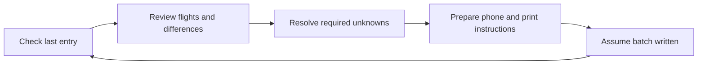
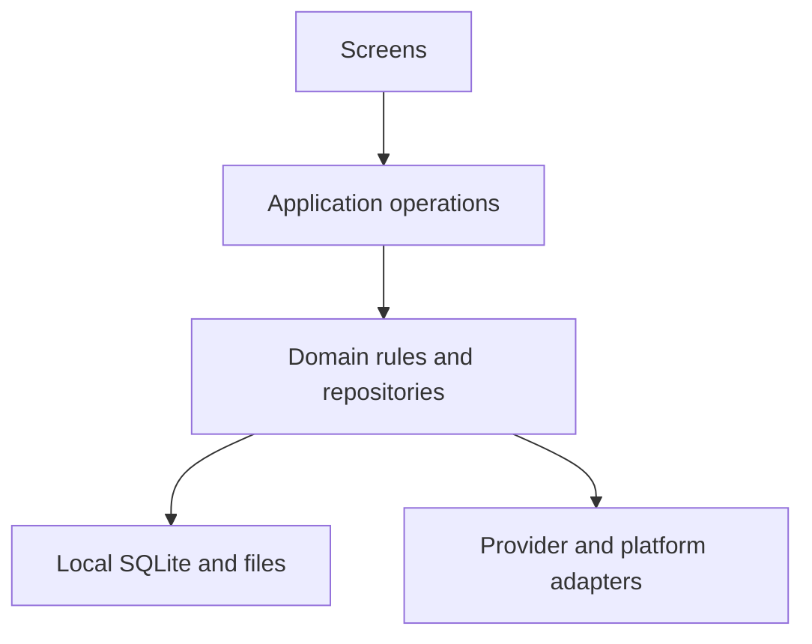

<p align="center">
  <picture>
    <source media="(prefers-color-scheme: dark)" srcset="docs/assets/branding/moflight-ai-logo-dark.png">
    
  </picture>
</p>

# MoFlight

> **Phone demo next gate — 16 October 2026:** Manuel approved a phone-compatible demo APK and a short physical-device check before more functionality. See the [handoff record](docs/verification/2026-10-16-phone-demo-handoff.md) and [manual checklist](docs/verification/2026-10-16-physical-phone-checklist.md). Physical-device acceptance remains pending until actual observations are recorded.

> **UI fidelity follow-up — 16 October 2026:** the approved four-screen image remains the visual target. Standing test widths are **MIN 360 dp**, **MAIN 390–412 dp**, **MAX 600+ dp**. The refined shell uses denser reference proportions and bounded tablet layouts. See the [refinement brief](docs/product/2026-10-16-ui-fidelity-refinement.md) and [native width/visual evidence](docs/verification/2026-10-16-ui-fidelity-width-matrix.md). Earlier same-day captures remain historical, not the target.

> **Native UI checkpoint — 16 October 2026:** Manuel authorized the supplied four-screen reference for Übersicht, Flüge, Verein and AI. The native shell now exists over the remembered synthetic SQLite book library, with search, filters, details, paper-workflow access and deterministic local quick queries. Club, weather, live canonical import and authenticated AI remain unconnected. This supersedes earlier design-only/not-started descriptions below for this bounded slice; existing preview alternatives are retained as history. See [scope and contracts](docs/product/2026-10-16-four-screen-implementation.md) and [verification](docs/verification/2026-10-16-four-screen-native-ui.md).

<table width="100%">
  <tr>
    <td width="33%" align="center">📱<br><strong>Android / iOS App</strong><br><sub>Target platforms</sub></td>
    <td width="33%" align="center">🔒<br><strong>Data privacy</strong><br><sub>Design priority</sub></td>
    <td width="33%" align="center">🏡<br><strong>Local-first</strong><br><sub>Phone-local data</sub></td>
  </tr>
  <tr>
    <td width="33%" align="center">📴<br><strong>Offline access</strong><br><sub>Saved information</sub></td>
    <td width="33%" align="center">📖<br><strong>Paper logbook</strong><br><sub>Writing companion</sub></td>
    <td width="33%" align="center">🚧<br><strong>In development</strong><br><sub>Not yet released</sub></td>
  </tr>
</table>

*Product priorities and target platforms; see the delivery status below.*

### More flying. Less paperwork. A clearer picture of your season.

**MoFlight is a mobile app in development for pilots, students and instructors who want to understand their flying, catch up on their paper logbook and keep useful club information close at hand.**

The vision is simple: bring your flight history, next actions and flying-club essentials into one calm, readable experience—starting with gliding, with other aircraft categories and book formats in view.

| 📊 Understand your flying | 📖 Keep your logbook moving | 🧭 Stay connected to your club |
| --- | --- | --- |
| Explore your season, aircraft and flight durations. Open a statistic to see the flights behind it. | Check where your paper book stops, review missing entries and prepare clear phone-side or printable writing instructions. | See relevant duties, your Putzdienst partner, work-hour progress, upcoming events and new club information. |

💶 **Make costs understandable:** the planned costs view separates flying from membership and other charges, with aircraft totals and account balances in details.

📱 **Built around your phone:** Android and iOS are the target platforms, with phone-local storage and offline access as the initial direction. The first app UI is German; an English option is planned later.

> **Early development, not a released app.** The features above describe the product direction. A native development lab and bounded Android proofs exist; the complete live-history, photo-to-writing and club-information journeys are not delivered yet.

**Explore:** [Product journeys](docs/product/2026-10-13-journey-information-map.md) · [Roadmap](docs/project-plan.md) · [Design direction](docs/product/2026-10-13-dark-concept-review.md) · [Ideas & progress](https://github.com/MomoRC-tech/MoFlight-App-framework/issues)

*Manuel selected the thermal-curve identity with an explicit AI badge on 13 October 2026. [Light and dark logos and app-icon variants](docs/assets/branding/README.md) are available; the project name remains MoFlight.*

---

<details>
<summary><strong>🧭 Product vision & user journeys</strong></summary>

## Products and Phase 1 boundaries

MoFlight is intended for students, instructors and pilots with overlapping roles. A shared start screen connects personal flying, paper-book tasks and relevant club information. Initial logbook work focuses on gliding; ultralight and powered-aircraft formats are later requirements. One account can own multiple books, including successive volumes of the same format.

The [reviewed journey map](docs/product/2026-10-13-journey-information-map.md) records the selected content and open questions. Exact launch scope, role-specific behavior and release packaging remain to be decided.

### Your flying, at a glance

A compact swipeable summary is planned for this year's flight count and known time, with a same-period previous-year comparison, aircraft flown most often and duration distribution. Tapping a summary opens its charts and supporting flights. Filters cover period, aircraft, person and your recorded role.

Unknown durations stay unknown. Incomplete history is shown as incomplete; a partial year must not look like a complete lifetime record.

## Flight-logbook product workflow

The intended catch-up journey starts with the remembered last written entry. Confirm it, or supply a current photo if it no longer matches your paper book. Review proposed flights and resolve required missing information before preparing an adjustable page-sized batch.



*Intended journey; real photo recognition and end-to-end writing remain future work.*

Assumed writing progress stays separate from confirmed paper evidence. The next session checks the remembered entry or a new photo; there is no mandatory post-writing completion prompt. Existing lab confirmation tests predate this revised requirement. Historical gaps and decisions to leave discrepancies unchanged remain visible and revisitable.

### Club information and costs

- **Duties:** own assignments and Fluglehrer, Flugleiter and Windenfahrer duties through the following week's weekend; own duties also have a later preview. When your duty is Putzdienst, include the other assigned member.
- **Club essentials:** work-hour progress, own tasks, upcoming events excluding birthdays, and notices for new news/documents. Own reservations and license/training information belong in details.
- **Costs:** yearly flying costs separately from membership/other charges, then totals per aircraft. Billing interpretation and retrieval still need investigation; account balances are distinct from costs.

See [product scope](docs/product/moflight-feature-scope.md), [writing presentation](docs/product/writing-template-presentation.md) and [provider discovery](docs/product/vereinsflieger-information-discovery.md) for definitions and gates.

</details>

<details>
<summary><strong>🚧 Development status & roadmap</strong></summary>

## Status and source of truth

**The [project plan](docs/project-plan.md) controls priorities, milestone status and acceptance.** Issues track work, product specifications explain behavior, and verification reports record what was actually checked.

| Area | Where it stands |
| --- | --- |
| User journeys | Reviewed; detailed UI/application contracts remain open |
| UI design | v0.30 increases popup and Back-button contrast and adds a compact visible Med label while preserving the header height. A 320 px browser review covered the popup, Back routes and aircraft disclosure; measured header/season/medical heights remained 66/48/48 px. The v0.28 twin-ring summary and v0.26 Wetter placeholder, goals and synthetic medical reminder carry forward. Manuel's visual review, detailed contracts and native acceptance remain open |
| Native foundation | Expo/React Native lab with local SQLite, backup and bounded Android evidence |
| Vereinsflieger access | Browser raw-capture and recovery proofs; complete canonical live history remains gated |
| Statistics and books | Deterministic synthetic queries and multi-book proofs; live integration remains open |
| Photo-to-writing | Product journey and format work exist; real recognition and full phone/print acceptance remain open |
| iOS | Intended platform; runtime acceptance remains open |

The connected Figma Starter tool-call limit currently blocks transferring/refining the revised design there. No upgrade or spending change was made. See the [initial wireframe record](docs/product/2026-10-13-rough-figma-wireframes.md) and [dark concept review](docs/product/2026-10-13-dark-concept-review.md).

## Phase 1 execution plan and Issues

| Milestone | Focus | Status |
| --- | --- | --- |
| M0 | Consolidate documentation | Complete for that scope |
| M1 | Review UI and define application contracts | Discovery started; application implementation not started |
| M2 | Reliable retrieval boundary | Existing lab partial; refactor planned |
| M3 | Normalized, saved live history | Planned |
| M4 | Reviewed initial analytics | Planned |
| M5 | Writing expansion and further features | Deferred |

Writing assistance has immediate product value; its place in the smallest useful release needs an explicit review rather than automatic milestone reordering.

## Next action and unresolved decisions

Review **what goes where** in the [screen-content and placement inventory](docs/product/screen-content.md), independently of visual design. Stable item IDs support adding or moving content screen by screen; confirmed needs, draft placements and prototype gaps are distinguished.

Review the [v0.30 draft](docs/product/prototypes/2026-10-16-clickable-v030.html) and its [standalone phone download](docs/product/prototypes/exports/moflight-design-v0.30.html) against the [versioned app design description](docs/product/app-design.md). It gives popup sheets and top-left Back buttons stronger contrast and adds a visible Med label with expiry on a second line, keeping the 48 px medical control and 66 px app header. The v0.28 twin-ring summary and v0.26 five-tab flow, 2026 goals, synthetic medical reminder and Wetter placeholder carry forward. Bounded browser observations are in the [popup/back/medical report](docs/verification/2026-10-16-popup-back-med-preview.md). Earlier [v0.29](docs/product/prototypes/2026-10-16-clickable-v029.html), [v0.28](docs/product/prototypes/2026-10-16-clickable-v028.html), [v0.27](docs/product/prototypes/2026-10-16-clickable-v027.html), [v0.26](docs/product/prototypes/2026-10-16-clickable-v026.html), [v0.25](docs/product/prototypes/2026-10-16-clickable-v025.html), [v0.23](docs/product/prototypes/2026-10-16-clickable-v023.html) and [browser observations](docs/verification/2026-10-16-weather-goals-medical-preview.md) remain available. No app implementation or change to weather/provider scope is claimed.

Latest visual revision: v0.30 increases popup and Back-button contrast and adds a compact visible Med label without increasing the header height. The current twin-ring content decision remains v0.28, recorded with [content inventory v0.7](docs/product/screen-content.md) and the [versioned app design](docs/product/app-design.md). v0.26 goals, medical reminder and Wetter placeholder remain. Bounded browser observations are recorded; Manuel's visual review remains open. No live lookup, weather provider or application behavior is claimed.

Deferred ideas include [Activities live — #14](https://github.com/MomoRC-tech/MoFlight-App-framework/issues/14), [in-app chat — #13](https://github.com/MomoRC-tech/MoFlight-App-framework/issues/13), possible SPL tutoring and weather integration. The v0.26 Wetter tab is a selected navigation placeholder only; weather content/provider/integration remain deferred. Billing inspection is also deferred. No release date is promised.

</details>

<details>
<summary><strong>🧩 Architecture & data principles</strong></summary>

## Current architecture proposal

The approved development baseline is **Expo + React Native + strict TypeScript**, in a pnpm workspace, with **expo-sqlite as the single native database writer**. Local storage comes first. Supabase Cloud Free is selected for a separate first cloud trial; cloud integration, detailed sync and production schemas remain gated.



*Agreed target boundary. The current lab still has some UI/provider orchestration to extract.*

## Data and API invariants

- Keep source facts, photo observations, effective user choices, confirmed paper evidence and assumed progress distinct.
- Scope paper state, photos, decisions and snapshots to the account and book; shared flight evidence does not mean shared paper progress.
- Preserve time basis, units, identities, coverage and original evidence. Unknown values are not zeros.
- Repeated retrieval must not duplicate flights. Partial failures preserve prior usable history and recovery state.
- Keep MoFlight identity separate from Vereinsflieger authorization; device secrets do not belong in Git or backups.

## AI, RAG and logbook behavior

AI may suggest handwriting transcriptions, matches and explanations. Deterministic code owns flight minutes, roles, counts, numbering and totals. AI suggestions cannot silently become confirmed facts. A bounded, approved handwriting evaluation is required before the real photo-to-writing journey is accepted; no model/provider or paid budget is selected here.

Read [ADR 0002: approved lab stack](docs/adr/0002-phase1-technology-proposal.md), [ADR 0007: proposed book/format architecture](docs/adr/0007-multiple-logbooks-and-formats.md), [ADR 0008: evidence/AI boundary](docs/adr/0008-logbook-ai-and-deterministic-boundary.md), [import contract](docs/architecture/vereinsflieger-import-contract.md) and [state/query semantics](docs/product/flight-logbook-state-and-queries.md).

## Proposed repository layout

| Location | Purpose |
| --- | --- |
| [apps/platform-lab](apps/platform-lab/README.md) | Native development lab; not a released product |
| `packages/flight-logbook/`, `packages/local-data/` | Domain calculations and local-data boundaries |
| `pocs/`, `tests/`, `scripts/` | Bounded trials, synthetic fixtures, checks and tooling |
| [docs/product](docs/product/README.md) | Journeys, requirements and design records |
| `docs/adr/`, `docs/architecture/`, `docs/verification/` | Decisions, contracts and evidence |

Additional product shells and infrastructure are proposals, not empty directories to create in advance. Final release packaging remains open.

</details>

<details>
<summary><strong>🛠️ Run the development lab</strong></summary>

## Development tools and environment

This repository is for development, not an app-store installation. Use Node 24 and the pinned pnpm version in [package.json](package.json). Android native work needs the configured SDK/JDK; iOS native work needs compatible macOS/Xcode tooling. The [Windows setup guide](docs/development/windows-local-setup.md) covers local builds, emulator isolation and Windows path-length handling.

## Runnable first milestone

```bash
npm install --global pnpm@11.25.0
pnpm install --frozen-lockfile
pnpm typecheck
pnpm test
pnpm fixtures:check
pnpm lab
```

The [platform-lab runbook](apps/platform-lab/README.md) is the source for native launch/build commands, fixtures, backup/restore and provider trials. Development builds normally need Metro; offline restart verification uses an appropriate standalone build with embedded JavaScript. Do not assume a successful bundle proves native behavior.

Use synthetic data for development. Keep authenticated provider-session emulators separate from **MoFlight_Synthetic_API37**, the designated emulator for destructive synthetic smoke tests. Never reset an unrelated session or dirty build checkout.

Changes go directly to `main` with traceable commits and existing Issues, following [AGENTS.md](AGENTS.md). No PR workflow is required. App-specific checks depend on the slice being changed.

</details>

<details>
<summary><strong>🔒 Privacy, reliability & verification</strong></summary>

## Security, testing and operating limits

Personal flight exports, photos, databases, credentials and private roster rows must not be committed. Account/book isolation, foreign-object references, backup/migrations, session expiry and offline recovery require their own checks. Local encryption and cross-device synchronization are not accepted merely because SQLite or cloud policies exist.

Other members' name display, abbreviation, retention and sharing remain a deferred [privacy task — #15](https://github.com/MomoRC-tech/MoFlight-App-framework/issues/15). Abbreviated names are not necessarily anonymous. Concepts use fictional people and flights.

Use documented local checks, committed-source builds and relevant native trials for scoped acceptance. Hosted CI is optional and manual-only; normal pushes do not start hosted runners. No paid CI, billing changes or spending-limit increases are authorized. See [ADR 0009](docs/adr/0009-local-android-development-and-checkpoint-ci.md).

**Evidence is scoped, not a blanket guarantee:** Android proofs, synthetic calculations, live raw capture and complete product journeys are separate achievements. iOS, full live import, real handwriting, costs and club-information integration still have open gates.

Recent evidence: [provider reset/recovery and remaining gates](docs/verification/2026-10-12-local-validation-and-provider-gates.md), [book/backup/capture proofs](docs/verification/2026-10-11-recovery-books-and-capture.md), [journey consolidation](docs/verification/2026-10-13-journey-consolidation.md).

</details>

<details>
<summary><strong>📋 Requirements & acceptance evidence</strong></summary>

## Requirements and evidence

This is the requirement register, not a claim that all requirements are delivered. The [roadmap feature register](docs/project-plan.md#2-feature-register) tracks current implementation/acceptance; the [dated audit register](docs/verification/2026-10-11-project-audit-register.md) retains provenance.

| ID | Requirement | Evidence needed |
| --- | --- | --- |
| R01 | Android and iOS | Platform-specific native runtime evidence |
| R02 | Multiple flight-related features | Reviewed scope and release packaging |
| R03 | Shared account identity | Verified ownership/session behavior across selected features |
| R04 | Offline reads and writes | Airplane-mode restart/recovery without data loss |
| R05 | Cross-device data | Two-device convergence and conflict handling |
| R06 | User isolation | Negative API, sync, storage, job and account-switch checks |
| R07 | Reusable modules | Domain independence from vendor/platform SDKs |
| R08 | Server-side AI | Authenticated validation, budget and measured usage |
| R09 | Private file processing | Retryable lifecycle, ownership and output verification |
| R10 | Agent-assisted development | Reproducible setup and actual check evidence |
| R11 | Commercial extensibility | Source rights, export/deletion and release requirements |
| R12 | Own Vereinsflieger flights | Authorized retrieval, source comparison and session/repeat behavior |
| R13 | Measurable RAG | Separate retrieval, citations, missing-evidence, latency/cost evaluation |
| R14 | Further aircraft-category logbooks | Format/field/rule evidence before activation |
| R15 | Multiple books and extensible formats | Independent state, migrations and format-extension proof |

For feature-level criteria, see [flight-logbook stories](docs/product/flight-logbook-user-stories.md), [phone/print presentation](docs/product/writing-template-presentation.md) and [requirements reconciliation](docs/architecture/phase1-reconciliation.md).

</details>

<details>
<summary><strong>💶 Costs, hosting & later services</strong></summary>

## Cost and effort status

Supabase Cloud Free is selected for the first cloud feasibility trial, not a prerequisite for local flight analytics. Free-tier quotas, idle behavior, email delivery and recovery need verification. No paid AI, hosted CI or subscription is authorized by the current roadmap.

Earlier person-day and tariff estimates are historical planning inputs, not a delivery promise or measured current cost. The initial aim is a small local-first footprint; no claim of unlimited free operation is made.

## Low-usage availability and approval choices

Cloud/sync, tutor/RAG, chat and weather are later work. A service that wakes automatically and one requiring owner recovery have different usability implications. [Backend/idle comparison](docs/architecture/low-usage-backend-comparison.md) and [ADR 0003](docs/adr/0003-low-usage-backend-proposal.md) retain the alternatives and approval boundaries. PowerSync and export-worker infrastructure remain deferred.

</details>

<details>
<summary><strong>📚 Documentation, decisions & development history</strong></summary>

Start with the [project plan](docs/project-plan.md) for order and the [reviewed journey map](docs/product/2026-10-13-journey-information-map.md) for behavior. Then follow the [product index](docs/product/README.md), [architecture decisions](docs/adr/0001-project-workflow.md) and [development runbook](apps/platform-lab/README.md).

- [Current visual direction](docs/product/2026-10-13-dark-concept-review.md): clean, dark, spacious; revised concept unselected.
- [Source access investigation](docs/architecture/vereinsflieger-access-investigation.md): observed access, permissions and open retrieval questions.
- [Provider preservation/recovery contract](docs/architecture/vereinsflieger-view-preservation.md): keep existing preferences and captures recoverable.
- [Book/format proposal](docs/adr/0007-multiple-logbooks-and-formats.md): production architecture remains proposed.
- [Complete pre-refactor README](docs/reference/2026-10-13-readme-development-history.md): preserved dated development notes, requirements, comparisons and evidence links; historical, not current operating instructions.
- [Original project draft](docs/reference/Segelflug_Plattform_Architektur_Phase1.md): retained source provenance.
- [Issues](https://github.com/MomoRC-tech/MoFlight-App-framework/issues): actionable work, open decisions and deferred ideas.

This entry point summarizes the project. Detailed specifications and dated verification reports carry the engineering evidence, so the front page can remain readable as the project grows.

</details>

<details>
<summary><strong>💼 Ownership & commercial licensing</strong></summary>

MoFlight's original code, documentation and artwork are **proprietary — all rights reserved**, as stated in [LICENSE](LICENSE). Manuel intends to retain control and market the app commercially; this repository does not grant public rights to reuse, modify or resell its original materials.

The package declaration `UNLICENSED` means no open-source license is granted; it is not the public-domain **Unlicense**. Third-party components retain their own licenses. Distribution obligations and end-user terms for selling the finished app must be reviewed separately before release.

</details>
