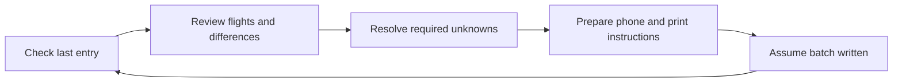
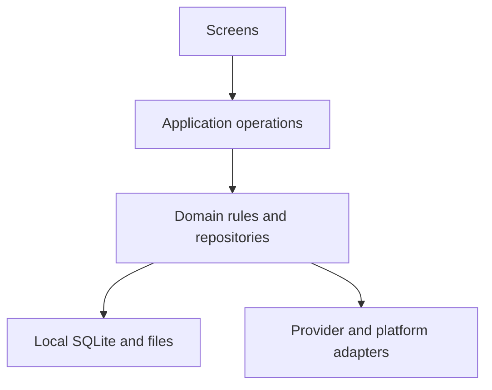

<p align="center">
  <picture>
    <source media="(prefers-color-scheme: dark)" srcset="docs/assets/branding/moflight-ai-logo-dark.png">
    
  </picture>
</p>

# MoFlight

**M2 source-assessment prerequisite — 18 October 2026:** [#2](https://github.com/MomoRC-tech/MoFlight-App-framework/issues/2) now composes raw fields, validated calendar dates/clocks and reported flight/block durations into a pure per-row assessment with evidence and unresolved findings. Crew slots, unknown timing and conflicting values stay explicit. **36 focused tests**, TypeScript and focused lint passed on `0594999`. [Evidence and limits](docs/verification/2026-10-18-source-duration-validation.md#source-flight-assessment-follow-up). It is unconnected to application flows or storage; production source semantics and live import remain gated.

**UI design:** [Design handbook](docs/product/design/README.md) · [Complete visual guide / copyable AI brief](docs/product/design/design-guide.html). Current direction, color map, typography, component shapes, layout rules and symbols are maintained together.

**Synthetic import preview — 18 October 2026:** authorized [#18](https://github.com/MomoRC-tech/MoFlight-App-framework/issues/18#issuecomment-6251766157) adds **Settings → Development → Importvorschau**: fictional new/changed/unchanged/conflicting flights, explained book suggestions, explicit correction/deferral and retained manual test choices. Application `85e4087`: **236 mobile / 85 Python tests**, types/lint/fixtures, both exports, committed-source Android Release/lint and 14 final-source native checks passed. [Development APK / ZIP](https://github.com/MomoRC-tech/MoFlight-App-framework/releases/tag/lab-2026-10-18-import-preview). iOS/physical acceptance remains open. The separate test stand lasts for the app session and changes no saved library/provider evidence. [Package evidence and remaining gates](docs/verification/2026-10-18-synthetic-import-preview.md). Real capture → saved flights, production identity/schema/migration and M5 remain separate.

**Default symbol family:** [Modern Duotone & Soft-Filled Glyphs](docs/product/design/symbols/index.html) is the app/guide standard, including M2 Medical card and Manuel's folded paper plane. The library contains 29 current glyphs and 47 semantic entries; superseded icon assets and comparison pages have been removed. Android Release/offline verification passed; iOS runtime and physical-device acceptance remain separate. [Evidence and limits](docs/verification/2026-10-18-icon-option-2.md).

**Follow-up delivery — 18 October 2026:** the approved launcher is implemented under [#25](https://github.com/MomoRC-tech/MoFlight-App-framework/issues/25), with [source-specific update evidence](docs/verification/2026-10-18-launcher-icon.md). [#26](https://github.com/MomoRC-tech/MoFlight-App-framework/issues/26)/[#27](https://github.com/MomoRC-tech/MoFlight-App-framework/issues/27) now group synthetic proofs in **Settings → Development**, remove ordinary lab shortcuts, and provide dark German backup/restore and read-only paper-status screens. Application `3ec0526`: **226 mobile / 81 Python tests**, both exports and committed-source Android Release/lint passed. [Disposition, native evidence and remaining platform limits](docs/verification/2026-10-18-development-navigation.md). [Latest development APK / ZIP](https://github.com/MomoRC-tech/MoFlight-App-framework/releases/tag/lab-2026-10-18-development). Full paper work remains M5; the separately authorized #18 synthetic preview is implemented at the checkpoint recorded above. Current provider captures still do not populate saved flights. [Placement and boundaries](docs/project-plan.md#immediate-follow-up--launcher-icon-tools-and-import-preview).

> **Portable testing infrastructure — 18 October 2026:** [Local/hosted commands, manual standalone APK and guarded Maestro smoke, GitHub Free estimates and rollback](docs/development/portable-ci.md). Fast checks are automatic on main pushes/PRs; expensive checks remain manual. Local types/lint/211 mobile/58 Python tests, committed-source Windows Release and offline Maestro passed; hosted Fast CI, APK and Maestro passed. [Actual results, source identities and limitations](docs/verification/2026-10-18-portable-ci.md). No paid usage or product acceptance is inferred.

> **Planning review — 18 October 2026:** [all 20 open Issues and current source gaps](docs/verification/2026-10-17-current-status-and-open-issues.md#18-october-review--20-open-issues) are reconciled with a [proposed package sequence through a real-flight beta and complete gliding release](docs/project-plan.md#proposed-delivery-packages-and-release-boundaries--18-october-2026). The main unfinished connection is reviewed live captures → saved flight library. Header/login, source/book mapping, persistence, analytics and later paper/photos are separate packages. This is a planning proposal; no new application implementation, release scope, production schema or paid work is approved.

> **Selected header/navigation and Medical presentation — 18 October 2026:** Manuel selected aircraft B, bounded persistent-header/overlay/provider Back/Close behavior and subsequently **Connection → Med → Profile**. The follow-up on `8b51f5a` adds **Med / unbekannt** and a read-only explanation sheet: all five host checks (215 mobile / 58 Python tests), both exports, committed-source Android Release/lint and **13 affected offline native checks** passed. [One package report with both checkpoints, screenshots and remaining gates](docs/verification/2026-10-18-header-navigation.md). No Medical data/input is connected. Private-session AVDs stayed stopped and untouched.

> **Login guidance implemented — 18 October 2026:** Manuel authorized [package 1a](docs/product/2026-10-18-header-status-review.md#smallest-next-package--1a-login-guidance) with “go”: concise German session/login wording, one primary next action and collapsed optional details/tools. **203 tests, TypeScript, both exports, committed-source Android Release/lint and ten scoped offline UI checks across recorded runs.** [Evidence, screenshot and user/live/TalkBack/iOS/physical limits](docs/verification/2026-10-18-login-guidance.md). Both existing AVDs/private sessions were untouched. The later selected header/navigation slice is recorded above; #20 remains open.

> **Retrieval verification — 18 October 2026:** application `dfb69cc` adds an explicit bounded read-only review of the current scoped raw capture. **197 tests, TypeScript, both exports and committed-source Release/lint passed.** Five saved rows matched six independently observed provider fields; read-only details independently matched all five references, dates, clocks and explicit flight-minute values. Repeated retrieval kept all five source references/first eight columns stable. Cancellation preserved the exact saved capture through restart/fresh session check. [Source-specific evidence and limits](docs/verification/2026-10-17-safe-disconnect.md#scoped-row-review-reference-comparison-and-repeatcancel--18-october). [Header/icon proposal](docs/product/2026-10-18-header-status-review.md) and [source/book mapping proposal](docs/architecture/vereinsflieger-import-contract.md#next-bounded-live-history-mapping-proposal--18-october-2026) are prepared; no canonical live import, automatic routing/polling or production-schema approval.

> **Initial scoped live capture — 18 October 2026:** a bounded own-flight raw capture saved successfully on `31a9aa6`; its saved summary reopened unchanged after process restart and a fresh matching profile passed. The later retrieval-verification checkpoint above supplies bounded field/reference and repeat/cancel evidence; canonical live import remains open. [Separate initial capture attempt and restart evidence](docs/verification/2026-10-17-safe-disconnect.md#bounded-scoped-live-capture-and-restart--18-october).

> **Later product questions — 18 October 2026:** tracked as [simpler login #17](https://github.com/MomoRC-tech/MoFlight-App-framework/issues/17), [flight-to-logbook suggestions/review #18](https://github.com/MomoRC-tech/MoFlight-App-framework/issues/18), and [retrieval timing #19](https://github.com/MomoRC-tech/MoFlight-App-framework/issues/19). Also tracked: [icons/header/provider status/Medical and Android design review #20](https://github.com/MomoRC-tech/MoFlight-App-framework/issues/20). These are later discovery tasks; automatic routing/polling, header exceptions and production schema remain undecided.

> **Recovery completed — 18 October 2026:** after manual sign-in and Manuel’s explicit private comparison choice, the reviewed view was restored on **MoFlight_API37** using verified application `31a9aa6`. Full supported readback/durable resolution and process restart with fresh matching profile passed. The current-view safety snapshot and original legacy journal remain retained; historical raw captures remain unassigned. No new retrieval or clearing was invoked. Preserve both AVDs; broader #16/#2/#8 acceptance remains open. [Native evidence and limits](docs/verification/2026-10-17-safe-disconnect.md#approved-private-choice-and-restoration).

> **Preservation-first recovery — 17 October 2026:** the approved recovery-only implementation on `31a9aa6` passed **197 tests, TypeScript, both exports and committed-source Release/lint**. Four synthetic native startup/restart checks passed; the reviewed journal fingerprint matched before/after the provider AVD update. The initial authentication blocker and failed saved-login attempt were superseded by the successful 18 October recovery continuation above. Legacy source/raw captures remain preserved. [Contract, evidence and remaining gate](docs/verification/2026-10-17-safe-disconnect.md#preservation-first-journal-handling-proposed).

> **Legacy recovery review checkpoint — 17 October 2026:** Manuel's **“passt”** confirms recognition of the privately reviewed account/view. The read-only diagnostic on application `20d2253` passed **185 tests, TypeScript, both exports and committed-source Release/lint**; two explicit Android reads returned identical metadata and journal fingerprints. Recognition alone does not adopt historical raw captures or authorize journal changes. The later recovery-only approval and implementation above control the next action; quarantine remains until verified resolution. [Contract and evidence](docs/verification/2026-10-17-safe-disconnect.md#preservation-first-journal-handling-proposed), [#16](https://github.com/MomoRC-tech/MoFlight-App-framework/issues/16).

> **Provider reliability hardening — 17 October 2026:** durable provisional local-owner association and scoped raw/recovery storage implemented; Android local clearing passed synthetic cookie/WebStorage/IndexedDB and preservation checks. **182 tests**, TypeScript, both exports and committed-source Release/lintVital passed. Android association survived restart. **Positive live capture/recovery/clearing acceptance is blocked by an unassigned legacy recovery journal**; it remains preserved. [Evidence and next action](docs/verification/2026-10-17-safe-disconnect.md#provider-ownership-and-local-clearing-hardening), [#16](https://github.com/MomoRC-tech/MoFlight-App-framework/issues/16). Production identity/schema and credential policy remain undecided.

> **Reconnect and small raw retrieval — 17 October 2026:** original-page assisted re-login verified. An observed single-page footer mismatch is fixed; final Android Release saved **five records on one page**, matching the native provider reference, and cancellation preserved the successful-save time. **168 tests**, types, both platform exports and Release/lintVital passed. [Source-specific evidence and remaining gates](docs/verification/2026-10-17-safe-disconnect.md#bounded-reconnectretrieval-follow-up). Automatic saved-login success, durable production identity and canonical live import remain open.

> **Earlier safe disconnect slice — 17 October 2026:** [Guarded provider logout verification and explicit saved-login states](docs/product/2026-10-17-safe-disconnect.md) are implemented. [Evidence](docs/verification/2026-10-17-safe-disconnect.md): 162 tests, committed-source Release, separate 19-check width/lifecycle and 8-check final-source native runs, plus bounded live sign-out/sign-in-required observations. The later follow-up above supersedes this slice's signed-out/re-login boundary; complete cookie clearing and production binding remain open.

> **Connection increment — 17 October 2026:** Manuel authorized the bounded [Vereinsflieger connection/controller PoC](docs/product/2026-10-17-connection-controller-poc.md) next, ahead of the deferred physical retest. Header/Profile entry and retained original-page browser are implemented. [Verification](docs/verification/2026-10-17-connection-controller-poc.md) records 149 tests, 16 synthetic native checks and a bounded Android existing-session/hidden raw-capture/cancel trial. Session observations remain provisional; production binding, full disconnect, canonical import and iOS runtime remain open.

> **Current status and open work — 17 October 2026:** [Earlier issue review and remaining gates](docs/verification/2026-10-17-current-status-and-open-issues.md). Manuel confirms Android 17 and defers further physical testing for now; the updated phone gate remains open. The [current five-tab checklist and reply template](docs/verification/2026-10-17-physical-phone-checklist.md) are ready for when testing resumes. [Vereinsflieger header status and login popup](docs/product/2026-10-17-vereinsflieger-connection-ui.md) now feed the bounded connection increment under #2.

> **Native shell corrections — 17 October 2026:** implementation now targets five tabs (Übersicht / Flüge / Flugbuch / Verein / AI), a compact fixed header with the approved logo, top-right profile/settings and real-data segmented season rings. [Scope and acceptance](docs/product/2026-10-17-native-shell-corrections.md). Manuel reports having tested the prior demo; detailed physical outcomes remain unrecorded. Earlier four-tab evidence is historical. [Verified corrections and screenshots](docs/verification/2026-10-17-native-shell-corrections.md): 136 mobile tests and 71 synthetic native checkpoints passed on source `db15203`; updated Pixel 6a retest remains pending.

> **Phone demo next gate — 16 October 2026:** Manuel approved a phone-compatible demo APK and a short physical-device check before more functionality. See the [handoff record](docs/verification/2026-10-16-phone-demo-handoff.md) and [manual checklist](docs/verification/2026-10-16-physical-phone-checklist.md). Physical-device acceptance remains pending until actual observations are recorded.

> **UI fidelity follow-up — 16 October 2026:** the approved four-screen image remains the visual target. Standing test widths are **MIN 360 dp**, **MAIN 390–412 dp**, **MAX 600+ dp**. The refined shell uses denser reference proportions and bounded tablet layouts. See the [refinement brief](docs/product/2026-10-16-ui-fidelity-refinement.md) and [native width/visual evidence](docs/verification/2026-10-16-ui-fidelity-width-matrix.md). Earlier same-day captures remain historical, not the target.

> **Native UI checkpoint — 16 October 2026:** Manuel authorized the supplied four-screen reference for Übersicht, Flüge, Verein and AI. The native shell now exists over the remembered synthetic SQLite book library, with search, filters, details, paper-workflow access and deterministic local quick queries. Club, weather, live canonical import and authenticated AI remain unconnected. This supersedes earlier design-only/not-started descriptions below for this bounded slice; existing preview alternatives are retained as history. See [scope and contracts](docs/product/2026-10-16-four-screen-implementation.md) and [verification](docs/verification/2026-10-16-four-screen-native-ui.md).

<table width="100%">
  <tr>
    <td width="33%" align="center">📱<br><strong>Android / iOS App</strong><br><sub>Target platforms</sub></td>
    <td width="33%" align="center">🔒<br><strong>Data privacy</strong><br><sub>Design priority</sub></td>
    <td width="33%" align="center">🏡<br><strong>Local-first</strong><br><sub>Phone-local data</sub></td>
  </tr>
  <tr>
    <td width="33%" align="center">📴<br><strong>Offline access</strong><br><sub>Saved information</sub></td>
    <td width="33%" align="center">📖<br><strong>Paper logbook</strong><br><sub>Writing companion</sub></td>
    <td width="33%" align="center">🚧<br><strong>In development</strong><br><sub>Not yet released</sub></td>
  </tr>
</table>

*Product priorities and target platforms; see the delivery status below.*

### More flying. Less paperwork. A clearer picture of your season.

**MoFlight is a mobile app in development for pilots, students and instructors who want to understand their flying, catch up on their paper logbook and keep useful club information close at hand.**

The vision is simple: bring your flight history, next actions and flying-club essentials into one calm, readable experience—starting with gliding, with other aircraft categories and book formats in view.

| 📊 Understand your flying | 📖 Keep your logbook moving | 🧭 Stay connected to your club |
| --- | --- | --- |
| Explore your season, aircraft and flight durations. Open a statistic to see the flights behind it. | Check where your paper book stops, review missing entries and prepare clear phone-side or printable writing instructions. | See relevant duties, your Putzdienst partner, work-hour progress, upcoming events and new club information. |

💶 **Make costs understandable:** the planned costs view separates flying from membership and other charges, with aircraft totals and account balances in details.

📱 **Built around your phone:** Android and iOS are the target platforms, with phone-local storage and offline access as the initial direction. The first app UI is German; an English option is planned later.

> **Early development, not a released app.** The features above describe the product direction. A native development lab and bounded Android proofs exist; the complete live-history, photo-to-writing and club-information journeys are not delivered yet.

**Explore:** [Product journeys](docs/product/2026-10-13-journey-information-map.md) · [Roadmap](docs/project-plan.md) · [UI design](docs/product/design/README.md) · [Ideas & progress](https://github.com/MomoRC-tech/MoFlight-App-framework/issues)

*Manuel selected the thermal-curve identity with an explicit AI badge on 13 October 2026. [Light and dark logos and app-icon variants](docs/assets/branding/README.md) are available; the project name remains MoFlight.*

---

<details>
<summary><strong>🧭 Product vision & user journeys</strong></summary>

## Products and Phase 1 boundaries

MoFlight is intended for students, instructors and pilots with overlapping roles. A shared start screen connects personal flying, paper-book tasks and relevant club information. Initial logbook work focuses on gliding; ultralight and powered-aircraft formats are later requirements. One account can own multiple books, including successive volumes of the same format.

The [reviewed journey map](docs/product/2026-10-13-journey-information-map.md) records the selected content and open questions. Exact launch scope, role-specific behavior and release packaging remain to be decided.

The [first-use journey added on 18 October](docs/product/2026-10-13-journey-information-map.md#first-use--guided-start-and-trust) covers a brief welcome, guidance before Vereinsflieger login, a suggested explicit retrieval, highlights for tiles with usable changed data, and help when first opening an area. Skippable contextual help is the proposed presentation. [#22](https://github.com/MomoRC-tech/MoFlight-App-framework/issues/22) tracks review and future implementation; this extends product discovery and does not claim an implemented onboarding flow.

### Your flying, at a glance

A compact swipeable summary is planned for this year's flight count and known time, with a same-period previous-year comparison, aircraft flown most often and duration distribution. Tapping a summary opens its charts and supporting flights. Filters cover period, aircraft, person and your recorded role.

Unknown durations stay unknown. Incomplete history is shown as incomplete; a partial year must not look like a complete lifetime record.

## Flight-logbook product workflow

The intended catch-up journey starts with the remembered last written entry. Confirm it for the named book, or enter the running number of your actual last written flight. Provide details/a current photo when that number or required continuation information cannot be resolved. Review proposed flights and resolve required missing information before preparing an adjustable page-sized batch.



*Intended journey; real photo recognition and end-to-end writing remain future work.*

Flight takeoff/landing times are saved and documented in **UTC**; original source values remain preserved, and an unknown source time zone must be clarified before conversion. See the [UTC requirement](docs/product/2026-10-13-journey-information-map.md#flight-clock-times--utc-requirement).

Vereinsflieger is authoritative for provider-backed flight data, including recorded flight duration. Later source corrections update the saved app flight and receive an orange label/dot; the marker clears only after explicit acknowledgement, while paper evidence and frozen instructions remain separate. Incorrect source records should be corrected in Vereinsflieger through the club administrator/responsible personnel. [Product decision and remaining marker rules](docs/product/2026-10-13-journey-information-map.md#authoritative-provider-data-and-changed-flight-indication), [#30](https://github.com/MomoRC-tech/MoFlight-App-framework/issues/30).

Assumed writing progress stays separate from confirmed paper evidence. The next session checks the remembered entry, accepts the actual last written book number or uses a photo when clarification is needed; there is no mandatory post-writing completion prompt. Existing lab confirmation tests predate this revised requirement. Historical gaps and decisions to leave discrepancies unchanged remain visible and revisitable.

### Club information and costs

- **Duties:** own assignments and Fluglehrer, Flugleiter and Windenfahrer duties through the following week's weekend; own duties also have a later preview. When your duty is Putzdienst, include the other assigned member.
- **Club essentials:** work-hour progress, own tasks, upcoming events excluding birthdays, and notices for new news/documents. Own reservations and license/training information belong in details.
- **Costs:** yearly flying costs separately from membership/other charges, then totals per aircraft. Billing interpretation and retrieval still need investigation; account balances are distinct from costs.

See [product scope](docs/product/moflight-feature-scope.md), [writing presentation](docs/product/writing-template-presentation.md) and [provider discovery](docs/product/vereinsflieger-information-discovery.md) for definitions and gates.

</details>

<details>
<summary><strong>🚧 Development status & roadmap</strong></summary>

## Status and source of truth

**The [project plan](docs/project-plan.md) controls priorities, milestone status and acceptance.** Issues track work, product specifications explain behavior, and verification reports record what was actually checked.

| Area | Where it stands |
| --- | --- |
| User journeys | Reviewed; detailed UI/application contracts remain open |
| UI design | Approved-reference native shell implemented with five tabs, fixed logo header, local profile and segmented rings; historical HTML alternatives remain separate. Full application contracts/service integration and updated physical retest are open |
| Native foundation | Expo/React Native lab with local SQLite, backup and bounded Android evidence |
| Vereinsflieger access | Browser raw-capture/recovery proofs plus retained header/Profile connection PoC; live hidden retrieval, stable binding and canonical history remain gated |
| Statistics and books | Deterministic synthetic queries and multi-book proofs; live integration remains open |
| Photo-to-writing | Product journey and format work exist; real recognition and full phone/print acceptance remain open |
| iOS | Intended platform; runtime acceptance remains open |

The connected Figma Starter tool-call limit currently blocks transferring/refining the revised design there. No upgrade or spending change was made. See the [initial wireframe record](docs/product/2026-10-13-rough-figma-wireframes.md) and [dark concept review](docs/product/2026-10-13-dark-concept-review.md).

## Phase 1 execution plan and Issues

| Milestone | Focus | Status |
| --- | --- | --- |
| M0 | Consolidate documentation | Complete for that scope |
| M1 | Native UI and application contracts | Bounded native shell implemented and tested; full contracts/acceptance remain open |
| M2 | Reliable retrieval boundary | Scoped Android re-login, recovery, capture/reference/repeat/cancel evidence exists; production identity/semantics, clean-profile clearing/re-login, real second-account and iOS gates remain open |
| M3 | Normalized, saved live history | Planned |
| M4 | Reviewed initial analytics | Planned |
| M5 | Writing expansion and further features | Deferred |

Writing assistance has immediate product value; its place in the smallest useful release needs an explicit review rather than automatic milestone reordering.

## Next action and unresolved decisions

The bounded current-account connection/recovery/reference/repeat/cancel package is complete within its recorded limits. Review the [proposed next packages and release boundaries](docs/project-plan.md#proposed-delivery-packages-and-release-boundaries--18-october-2026): connection/header usability, remaining source/ownership rules, reviewable book-assignment planning, transactional live-history storage and the real refresh-to-library journey, then analytics and later paper/photos. Canonical writes need the approved identity/source/book/migration contract; automatic polling is separate. Further implementation needs its bounded scope and authorization. The updated Pixel 6a retest remains deferred; iOS and broader account/lifecycle gates stay open. Use the [current 20-Issue index](docs/verification/2026-10-17-current-status-and-open-issues.md#18-october-review--20-open-issues); older prototype paragraphs below remain design history.

Review **what goes where** in the [screen-content and placement inventory](docs/product/screen-content.md), independently of visual design. Stable item IDs support adding or moving content screen by screen; confirmed needs, draft placements and prototype gaps are distinguished.

Historical unselected review: [two cleaner Start proposals](docs/product/2026-10-16-start-alternatives.md) and their standalone comparison HTML (historical planned artifact; unavailable). Klarer Überblick uses numerical summaries; Saison im Fokus keeps the aircraft rings with clearer labels and less competing decoration. Neither alternative is selected. Official Android guidance informs spacing, grouping and touch-target aims; HTML browser checks do not prove native Material/accessibility compliance. The earlier selected arrangement below remains available.

Review the [v0.30 draft](docs/product/prototypes/2026-10-16-clickable-v030.html) and its [standalone phone download](docs/product/prototypes/exports/moflight-design-v0.30.html) against the [versioned app design description](docs/product/app-design.md). It gives popup sheets and top-left Back buttons stronger contrast and adds a visible Med label with expiry on a second line, keeping the 48 px medical control and 66 px app header. The v0.28 twin-ring summary and v0.26 five-tab flow, 2026 goals, synthetic medical reminder and Wetter placeholder carry forward. Bounded browser observations are in the [popup/back/medical report](docs/verification/2026-10-16-popup-back-med-preview.md). Earlier [v0.29](docs/product/prototypes/2026-10-16-clickable-v029.html), [v0.28](docs/product/prototypes/2026-10-16-clickable-v028.html), [v0.27](docs/product/prototypes/2026-10-16-clickable-v027.html), [v0.26](docs/product/prototypes/2026-10-16-clickable-v026.html), [v0.25](docs/product/prototypes/2026-10-16-clickable-v025.html), [v0.23](docs/product/prototypes/2026-10-16-clickable-v023.html) and [browser observations](docs/verification/2026-10-16-weather-goals-medical-preview.md) remain available. No app implementation or change to weather/provider scope is claimed.

Latest visual revision: v0.30 increases popup and Back-button contrast and adds a compact visible Med label without increasing the header height. The current twin-ring content decision remains v0.28, recorded with [content inventory v0.7](docs/product/screen-content.md) and the [versioned app design](docs/product/app-design.md). v0.26 goals, medical reminder and Wetter placeholder remain. Bounded browser observations are recorded; Manuel's visual review remains open. No live lookup, weather provider or application behavior is claimed.

Deferred ideas include [Activities live — #14](https://github.com/MomoRC-tech/MoFlight-App-framework/issues/14), [in-app chat — #13](https://github.com/MomoRC-tech/MoFlight-App-framework/issues/13), possible SPL tutoring and weather integration. The v0.26 Wetter tab is a selected navigation placeholder only; weather content/provider/integration remain deferred. Billing inspection is also deferred. No release date is promised.

</details>

<details>
<summary><strong>🧩 Architecture & data principles</strong></summary>

## Current architecture proposal

The approved development baseline is **Expo + React Native + strict TypeScript**, in a pnpm workspace, with **expo-sqlite as the single native database writer**. Local storage comes first. Supabase Cloud Free is selected for a separate first cloud trial; cloud integration, detailed sync and production schemas remain gated.



*Agreed target boundary. The current lab still has some UI/provider orchestration to extract.*

## Data and API invariants

- Keep source facts, photo observations, effective user choices, confirmed paper evidence and assumed progress distinct.
- Scope paper state, photos, decisions and snapshots to the account and book; shared flight evidence does not mean shared paper progress.
- Preserve time basis, units, identities, coverage and original evidence. Unknown values are not zeros.
- Repeated retrieval must not duplicate flights. Partial failures preserve prior usable history and recovery state.
- Keep MoFlight identity separate from Vereinsflieger authorization; device secrets do not belong in Git or backups.

## AI, RAG and logbook behavior

AI may suggest handwriting transcriptions, matches and explanations. Deterministic code owns flight minutes, roles, counts, numbering and totals. AI suggestions cannot silently become confirmed facts. A bounded, approved handwriting evaluation is required before the real photo-to-writing journey is accepted; no model/provider or paid budget is selected here.

Read [ADR 0002: approved lab stack](docs/adr/0002-phase1-technology-proposal.md), [ADR 0007: proposed book/format architecture](docs/adr/0007-multiple-logbooks-and-formats.md), [ADR 0008: evidence/AI boundary](docs/adr/0008-logbook-ai-and-deterministic-boundary.md), [import contract](docs/architecture/vereinsflieger-import-contract.md) and [state/query semantics](docs/product/flight-logbook-state-and-queries.md).

## Proposed repository layout

| Location | Purpose |
| --- | --- |
| [apps/platform-lab](apps/platform-lab/README.md) | Native development lab; not a released product |
| `packages/flight-logbook/`, `packages/local-data/` | Domain calculations and local-data boundaries |
| `pocs/`, `tests/`, `scripts/` | Bounded trials, synthetic fixtures, checks and tooling |
| [docs/product](docs/product/README.md) | Journeys, requirements and design records |
| `docs/adr/`, `docs/architecture/`, `docs/verification/` | Decisions, contracts and evidence |

Additional product shells and infrastructure are proposals, not empty directories to create in advance. Final release packaging remains open.

</details>

<details>
<summary><strong>🛠️ Run the development lab</strong></summary>

## Development tools and environment

This repository is for development, not an app-store installation. Use Node 24 and the pinned pnpm version in [package.json](package.json). Android native work needs the configured SDK/JDK; iOS native work needs compatible macOS/Xcode tooling. The [Windows setup guide](docs/development/windows-local-setup.md) covers local builds, emulator isolation and Windows path-length handling.

## Runnable first milestone

```bash
npm install --global pnpm@11.25.0
pnpm install --frozen-lockfile
pnpm check
pnpm lab
```

`pnpm check` runs types, TypeScript/SQLite tests, Python tests and fixture parity without model calls. It prints a compact summary and saves full logs under ignored `build/host-checks/`; see the [workflow](docs/development/verification-workflow.md#local-checks-without-model-calls). Individual and focused checks remain available.

Every implementation assesses existing coverage and adds useful automated regression tests in the same package, preferably without inference calls; see the [standing test rule](docs/development/verification-workflow.md#assess-and-implement-useful-tests). The [acceptance map](docs/project-plan.md#21-acceptance-traceability) links selected requirements and journey scenarios to tests, evidence and remaining gates.

The [platform-lab runbook](apps/platform-lab/README.md) is the source for native launch/build commands, fixtures, backup/restore and provider trials. Development builds normally need Metro; offline restart verification uses an appropriate standalone build with embedded JavaScript. Do not assume a successful bundle proves native behavior.

Use synthetic data for development. Keep authenticated provider-session emulators separate from **MoFlight_Synthetic_API37**, the designated emulator for destructive synthetic smoke tests. Never reset an unrelated session or dirty build checkout.

Changes go directly to `main` with traceable commits and existing Issues, following [AGENTS.md](AGENTS.md). No PR workflow is required. App-specific checks depend on the slice being changed.

**Development default, approved 17 October 2026:** [logic-first, risk-based verification](docs/development/verification-workflow.md). Use relevant tests and TypeScript during iteration; batch committed-source Release/native checks at integration acceptance. No routine visual verification for logic-only work; inspect affected UI for small visual changes and use the size matrix for substantial layout/navigation/typography changes. No routine subagents for small tasks; keep one concise package/evidence summary. Documentation changes need links/consistency checks only.

The separately authorized [18 October UI-agent comparison](docs/verification/2026-10-18-ui-agent-experiment.md#sol-61--low-comparison--18-october-2026) supported 8/8 scoped checks with Sol 6.1/Low in 257.73 s versus Luna/Max's 7/8 in 721.50 s. This pair favors Sol/Low for further evaluation, with operating-limit qualifications and preserved state. Token savings, repeatability and routine delegation remain unestablished under #6.

Manuel subsequently authorized the [bounded Sol 6.1/Low UI workflow](docs/development/ui-agent.md). Say **“Run a UI test with Sol Low”** and name a screen/scenario if needed. The local `pnpm ui:agent` controller enforces UI-action/capture/time limits and holds automatic display cleanup; Codex launches the fresh subagent. Use it for requested/relevant synthetic UI checks, not routine screenshots for logic-only changes. No API calls, dependencies or app-data clearing.

</details>

<details>
<summary><strong>🔒 Privacy, reliability & verification</strong></summary>

## Security, testing and operating limits

Personal flight exports, photos, databases, credentials and private roster rows must not be committed. Account/book isolation, foreign-object references, backup/migrations, session expiry and offline recovery require their own checks. Local encryption and cross-device synchronization are not accepted merely because SQLite or cloud policies exist.

Other members' name display, abbreviation, retention and sharing remain a deferred [privacy task — #15](https://github.com/MomoRC-tech/MoFlight-App-framework/issues/15). Abbreviated names are not necessarily anonymous. Concepts use fictional people and flights.

The [18 October GDPR/DSGVO readiness review](docs/verification/2026-10-18-gdpr-readiness-review.md) records current storage/backup gaps and proposed release checks under [#21](https://github.com/MomoRC-tech/MoFlight-App-framework/issues/21). Operator/legal bases, retention/erasure, notices and optional Medical/cloud/AI gates remain open; the review does not approve implementation or establish compliance.

Manuel's [approved privacy evaluation guideline](docs/verification/2026-10-18-gdpr-readiness-review.md#approved-evaluation-method) applies proportionate effort to each requirement's actual risk and benefit. He may accept a specific documented remaining risk when further mitigation is disproportionate; legal compliance, practical risk and owner acceptance stay distinct. No individual gap is accepted by this guideline.

Use documented local checks, committed-source builds and relevant native trials for scoped acceptance. Hosted execution is optional. The authorized 18 October handover enables automatic fast checks on main pushes/PRs; Android builds and UI checks remain manual. No paid CI, billing changes or spending-limit increases are authorized. See [ADR 0009](docs/adr/0009-local-android-development-and-checkpoint-ci.md) and the [portable CI runbook](docs/development/portable-ci.md).

**Evidence is scoped, not a blanket guarantee:** Android proofs, synthetic calculations, live raw capture and complete product journeys are separate achievements. iOS, full live import, real handwriting, costs and club-information integration still have open gates.

Recent evidence: [provider reset/recovery and remaining gates](docs/verification/2026-10-12-local-validation-and-provider-gates.md), [book/backup/capture proofs](docs/verification/2026-10-11-recovery-books-and-capture.md), [journey consolidation](docs/verification/2026-10-13-journey-consolidation.md).

</details>

<details>
<summary><strong>📋 Requirements & acceptance evidence</strong></summary>

## Requirements and evidence

This is the requirement register, not a claim that all requirements are delivered. The [roadmap feature register](docs/project-plan.md#2-feature-register) tracks current implementation/acceptance; the [dated audit register](docs/verification/2026-10-11-project-audit-register.md) retains provenance.

| ID | Requirement | Evidence needed |
| --- | --- | --- |
| R01 | Android and iOS | Platform-specific native runtime evidence |
| R02 | Multiple flight-related features | Reviewed scope and release packaging |
| R03 | Shared account identity | Verified ownership/session behavior across selected features |
| R04 | Offline reads and writes | Airplane-mode restart/recovery without data loss |
| R05 | Cross-device data | Two-device convergence and conflict handling |
| R06 | User isolation | Negative API, sync, storage, job and account-switch checks |
| R07 | Reusable modules | Domain independence from vendor/platform SDKs |
| R08 | Server-side AI | Authenticated validation, budget and measured usage |
| R09 | Private file processing | Retryable lifecycle, ownership and output verification |
| R10 | Agent-assisted development | Reproducible setup and actual check evidence |
| R11 | Commercial extensibility | Source rights, export/deletion and release requirements |
| R12 | Own Vereinsflieger flights | Authorized retrieval, source comparison and session/repeat behavior |
| R13 | Measurable RAG | Separate retrieval, citations, missing-evidence, latency/cost evaluation |
| R14 | Further aircraft-category logbooks | Format/field/rule evidence before activation |
| R15 | Multiple books and extensible formats | Independent state, migrations and format-extension proof |

For feature-level criteria, see [flight-logbook stories](docs/product/flight-logbook-user-stories.md), [phone/print presentation](docs/product/writing-template-presentation.md) and [requirements reconciliation](docs/architecture/phase1-reconciliation.md).

</details>

<details>
<summary><strong>💶 Costs, hosting & later services</strong></summary>

## Cost and effort status

Supabase Cloud Free is selected for the first cloud feasibility trial, not a prerequisite for local flight analytics. Free-tier quotas, idle behavior, email delivery and recovery need verification. No paid AI, hosted CI or subscription is authorized by the current roadmap.

Earlier person-day and tariff estimates are historical planning inputs, not a delivery promise or measured current cost. The initial aim is a small local-first footprint; no claim of unlimited free operation is made.

## Low-usage availability and approval choices

Cloud/sync, tutor/RAG, chat and weather are later work. A service that wakes automatically and one requiring owner recovery have different usability implications. [Backend/idle comparison](docs/architecture/low-usage-backend-comparison.md) and [ADR 0003](docs/adr/0003-low-usage-backend-proposal.md) retain the alternatives and approval boundaries. PowerSync and export-worker infrastructure remain deferred.

</details>

<details>
<summary><strong>📚 Documentation, decisions & development history</strong></summary>

Start with the [project plan](docs/project-plan.md) for order and the [reviewed journey map](docs/product/2026-10-13-journey-information-map.md) for behavior. Then follow the [product index](docs/product/README.md), [architecture decisions](docs/adr/0001-project-workflow.md) and [development runbook](apps/platform-lab/README.md).

- [Current visual direction](docs/product/2026-10-13-dark-concept-review.md): clean, dark, spacious; revised concept unselected.
- [Source access investigation](docs/architecture/vereinsflieger-access-investigation.md): observed access, permissions and open retrieval questions.
- [Provider preservation/recovery contract](docs/architecture/vereinsflieger-view-preservation.md): keep existing preferences and captures recoverable.
- [Book/format proposal](docs/adr/0007-multiple-logbooks-and-formats.md): production architecture remains proposed.
- [Complete pre-refactor README](docs/reference/2026-10-13-readme-development-history.md): preserved dated development notes, requirements, comparisons and evidence links; historical, not current operating instructions.
- [Original project draft](docs/reference/Segelflug_Plattform_Architektur_Phase1.md): retained source provenance.
- [Issues](https://github.com/MomoRC-tech/MoFlight-App-framework/issues): actionable work, open decisions and deferred ideas.

This entry point summarizes the project. Detailed specifications and dated verification reports carry the engineering evidence, so the front page can remain readable as the project grows.

</details>

<details>
<summary><strong>💼 Ownership & commercial licensing</strong></summary>

MoFlight's original code, documentation and artwork are **proprietary — all rights reserved**, as stated in [LICENSE](LICENSE). Manuel intends to retain control and market the app commercially; this repository does not grant public rights to reuse, modify or resell its original materials.

The package declaration `UNLICENSED` means no open-source license is granted; it is not the public-domain **Unlicense**. Third-party components retain their own licenses. Distribution obligations and end-user terms for selling the finished app must be reviewed separately before release.

</details>
