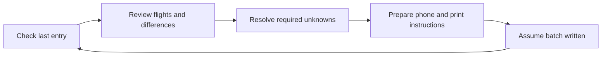
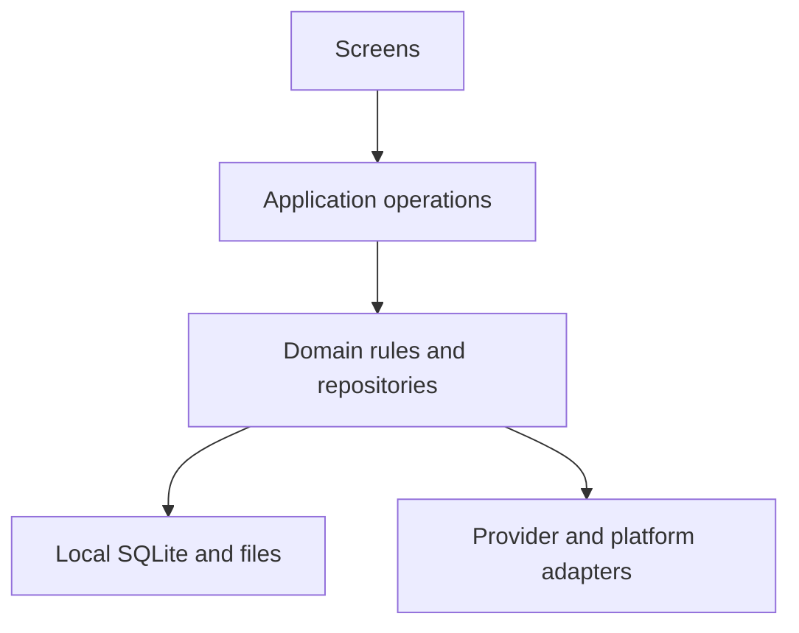

**Data-update header delivered — 22 October 2026:** the header now fetches new Vereinsflieger data, with login only if needed, and shows the last saved flight-data age: green under one hour, amber for older, neutral when unknown. Failed/cancelled updates and login checks cannot renew the timestamp. [Download APK ZIP](https://github.com/MomoRC-tech/MoFlight-App-framework/releases/download/lab-2026-10-22-data-update/MoFlight-Android-data-update.zip), actual APK source `1560454`. 769 mobile/110 Python, types/lint/fixtures, both exports and committed Release pass; eight named native layout/route/offline assertions have source-specific evidence. [Verification and limits](docs/verification/2026-10-21-simple-flight-loading.md#header-data-freshness-and-explicit-update--22-october-2026). Medical/duty freshness remains separate; new physical-header/live-retrieval and iOS acceptance remain open.

**Phone follow-up — 22 October 2026:** Manuel reports login works after the prior replacement delivery. This is user-reported login success; authenticated flight retrieval/save is not separately confirmed. His unclear-header feedback led to the selected data-update meaning above. [Evidence](docs/verification/2026-10-21-simple-flight-loading.md#user-phone-confirmation-and-header-feedback--22-october-2026). Earlier delivery statements below retain their original verification scope.

**Inline login reset correction — 22 October 2026:** source `7afe69d` fixes repeated profile navigation when the original Vereinsflieger form appears at the protected profile URL. Credential returns retain the form; read-only structural observation precedes fresh account proof. 765 mobile/110 Python, types/lint/fixtures, both exports and committed Release pass. Scoped native synthetic Autofill/return assertions and correctly scoped diagnostic analysis pass, with composite-helper limits recorded. [Download replacement APK ZIP](https://github.com/MomoRC-tech/MoFlight-App-framework/releases/download/lab-2026-10-22-inline-login/MoFlight-Android-inline-login.zip); [evidence and remaining phone/iOS gates](docs/verification/2026-10-21-simple-flight-loading.md#inline-login-form-and-credential-return-correction--22-october-2026). Actual Google valid-account sign-in and authenticated phone retrieval remain unverified.

**Shared connection delivered — 22 October 2026:** source `efab01c` opens Vereinsflieger directly from header/Profile, retains one selected-owner browser across close/reopen, returns to the invoking screen and offers independent Medical/duty retries after a confirmed flight save. Android keyboard handling keeps the original form usable above the IME. 760 mobile/110 Python, types/lint/fixtures and both exports pass; committed-source Android Release and scoped native evidence are recorded. [Download APK ZIP](https://github.com/MomoRC-tech/MoFlight-App-framework/releases/download/lab-2026-10-22-shared-connection/MoFlight-Android-shared-connection.zip); [verification and remaining gates](docs/verification/2026-10-21-simple-flight-loading.md#shared-connection-implementation--22-october-2026). Actual fresh Google Password Manager sign-in with authenticated retrieval on Manuel’s phone, iOS runtime and spoken accessibility remain unverified.

<p align="center">

**Alternative Start layout — 22 October 2026:** application `3950ee1`, final scale-label correction `15412e2`, replaces season rings with count/known-time KPIs, compacts aircraft/recent flights, adds Alle anzeigen into Flüge and fits the month chart with enlarged-text reflow. Full host checks pass 750 mobile/110 Python; final label checks pass 13 focused tests/types/lint/exports and committed-source Android Release. Populated MIN/MAIN/WIDE/enlarged-text checks retain source-specific evidence. [APK ZIP](https://github.com/MomoRC-tech/MoFlight-App-framework/releases/download/lab-2026-10-22-alternative-start/MoFlight-Android-alternative-start.zip); [verification and limits](docs/verification/2026-10-21-simple-flight-loading.md#alternative-start-layout--22-october-2026).

  <picture>
    <source media="(prefers-color-scheme: dark)" srcset="docs/assets/branding/moflight-ai-logo-dark.png">
    
  </picture>
</p>

# MoFlight

**Start usability follow-up — 22 October 2026:** application `a946a2a` displays local preparation feedback, combines monthly counts/hours in one switchable chart and displays the latest two flights in read-only boxes before the chart. Start detail drill-downs are removed. Details belong in Flüge; broader filtered analytics remain pending in #9. [Download APK ZIP](https://github.com/MomoRC-tech/MoFlight-App-framework/releases/download/lab-2026-10-22-start-simplification/MoFlight-Android-start-simplification.zip); [verification and limits](docs/verification/2026-10-21-simple-flight-loading.md#start-feedback-simplification--22-october-2026).

**Android automatic-sign-in follow-up — 22 October 2026:** manual login works on Manuel's phone; the prior handoff APK did not resolve Google auto-sign-in. Application `ce61e50` corrects a reproduced race that could stop/replace the unfinished authentication response on credential-window return. It also adds credential-free input/submit/navigation traces to the existing user-exported diagnostic JSON. **749 mobile/110 Python**, types/lint/fixtures, both exports, committed-source Release/lint and native synthetic fill → Enter → rejected-response → diagnostic-export checks pass. Physical Google acceptance remains open. [APK ZIP](https://github.com/MomoRC-tech/MoFlight-App-framework/releases/download/lab-2026-10-22-autofill-submit/MoFlight-Android-autofill-submit.zip); [evidence and remaining gates](docs/verification/2026-10-21-simple-flight-loading.md#automatic-sign-in-response-race--22-october-2026).

**Compact Start/data package — 22 October 2026:** application `6dcc0da` integrates monthly flight-count/known-hours comparisons and the latest saved flight into Meine Saison, replaces the returning large flight box with a conditional 72-hour reminder/24-hour snooze, and displays the earliest recorded Medical expiry with six-calendar-month attention. Verein now presents scope-labelled partial duty sources through a separate manual-update job and 30-day backup-excluded cache with abbreviated names. The startup latest-flight check uses the approved reminder-only fallback because no safe lightweight source is proven; full roster/partner coverage and live duty acceptance remain open. Checks pass **739 mobile/110 Python**, types/lint/fixtures, both exports and committed-source Android Release. Scoped offline month/detail return, normal/enlarged/wide chart layout and actual saved Medical-expiry display pass with source-specific limits. Included in the newer APK above; [evidence and remaining gates](docs/verification/2026-10-21-simple-flight-loading.md#compact-start-monthly-comparisons-medical-and-duty-sources--22-october-2026).

**Persistent data-loading screen — 21 October 2026:** “Anmelden & Daten laden” / “Daten aktualisieren” now stays in one progress screen through login, verification, flight save and Medical. The original login form survives a safe sign-in foreground return; completed or partial results remain until acknowledgement. Interactive sign-in wait is separate from flight-response timeouts. [Source-specific checks, Android evidence and remaining phone/iOS limits](docs/verification/2026-10-21-simple-flight-loading.md#persistent-login-to-data-progress--21-october-2026). The exact e0a5d39 Android Release passes retained-session flights/Medical completion, acknowledgement and offline restart; [download the phone ZIP](https://github.com/MomoRC-tech/MoFlight-App-framework/releases/download/lab-2026-10-21-guided-data-loading/MoFlight-Android-guided-data-loading.zip). Physical Autofill and an intermittent session-check failure remain open.

**Android retrieval follow-up — 21 October 2026:** The combined action now coordinates independent flight and other-data jobs (currently own Medical class/expiry). First use opens original login visibly; successful real-account verification reaches Start/header. Medical source fields/date reopen offline without a validity claim; failures preserve saved flights. The final retained-session Android emulator journey passes; the original phone failure still needs a phone retry, and latency remains open. Medical is excluded from own-flight backups. [Source-specific evidence and limits](docs/verification/2026-10-21-simple-flight-loading.md#phone-feedback-and-separate-retrieval-jobs--21-october-2026).

**Support diagnostics — 21 October 2026:** Settings → Diagnose now retains a larger bounded action/navigation and technical history, protected failure context, phase/login timings and observed journey transitions. Total managed journal/export storage is capped at 1 MB, with 14-day expiry. Users can share a full JSON file or copy a short report and clear both stores. [Verification and platform limits](docs/verification/2026-10-21-diagnostics.md).

**Usability implementation — 21 October 2026:** Start/Profile/Flüge now offer one explicit login-and-load/update action. The app prepares local storage, checks the retained provider session and saves validated flights without routine review/save clicks; no book is required. Start freshness uses the committed library and season detail is quieter. Host checks, both exports, committed Android Release, scoped UI/live retained-session save, preserved backup and offline restart checks pass; fresh-login/iOS/physical acceptance and measured latency remain open. [Verification and limits](docs/verification/2026-10-21-simple-flight-loading.md).

**Current delivery — 20 October 2026:** the real account-owned flight library and ordinary Flüge list/detail/filters/offline journey are delivered within their recorded Android scope. Start statistics use that saved library, with restored aircraft-share season rings and current-year drill-down. Scoped populated Android ring/year-navigation checks now pass; broader statistics/platform acceptance remains open. The shell-test regression is repaired, and the selected controller refactor passes host checks, both exports, committed Android Release and six bounded offline native checks. [Current roadmap](docs/project-plan.md#current-focus-and-usability-decision--20-october-2026), [review and evidence](docs/verification/2026-10-17-current-status-and-open-issues.md#20-october-review--baseline-repair-and-bounded-controller-refactor).

The bounded statistics/UI implementation (#9/#20) follows the delivered controller checkpoint (#39); source-specific checks and remaining acceptance are in the [statistics report](docs/verification/2026-10-20-real-flight-statistics.md). Book assignment and paper work come later. Android remains the selected focus; iOS, training and new invoice retrieval remain deferred. Broader account, backup/update and release gates remain open. Earlier source-specific checkpoints are retained in the linked verification reports and Git history.

<table width="100%">
  <tr>
    <td width="33%" align="center">📱<br><strong>Android / iOS App</strong><br><sub>Target platforms</sub></td>
    <td width="33%" align="center">🔒<br><strong>Data privacy</strong><br><sub>Design priority</sub></td>
    <td width="33%" align="center">🏡<br><strong>Local-first</strong><br><sub>Phone-local data</sub></td>
  </tr>
  <tr>
    <td width="33%" align="center">📴<br><strong>Offline access</strong><br><sub>Saved information</sub></td>
    <td width="33%" align="center">📖<br><strong>Paper logbook</strong><br><sub>Writing companion</sub></td>
    <td width="33%" align="center">🚧<br><strong>In development</strong><br><sub>Not yet released</sub></td>
  </tr>
</table>

*Product priorities and target platforms; see the delivery status below.*

### More flying. Less paperwork. A clearer picture of your season.

**MoFlight is a mobile app in development for pilots, students and instructors who want to understand their flying, catch up on their paper logbook and keep useful club information close at hand.**

The vision is simple: bring your flight history, next actions and flying-club essentials into one calm, readable experience—starting with gliding, with other aircraft categories and book formats in view.

| 📊 Understand your flying | 📖 Keep your logbook moving | 🧭 Stay connected to your club |
| --- | --- | --- |
| Explore your season, aircraft and flight durations. Open a statistic to see the flights behind it. | Check where your paper book stops, review missing entries and prepare clear phone-side or printable writing instructions. | See relevant duties, others assigned to the same duties, work-hour progress, upcoming events and new club information. |

💶 **Make costs understandable:** the planned costs view separates flying from membership and other charges, with aircraft totals and account balances in details.

📱 **Built around your phone:** Android and iOS are the target platforms, with phone-local storage and offline access as the initial direction. The first app UI is German; an English option is planned later.

> **Early development, not a released app.** The features above describe the product direction. A native development lab and bounded Android proofs exist; the complete live-history, photo-to-writing and club-information journeys are not delivered yet.

**Explore:** [Product journeys](docs/product/2026-10-13-journey-information-map.md) · [Roadmap](docs/project-plan.md) · [Next implementation plan](docs/project-plan.md#retrieval-to-library-continuation-plan--20-october-2026) · [UI design](docs/product/design/README.md) · [Ideas & progress](https://github.com/MomoRC-tech/MoFlight-App-framework/issues)

*Manuel selected the thermal-curve identity with an explicit AI badge on 13 October 2026. [Light and dark logos and app-icon variants](docs/assets/branding/README.md) are available; the project name remains MoFlight.*

---

<details>
<summary><strong>🧭 Product vision & user journeys</strong></summary>

## Products and Phase 1 boundaries

MoFlight is intended for students, instructors and pilots with overlapping roles. A shared start screen connects personal flying, paper-book tasks and relevant club information. Initial logbook work focuses on gliding; ultralight and powered-aircraft formats are later requirements. One account can own multiple books, including successive volumes of the same format.

The [reviewed journey map](docs/product/2026-10-13-journey-information-map.md) records the selected content and open questions. Exact launch scope, role-specific behavior and release packaging remain to be decided.

The [first-use journey added on 18 October](docs/product/2026-10-13-journey-information-map.md#first-use--guided-start-and-trust) covers a brief welcome, guidance before Vereinsflieger login, a suggested explicit retrieval, highlights for tiles with usable changed data, and help when first opening an area. Skippable contextual help is the proposed presentation. [#22](https://github.com/MomoRC-tech/MoFlight-App-framework/issues/22) tracks review and future implementation; this extends product discovery and does not claim an implemented onboarding flow.

### Your flying, at a glance

A compact swipeable summary is planned for this year's flight count and known time, with a same-period previous-year comparison, aircraft flown most often and duration distribution. Start now keeps its overview and recent-flight boxes read-only. Richer charts, supporting flights and period/aircraft/person/recorded-role filters are planned in Flüge; the complete set is not implemented yet.

Unknown durations stay unknown. Incomplete history is shown as incomplete; a partial year must not look like a complete lifetime record.

## Flight-logbook product workflow

The writing template's primary benefit is adding **new paper-logbook entries**; checking older written entries is secondary and optional. The intended catch-up journey starts with the remembered last written entry. Confirm it for the named book, or enter the running number of your actual last written flight. Provide details/a current photo when that number or required continuation information cannot be resolved. Review proposed flights and resolve required missing information before preparing an adjustable page-sized batch.



*Intended journey; real photo recognition and end-to-end writing remain future work.*

Flight takeoff/landing times are saved and documented in **UTC**; original source values remain preserved, and an unknown source time zone must be clarified before conversion. See the [UTC requirement](docs/product/2026-10-13-journey-information-map.md#flight-clock-times--utc-requirement).

Vereinsflieger is authoritative for provider-backed flight data, including recorded flight duration. Statistics group by its recorded flight date; year comparisons use 1 January–today against the same calendar dates in the previous year. Later source corrections update the saved app flight and receive an orange label/dot; the marker clears only after explicit acknowledgement, while paper evidence and frozen instructions remain separate. Incorrect source records should be corrected in Vereinsflieger through the club administrator/responsible personnel. [Product decision and remaining marker rules](docs/product/2026-10-13-journey-information-map.md#authoritative-provider-data-and-changed-flight-indication), [#30](https://github.com/MomoRC-tech/MoFlight-App-framework/issues/30).

A pilot may accept a historical paper-total discrepancy. A persistent, book-specific [totals adjustment](docs/product/2026-10-13-journey-information-map.md#paper-total-adjustments) carries it into future writing templates: accepted paper carryover plus new Vereinsflieger durations. Provider flight facts and app statistics remain unchanged. Later source corrections can be accepted through revised adjustments while paper entries stay unchanged. Evidenced affected flights retain a deviation dot/label in lists/details, including accepted deviations; acknowledging a source update does not hide an ongoing deviation.

Assumed writing progress stays separate from confirmed paper evidence. The next session checks the remembered entry, accepts the actual last written book number or uses a photo when clarification is needed; there is no mandatory post-writing completion prompt. Existing lab confirmation tests predate this revised requirement. Historical gaps and decisions to leave discrepancies unchanged remain visible and revisitable.

### Club information and costs

- **Duties:** own assignments and all permitted club duty types through the following week's weekend, preserving club-defined names and including multi-day duties whose periods overlap that window. Show each assignment once with its full period; own duties also have a later preview of the next three assignments. For each own assignment, show all other people assigned to the same duty name in the same club on that day, supporting club-specific names and multiple people.
- **Club essentials:** work-hour progress, own tasks, upcoming events excluding birthdays, and notices for new news/documents. Own reservations and license/training information belong in details.
- **Costs:** yearly flying costs separately from membership/other charges, then totals per aircraft. Billing interpretation and retrieval still need investigation; account balances are distinct from costs.

See [product scope](docs/product/moflight-feature-scope.md), [writing presentation](docs/product/writing-template-presentation.md) and [provider discovery](docs/product/vereinsflieger-information-discovery.md) for definitions and gates.

</details>

<details>
<summary><strong>🚧 Development status & roadmap</strong></summary>

## Status and source of truth

**The [project plan](docs/project-plan.md) controls priorities, milestone status and acceptance.** Issues track work, product specifications explain behavior, and verification reports record what was actually checked.

| Area | Where it stands |
| --- | --- |
| User journeys | Reviewed; detailed UI/application contracts remain open |
| UI design | Approved-reference five-tab shell/header and restored saved-flight aircraft-share season rings implemented; remaining populated native statistics acceptance stays under #9/#20; no redesign is selected |
| Native foundation | Expo/React Native lab with local SQLite, backup and bounded Android evidence |
| Vereinsflieger access | Verified account-scoped own-flight storage and ordinary Flüge delivered within bounded Android evidence; broader source/account/platform gates remain open |
| Statistics and books | Real-library Start counts/time/year/registration/coverage implemented; scoped populated Android ring/year-navigation checks pass; broader statistics/platform acceptance open. Real book assignment is deferred; multi-book proofs remain synthetic |
| Photo-to-writing | Product journey and format work exist; real recognition and full phone/print acceptance remain open |
| iOS | Intended platform, currently deferred; exports do not establish runtime acceptance |

The connected Figma Starter tool-call limit currently blocks transferring/refining the revised design there. No upgrade or spending change was made. See the [initial wireframe record](docs/product/2026-10-13-rough-figma-wireframes.md) and [dark concept review](docs/product/2026-10-13-dark-concept-review.md).

## Phase 1 execution plan and Issues

| Milestone | Focus | Status |
| --- | --- | --- |
| M0 | Consolidate documentation | Complete for that scope |
| M1 | Native UI and application contracts | Bounded native shell implemented and tested; full contracts/acceptance remain open |
| M2 | Reliable retrieval boundary | Scoped Android re-login, recovery, capture/reference/repeat/cancel evidence exists; production identity/semantics, clean-profile clearing/re-login, real second-account and iOS gates remain open |
| M3 | Account-owned saved live history | Bounded Android foundation and ordinary Flüge delivered; broader preservation/platform/book gates open |
| M4 | Reviewed initial analytics | Real-library Start slice implemented; broader measures, presentation and native acceptance open |
| M5 | Writing expansion and further features | Deferred |

Writing assistance has immediate product value; its place in the smallest useful release needs an explicit review rather than automatic milestone reordering.

## Next action and unresolved decisions

The [ordered implementation plan](docs/project-plan.md#ordered-open-issue-implementation-plan--review-21-october-2026) maps all **39 open Issues**. Manuel selected **packages 1 and 2**: retrieval/recovery follow-up and the smaller everyday interface. `1451f1a` fixes failed original-login opening that could leave combined progress waiting; `bfbd470` retains conditional sign-in wording and concise original-field paging with full accessibility labels. **695 mobile / 110 Python**, types/lint/fixtures, both exports and committed-source Android Release pass. Source-specific Android evidence covers populated WIDE rows, MIN48-field paging/bottom return and native offline opening/failure/Retry; the separate same-Release final readback preserves0/no successful retrieval. [Evidence and limitations](docs/verification/2026-10-21-simple-flight-loading.md#first-login-failure-and-remaining-visual-checks--22-october-2026) distinguish helper failures, user/spoken/physical/iOS acceptance and the unproven physical/intermittent login cause. #50/#52 remain closed within their scopes. The synthetic fixture rollback still preserves newer history with the original empty selection read-only. Measured responsiveness/latency follows, then ownership, backup/update/restore and scoped beta/privacy gates. Later candidates retain their decisions; #36's accepted risk and deferred iOS/training/invoice scope are unchanged.

**Historical design-review notes below (16–18 October):** these preserve earlier options and do not define the current next action.

Review **what goes where** in the [screen-content and placement inventory](docs/product/screen-content.md), independently of visual design. Stable item IDs support adding or moving content screen by screen; confirmed needs, draft placements and prototype gaps are distinguished.

Historical unselected review: [two cleaner Start proposals](docs/product/2026-10-16-start-alternatives.md) and their standalone comparison HTML (historical planned artifact; unavailable). Klarer Überblick uses numerical summaries; Saison im Fokus keeps the aircraft rings with clearer labels and less competing decoration. Neither alternative is selected. Official Android guidance informs spacing, grouping and touch-target aims; HTML browser checks do not prove native Material/accessibility compliance. The earlier selected arrangement below remains available.

Review the [v0.30 draft](docs/product/prototypes/2026-10-16-clickable-v030.html) and its [standalone phone download](docs/product/prototypes/exports/moflight-design-v0.30.html) against the [versioned app design description](docs/product/app-design.md). It gives popup sheets and top-left Back buttons stronger contrast and adds a visible Med label with expiry on a second line, keeping the 48 px medical control and 66 px app header. The v0.28 twin-ring summary and v0.26 five-tab flow, 2026 goals, synthetic medical reminder and Wetter placeholder carry forward. Bounded browser observations are in the [popup/back/medical report](docs/verification/2026-10-16-popup-back-med-preview.md). Earlier [v0.29](docs/product/prototypes/2026-10-16-clickable-v029.html), [v0.28](docs/product/prototypes/2026-10-16-clickable-v028.html), [v0.27](docs/product/prototypes/2026-10-16-clickable-v027.html), [v0.26](docs/product/prototypes/2026-10-16-clickable-v026.html), [v0.25](docs/product/prototypes/2026-10-16-clickable-v025.html), [v0.23](docs/product/prototypes/2026-10-16-clickable-v023.html) and [browser observations](docs/verification/2026-10-16-weather-goals-medical-preview.md) remain available. No app implementation or change to weather/provider scope is claimed.

Historical visual revision: v0.30 increases popup and Back-button contrast and adds a compact visible Med label without increasing the header height. The current twin-ring content decision remains v0.28, recorded with [content inventory v0.7](docs/product/screen-content.md) and the [versioned app design](docs/product/app-design.md). v0.26 goals, medical reminder and Wetter placeholder remain. Bounded browser observations are recorded; Manuel's visual review remains open. No live lookup, weather provider or application behavior is claimed.

Deferred ideas include [Activities live — #14](https://github.com/MomoRC-tech/MoFlight-App-framework/issues/14), [in-app chat — #13](https://github.com/MomoRC-tech/MoFlight-App-framework/issues/13), possible SPL tutoring and weather integration. The v0.26 Wetter tab is a selected navigation placeholder only; weather content/provider/integration remain deferred. Billing discovery was added to the basic retrieval checkpoint on 19 October; cost analytics implementation still needs its source contract. No release date is promised.

</details>

<details>
<summary><strong>🧩 Architecture & data principles</strong></summary>

## Current architecture proposal

The approved development baseline is **Expo + React Native + strict TypeScript**, in a pnpm workspace, with **expo-sqlite as the single native database writer**. Local storage comes first. Supabase Cloud Free is selected for a separate first cloud trial; cloud integration, detailed sync and production schemas remain gated.



*Agreed target boundary. The current lab still has some UI/provider orchestration to extract.*

## Data and API invariants

- Keep source facts, photo observations, effective user choices, confirmed paper evidence and assumed progress distinct.
- Scope paper state, photos, decisions and snapshots to the account and book; shared flight evidence does not mean shared paper progress.
- Preserve time basis, units, identities, coverage and original evidence. Unknown values are not zeros.
- Repeated retrieval must not duplicate flights. Partial failures preserve prior usable history and recovery state.
- Keep MoFlight identity separate from Vereinsflieger authorization; device secrets do not belong in Git or backups.

## AI, RAG and logbook behavior

AI may suggest handwriting transcriptions, matches and explanations. Deterministic code owns flight minutes, roles, counts, numbering and totals. AI suggestions cannot silently become confirmed facts. A bounded, approved handwriting evaluation is required before the real photo-to-writing journey is accepted; no model/provider or paid budget is selected here.

Read [ADR 0002: approved lab stack](docs/adr/0002-phase1-technology-proposal.md), [ADR 0007: proposed book/format architecture](docs/adr/0007-multiple-logbooks-and-formats.md), [ADR 0008: evidence/AI boundary](docs/adr/0008-logbook-ai-and-deterministic-boundary.md), [import contract](docs/architecture/vereinsflieger-import-contract.md) and [state/query semantics](docs/product/flight-logbook-state-and-queries.md).

## Proposed repository layout

| Location | Purpose |
| --- | --- |
| [apps/platform-lab](apps/platform-lab/README.md) | Native development lab; not a released product |
| `packages/flight-logbook/`, `packages/local-data/` | Domain calculations and local-data boundaries |
| `pocs/`, `tests/`, `scripts/` | Bounded trials, synthetic fixtures, checks and tooling |
| [docs/product](docs/product/README.md) | Journeys, requirements and design records |
| `docs/adr/`, `docs/architecture/`, `docs/verification/` | Decisions, contracts and evidence |

Additional product shells and infrastructure are proposals, not empty directories to create in advance. Final release packaging remains open.

</details>

<details>
<summary><strong>🛠️ Run the development lab</strong></summary>

## Development tools and environment

This repository is for development, not an app-store installation. Use Node 24 and the pinned pnpm version in [package.json](package.json). Android native work needs the configured SDK/JDK; iOS native work needs compatible macOS/Xcode tooling. The [Windows setup guide](docs/development/windows-local-setup.md) covers local builds, emulator isolation and Windows path-length handling.

## Runnable first milestone

```bash
npm install --global pnpm@11.25.0
pnpm install --frozen-lockfile
pnpm check
pnpm lab
```

`pnpm check` runs types, TypeScript/SQLite tests, Python tests and fixture parity without model calls. It prints a compact summary and saves full logs under ignored `build/host-checks/`; see the [workflow](docs/development/verification-workflow.md#local-checks-without-model-calls). Individual and focused checks remain available.

Every implementation assesses existing coverage and adds useful automated regression tests in the same package, preferably without inference calls; see the [standing test rule](docs/development/verification-workflow.md#assess-and-implement-useful-tests). The [acceptance map](docs/project-plan.md#21-acceptance-traceability) links selected requirements and journey scenarios to tests, evidence and remaining gates.

The [platform-lab runbook](apps/platform-lab/README.md) is the source for native launch/build commands, fixtures, backup/restore and provider trials. Development builds normally need Metro; offline restart verification uses an appropriate standalone build with embedded JavaScript. Do not assume a successful bundle proves native behavior.

Use synthetic data for development. Keep authenticated provider-session emulators separate from **MoFlight_Synthetic_API37**, the designated emulator for destructive synthetic smoke tests. Never reset an unrelated session or dirty build checkout.

Changes go directly to `main` with traceable commits and existing Issues, following [AGENTS.md](AGENTS.md). No PR workflow is required. App-specific checks depend on the slice being changed.

**Development default, approved 17 October 2026:** [logic-first, risk-based verification](docs/development/verification-workflow.md). Use relevant tests and TypeScript during iteration; batch committed-source Release/native checks at integration acceptance. No routine visual verification for logic-only work; inspect affected UI for small visual changes and use the size matrix for substantial layout/navigation/typography changes. No routine subagents for small tasks; keep one concise package/evidence summary. Documentation changes need links/consistency checks only.

The separately authorized [18 October UI-agent comparison](docs/verification/2026-10-18-ui-agent-experiment.md#sol-61--low-comparison--18-october-2026) supported 8/8 scoped checks with Sol 6.1/Low in 257.73 s versus Luna/Max's 7/8 in 721.50 s. This pair favors Sol/Low for further evaluation, with operating-limit qualifications and preserved state. Token savings, repeatability and routine delegation remain unestablished under #6.

Manuel subsequently authorized the [bounded Sol 6.1/Low UI workflow](docs/development/ui-agent.md). Say **“Run a UI test with Sol Low”** and name a screen/scenario if needed. The local `pnpm ui:agent` controller enforces UI-action/capture/time limits and holds automatic display cleanup; Codex launches the fresh subagent. Use it for requested/relevant synthetic UI checks, not routine screenshots for logic-only changes. No API calls, dependencies or app-data clearing.

</details>

<details>
<summary><strong>🔒 Privacy, reliability & verification</strong></summary>

## Security, testing and operating limits

Personal flight exports, photos, databases, credentials and private roster rows must not be committed. Account/book isolation, foreign-object references, backup/migrations, session expiry and offline recovery require their own checks. Local encryption and cross-device synchronization are not accepted merely because SQLite or cloud policies exist.

Other members' name display, abbreviation, retention and sharing remain a deferred [privacy task — #15](https://github.com/MomoRC-tech/MoFlight-App-framework/issues/15). Abbreviated names are not necessarily anonymous. Concepts use fictional people and flights.

The [18 October GDPR/DSGVO readiness review](docs/verification/2026-10-18-gdpr-readiness-review.md) records current storage/backup gaps and proposed release checks under [#21](https://github.com/MomoRC-tech/MoFlight-App-framework/issues/21). Operator/legal bases, retention/erasure, notices and optional Medical/cloud/AI gates remain open; the review does not approve implementation or establish compliance.

Manuel's [approved privacy evaluation guideline](docs/verification/2026-10-18-gdpr-readiness-review.md#approved-evaluation-method) applies proportionate effort to each requirement's actual risk and benefit. He may accept a specific documented remaining risk when further mitigation is disproportionate; legal compliance, practical risk and owner acceptance stay distinct. No individual gap is accepted by this guideline.

Use documented local checks, committed-source builds and relevant native trials for scoped acceptance. Hosted execution is optional. The authorized 18 October handover enables automatic fast checks on main pushes/PRs; Android builds and UI checks remain manual. No paid CI, billing changes or spending-limit increases are authorized. See [ADR 0009](docs/adr/0009-local-android-development-and-checkpoint-ci.md) and the [portable CI runbook](docs/development/portable-ci.md).

**Evidence is scoped, not a blanket guarantee:** Android proofs, synthetic calculations, live raw capture and complete product journeys are separate achievements. iOS, full live import, real handwriting, costs and club-information integration still have open gates.

Recent evidence: [provider reset/recovery and remaining gates](docs/verification/2026-10-12-local-validation-and-provider-gates.md), [book/backup/capture proofs](docs/verification/2026-10-11-recovery-books-and-capture.md), [journey consolidation](docs/verification/2026-10-13-journey-consolidation.md).

</details>

<details>
<summary><strong>📋 Requirements & acceptance evidence</strong></summary>

## Requirements and evidence

This is the requirement register, not a claim that all requirements are delivered. The [roadmap feature register](docs/project-plan.md#2-feature-register) tracks current implementation/acceptance; the [dated audit register](docs/verification/2026-10-11-project-audit-register.md) retains provenance.

| ID | Requirement | Evidence needed |
| --- | --- | --- |
| R01 | Android and iOS | Platform-specific native runtime evidence |
| R02 | Multiple flight-related features | Reviewed scope and release packaging |
| R03 | Shared account identity | Verified ownership/session behavior across selected features |
| R04 | Offline reads and writes | Airplane-mode restart/recovery without data loss |
| R05 | Cross-device data | Two-device convergence and conflict handling |
| R06 | User isolation | Negative API, sync, storage, job and account-switch checks |
| R07 | Reusable modules | Domain independence from vendor/platform SDKs |
| R08 | Server-side AI | Authenticated validation, budget and measured usage |
| R09 | Private file processing | Retryable lifecycle, ownership and output verification |
| R10 | Agent-assisted development | Reproducible setup and actual check evidence |
| R11 | Commercial extensibility | Source rights, export/deletion and release requirements |
| R12 | Own Vereinsflieger flights | Authorized retrieval, source comparison and session/repeat behavior |
| R13 | Measurable RAG | Separate retrieval, citations, missing-evidence, latency/cost evaluation |
| R14 | Further aircraft-category logbooks | Format/field/rule evidence before activation |
| R15 | Multiple books and extensible formats | Independent state, migrations and format-extension proof |

For feature-level criteria, see [flight-logbook stories](docs/product/flight-logbook-user-stories.md), [phone/print presentation](docs/product/writing-template-presentation.md) and [requirements reconciliation](docs/architecture/phase1-reconciliation.md).

</details>

<details>
<summary><strong>💶 Costs, hosting & later services</strong></summary>

## Cost and effort status

Supabase Cloud Free is selected for the first cloud feasibility trial, not a prerequisite for local flight analytics. Free-tier quotas, idle behavior, email delivery and recovery need verification. No paid AI, hosted CI or subscription is authorized by the current roadmap.

Earlier person-day and tariff estimates are historical planning inputs, not a delivery promise or measured current cost. The initial aim is a small local-first footprint; no claim of unlimited free operation is made.

## Low-usage availability and approval choices

Cloud/sync, tutor/RAG, chat and weather are later work. A service that wakes automatically and one requiring owner recovery have different usability implications. [Backend/idle comparison](docs/architecture/low-usage-backend-comparison.md) and [ADR 0003](docs/adr/0003-low-usage-backend-proposal.md) retain the alternatives and approval boundaries. PowerSync and export-worker infrastructure remain deferred.

</details>

<details>
<summary><strong>📚 Documentation, decisions & development history</strong></summary>

Start with the [project plan](docs/project-plan.md) for order and the [reviewed journey map](docs/product/2026-10-13-journey-information-map.md) for behavior. Then follow the [product index](docs/product/README.md), [architecture decisions](docs/adr/0001-project-workflow.md) and [development runbook](apps/platform-lab/README.md).

- [Current visual direction](docs/product/2026-10-13-dark-concept-review.md): clean, dark, spacious; revised concept unselected.
- [Source access investigation](docs/architecture/vereinsflieger-access-investigation.md): observed access, permissions and open retrieval questions.
- [Provider preservation/recovery contract](docs/architecture/vereinsflieger-view-preservation.md): keep existing preferences and captures recoverable.
- [Book/format proposal](docs/adr/0007-multiple-logbooks-and-formats.md): production architecture remains proposed.
- [Complete pre-refactor README](docs/reference/2026-10-13-readme-development-history.md): preserved dated development notes, requirements, comparisons and evidence links; historical, not current operating instructions.
- [Original project draft](docs/reference/Segelflug_Plattform_Architektur_Phase1.md): retained source provenance.
- [Issues](https://github.com/MomoRC-tech/MoFlight-App-framework/issues): actionable work, open decisions and deferred ideas.

This entry point summarizes the project. Detailed specifications and dated verification reports carry the engineering evidence, so the front page can remain readable as the project grows.

</details>

<details>
<summary><strong>💼 Ownership & commercial licensing</strong></summary>

MoFlight's original code, documentation and artwork are **proprietary — all rights reserved**, as stated in [LICENSE](LICENSE). Manuel intends to retain control and market the app commercially; this repository does not grant public rights to reuse, modify or resell its original materials.

The package declaration `UNLICENSED` means no open-source license is granted; it is not the public-domain **Unlicense**. Third-party components retain their own licenses. Distribution obligations and end-user terms for selling the finished app must be reviewed separately before release.

</details>
