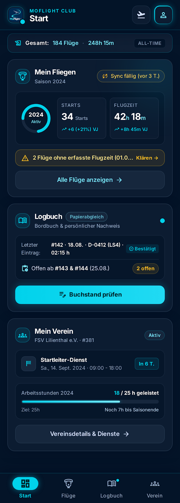

# MoFlight app design

Version: **0.18 — Start paper-book overview revised; summary proposal under review**. Updated: 2026-10-16 (Europe/Berlin). Product/design decisions: Manuel. This is a living design description; Git preserves revisions and the change log records meaningful decisions. A draft version is not approval of the entire design.

## Purpose and task boundary

M1 discovery deliverable: a shared description of appearance, screen structure, navigation and representative states, starting from Manuel's supplied Stitch export. Dependencies: the [confirmed journey map](2026-10-13-journey-information-map.md), [earlier design decisions](2026-10-13-dark-concept-review.md), and [project plan](../project-plan.md). Existing Issues [#5](https://github.com/MomoRC-tech/MoFlight-App-framework/issues/5), [#9](https://github.com/MomoRC-tech/MoFlight-App-framework/issues/9), and [#11](https://github.com/MomoRC-tech/MoFlight-App-framework/issues/11) were checked open on 2026-10-16; no new Issue is needed.

Review acceptance: Manuel has reviewed the relevant design choices; the description identifies destinations, primary actions, supporting screens and data states; a subsequent clickable preview demonstrates the selected journeys. This document alone does not complete M1 or authorize application implementation. Detailed operations, native checks and feasibility gates remain in the roadmap.

## Source and versioning

The [archived Stitch source](design-sources/2026-10-16-stitch/README.md) contains one Start-screen image, HTML and generated DESIGN.md. It is reference material, not binding instructions or an approved specification. Keep that snapshot unchanged; record our reviewed design here. Screen variants and future previews should identify the description version they implement.

Use three explicit labels: **Confirmed** (Manuel's decision), **Proposed** (awaiting review), and **Open** (not yet settled). Revise this document after answers; retain decision provenance and summarize meaningful changes below. Do not equate version numbers with milestone completion.

## Confirmed foundation carried forward

These choices carry forward from the earlier design review, with the explicit visual-style revision recorded below:

- Dark, clean, spacious; logical content is boxed. On 2026-10-16 Manuel selected keeping the Stitch visual style closely: navy/cyan, glowing accents, outlined and nested cards. This supersedes the earlier preference for filled cards with outlines only where needed. Phone readability remains a review requirement.
- Compact fixed header with current page title and contextual Back. On 2026-10-16 Manuel selected Refresh + Profile in the top-right header: Refresh retrieves the latest Vereinsflieger data; Profile opens account/settings. This replaces the Stitch starter's new-flight header action. Exact retrieval scope, progress/cancellation and behavior during guided steps remain to be specified.
- Four peer destinations: Start, Flüge, Papierbuch and Verein. Attached full-width bottom navigation with equal destinations and a selected indicator; the latest decision supersedes the earlier hovering dock.
- Start leads with Mein Fliegen, followed by Papierbuch. On 2026-10-16 Manuel selected a compact overview: smaller summaries for flying, paper-book and club information, with details available by tapping. This changes summary density, not the availability of the full information in its section. Exact summary fields, dimensions and club placement remain open; fitting everything without scrolling is not yet a requirement.
- On 2026-10-16 Manuel selected keeping the overall flight-count/known-time totals strip on Start, above the yearly flying summary, as in Stitch. Totals describe available saved history with explicit coverage; they must not imply a complete lifetime record where history is incomplete. Exact wording and coverage presentation remain open.
- Year diagram requirement, confirmed 2026-10-16: represent actual current-year values prominently and prior-year values less prominently for comparison. Manuel supplied this requirement instead of selecting removal or a decorative year badge; neither offered option is selected. The existing same-period prior-year comparison remains applicable.
- Year diagram presentation, confirmed 2026-10-16: paired horizontal bars for flight count and known flight time; current year thicker/cyan, prior year thinner/muted, with exact values and same-period comparison. This replaces the starter's ring; the comparison-ring alternative is not selected.
- Papierbuch overview retains navigation; guided checking/review/template steps hide it and use header Back.
- Papierbuch tab default, confirmed 2026-10-16: open the last-used book's overview, with its status and “Buchstand prüfen,” and a visible book selector at the top (option 1). Manuel explicitly reiterated that one pilot/user can own multiple paper books; never equate user identity with book identity. Support distinct books including successive volumes of the same format, consistent with the existing requirements. Switching books changes the displayed book's status: paper evidence, assumed writing progress, pending entries, photos, decisions and writing snapshots remain scoped to that book. Identify books by a stable book identity, not merely aircraft category/format. Exact selector presentation, first-book/no-book/removed-book fallback and switching during unfinished guided work remain open. This confirms product navigation and isolation requirements; ADR 0007 remains proposed and no production schema expansion is approved.
- Papierbuch on Start, revised by Manuel on 2026-10-16: show only an overview; all book details and the book selector belong in Papierbuch. This supersedes v0.8's per-book last-entry/action card and v0.17's selected-book switcher on Start. Do not introduce shared Start/Papierbuch selection: Start no longer selects a book. One user may still own multiple independent books; aggregate presentation must not merge their progress. Exact overview measures/copy are proposed below, not yet selected.
- Additional club information on Start, confirmed 2026-10-16: a single compact summary row using symbols to indicate changes or upcoming items, rather than separate task/headline/event preview rows. This answers the question about tasks, news/documents and events alongside duties/work-hour progress; it does not remove the previously selected duty/work-hour content. Details remain in Verein. Numeric counts are not required by this answer. Symbols remain visible in stable positions: subdued when inactive, highlighted for relevant updates/upcoming items (option 1, confirmed 2026-10-16). Exact icon grouping, change/read semantics and upcoming horizon remain open; an unavailable or stale check must not imply that nothing is new or upcoming. Pair visual indicators with meaningful accessible labels; specific tap targets remain proposed for the next preview.
- Flight filters open in a slide-up panel over the list.
- Flüge tab default, confirmed 2026-10-16: flight list first, with compact statistics at the top followed by searchable/filterable flights (option 1). Tapping a Start chart still opens its corresponding metric details with comparison/filter context, rather than forcing the tab default. Exact list-row layout, initial period/order, searchable fields and query behavior remain for review. This selects presentation, not a new search implementation or provider capability.
- Flight-list layout, confirmed 2026-10-16: compact rows inside boxed day groups (option 1), retaining the selected Stitch styling. Tap a row to open flight details. Separate roomy cards per flight are not selected. Exact row fields, hierarchy, sorting and date/time basis remain open; the layout choice does not resolve source semantics.
- Flight-row content, accepted for now on 2026-10-16: main line shows aircraft registration/model and duration; secondary line shows departure time, airfield and the user's recorded role. Other-pilot information and all further details are available by opening the flight. Manuel's “ok for now” establishes a revisitable working choice for the next preview, not a frozen field contract. Missing values remain unknown; narrower widths, exact formatting and source semantics still need review.
- Missing-data presentation, confirmed 2026-10-16: show a compact notice on Start (example: “2 Flüge prüfen”) and markers on affected flight rows (option 1). Tapping the notice opens the affected flights in Flüge. Unknown duration remains unknown, not zero. Exact issue eligibility, notice scope/count semantics and review/resolution actions remain open; the presentation choice does not authorize editing provider evidence or inventing missing values.
- Flight details, confirmed 2026-10-16: one scrollable page with boxed sections for aircraft, times/route, people/roles and source information (option 1). Back remains in the compact header. Internal Overview/People/Source tabs are not selected. Exact fields, section density and missing/conflicting-evidence presentation remain open; this selects layout rather than new provider capabilities or editing behavior.
- German app text; Android and iOS target platforms; offline access and clear data freshness/coverage. Keep unknown duration distinct from zero and assumed writing progress distinct from confirmed paper evidence.
- Approved branding and Expo/React Native remain as recorded; this description selects no new technology or service.

## Selected visual direction and remaining source observations

The screen uses deep navy surfaces, cyan highlights, rounded nested cards, Inter text, icon-and-label bottom navigation and a compact brand/page header. It shows an all-time total ribbon, seasonal flight count/time, an unexplained partial ring, a stale-sync badge and missing-duration alert. The paper card shows a last entry and pending entries; the club card shows a duty and work-hour progress. Dates and values are example content, not verified provider results.

The exported HTML contains placeholder destination links; it does not establish a working multi-screen journey. The generated style guide includes telemetry, cockpit and weather concepts outside our selected scope. Those do not become requirements. The screen's navy/cyan appearance, glowing accents and outlined/nested card treatment are selected as the visual reference. Exact implementation tokens, typography sizes, metrics, labels and behaviors still need review; selecting the look does not approve every source value or generated instruction.

## Selected year comparison and historical alternative

The [comparison preview source](prototypes/2026-10-16-year-comparison.html) preserves the two alternatives reviewed in the selected Stitch style. Manuel selected **Vergleichsbalken** on 2026-10-16; Vergleichsringe remains a historical unselected alternative. This is an isolated conversation-preview fragment with synthetic values, not application implementation or native acceptance.

- **Comparison rings — not selected:** two metric groups, flights and known flight time, with current-year outer arcs and quieter prior-year inner arcs. Preserved only as a record of the comparison.
- **Comparison bars — confirmed:** flights and known flight time with paired horizontal bars. Current year is cyan and thicker, prior year muted and thinner, with direct values. Each pair shares a zero baseline and scale, making differences easier to compare. Flight count and time use independent scales and explicit units.

For the selected bars: label the same date interval for both years (example: 1 January through 16 October), use available saved evidence, and keep incomplete coverage/missing durations visible. Do not call a partial known-time total complete flight time. Do not present missing prior-year evidence as zero; suppress percentage change when the prior baseline is zero or unknown. Choose a shared scale ceiling from both years' available values rather than capping at last year's total; the higher current/prior value must fit. Exact unknown-state layout and rounding remain for contract review. Tapping should retain the selected metric and comparison context in Flüge, consistent with the existing journey map.

## Start paper-book overview — proposal under review

Confirmed boundary: compact overview on Start; book selector, last-entry details, book-specific status and “Buchstand prüfen” stay inside Papierbuch.

Proposed boxed card, using fictional example values:

> **Papierbücher · 3 Bücher**
>
> **2 Bücher mit offenen Einträgen**
>
> 12 Bucheinträge vorzubereiten
>
> **Papierbücher öffnen →**

The primary action opens the Papierbuch destination; its previously selected last-used-book default and top selector remain. Overview measures and exact button copy are engineer proposals. Count book entries, not unique flights: a source flight linked to two books can require two independent entries. Do not sum incompatible format totals or treat one book's assumed progress as another's confirmed evidence. Unknown/pending-review book status must remain visible rather than producing a misleading zero or “all up to date”; partial known totals need an explicit qualification. Exact count eligibility, freshness, no-book and uncertain-state presentation remain for the detailed contract. Counts do not prove that handwritten books have been checked.

## Review queue — one question at a time

| Order | Choice to settle | Current status |
| --- | --- | --- |
| 1 | Overall appearance: retain Stitch closely, simplify its styling, or use it mainly for structure? | Confirmed 2026-10-16: option 1, keep closely; navy/cyan, glowing accents, outlined and nested cards |
| 2 | Start density: what should be visible immediately, and what belongs behind a tap? | Confirmed 2026-10-16: option 2, compact overview of all three areas; tap for details; preserve flying-first/paper-second order |
| 3 | Header content and action hierarchy, including retrieval access | Confirmed 2026-10-16: option 1, Refresh + Profile; retain compact page title and contextual Back |
| 4 | Flight-summary presentation: year/comparison, aircraft and duration views; treatment of all-time totals and ring | Totals strip retained on Start; paired comparison bars selected 2026-10-16 for flights/known time. Aircraft/duration views remain in confirmed journey scope; remaining detail is open |
| 5 | Papierbuch overview and next action: active book, evidence/assumed progress, pending work | Revised: Start overview only; all details/selector inside Papierbuch, which retains last-used-book default. Cross-book summary counts/copy proposed, not selected. Preserve separate same-format volumes; detailed fields, selector/fallback and unfinished-work switching remain open |
| 6 | Compact club summary and paths to details | Confirmed 2026-10-16: one persistent symbol row; stable positions, subdued when inactive, highlighted for changes/upcoming items; details in Verein. Exact grouping and state semantics remain open |
| 7 | Destination layouts, details, filters, back behavior and representative states | Flüge tab default: compact statistics above searchable/filterable flights; compact rows in boxed day groups, tap for details. Row fields accepted for now: aircraft/model + duration; departure time/airfield/own role beneath. Compact missing-data notice on Start opens affected flights; mark their rows. Flight details: one scrollable page of boxed aircraft, times/route, people/roles and source sections, with header Back. Start charts retain direct corresponding detail entry. Formatting and remaining destination/state behavior open |
| 8 | Reusable spacing, type, controls and phone-size review | Open; test narrow widths, larger text, scroll clearance and meaningful labels |

Review loading, empty, offline, stale, incomplete, unknown, error, cancel and recovery examples before declaring a journey ready for detailed contracts. Preserve earlier saved information after a failed refresh. A visual example does not prove provider access or native behavior.

## Change log

| Version | Date | Change and decision status |
| --- | --- | --- |
| 0.1 | 2026-10-16 | Created from the supplied Stitch starter and earlier confirmed decisions following Manuel's request for a versioned description and guided questions. No new appearance choice confirmed yet. |
| 0.2 | 2026-10-16 | Manuel answered “1. keep” to the appearance question: retain the Stitch visual style closely. Earlier calmer-style recommendation is not selected; source content and behavior remain under review. |
| 0.3 | 2026-10-16 | Manuel answered “2.” to Start density: compact flying, paper-book and club summaries, with details behind a tap. Exact fields and sizing remain under review. |
| 0.4 | 2026-10-16 | Manuel answered “1.” to header actions: Refresh + Profile replace new flight + Profile; current page title and contextual Back remain. |
| 0.5 | 2026-10-16 | Manuel answered “2.” to overall totals: keep flight-count/known-time totals on Start above the yearly summary, with available-history coverage rather than an unsupported lifetime-completeness claim. |
| 0.6 | 2026-10-16 | Manuel clarified that the diagram should represent current-year values with a less prominent prior-year comparison. Prepared comparison-ring and comparison-bar proposals; geometry is not selected. |
| 0.7 | 2026-10-16 | Manuel answered “bars”: selected paired horizontal comparison bars for flights and known flight time; rings retained only as a historical alternative. |
| 0.8 | 2026-10-16 | Manuel answered “1.” to the compact Papierbuch card: book name, last entry, pending count and Buchstand prüfen. Preserve book scope and confirmed/assumed distinction. |
| 0.9 | 2026-10-16 | Manuel requested “just a summary row with symbols” indicating changes or upcoming items for additional club information. Separate preview rows are not selected; indicator details remain open. |
| 0.10 | 2026-10-16 | Manuel answered “1.” to inactive symbols: always visible in stable positions, subdued when inactive and highlighted for relevant updates/upcoming items. Unknown/stale is distinct from checked inactive. |
| 0.11 | 2026-10-16 | Manuel answered “1.” to Flüge tab default: compact statistics above the searchable/filterable flight list; Start chart taps still open corresponding details directly. |
| 0.12 | 2026-10-16 | Manuel answered “1.” to flight-list layout: compact rows inside boxed day groups, tap a row for details. Preserve Stitch styling; individual roomy cards are not selected. |
| 0.13 | 2026-10-16 | Manuel answered “ok for now” to proposed row fields: aircraft registration/model and duration; departure time, airfield and own role beneath; other pilot in details. Accepted as revisitable preview content. |
| 0.14 | 2026-10-16 | Manuel answered “1.” to missing-data warnings: compact notice on Start plus markers on affected rows; tapping the notice opens those flights. Exact review/resolution behavior remains open. |
| 0.15 | 2026-10-16 | Manuel answered “1.” to flight-detail arrangement: one scrollable page with boxed aircraft, times/route, people/roles and source sections; header Back retained. Internal detail tabs are not selected. |
| 0.16 | 2026-10-16 | Manuel selected last-used book overview with top selector and explicitly reiterated multiple paper books per pilot/user. Preserve separate book identity and progress, including same-format volumes; production architecture remains gated. |
| 0.17 | 2026-10-16 | Manuel answered “1.” to multiple books on Start: one selected book's summary with a visible switcher; no separate summary card per book. |
| 0.18 | 2026-10-16 | Manuel revised Start to overview only, with all details/book selector in Papierbuch. Supersedes selected-book card/switcher on Start; proposed a compact cross-book status card for review. No shared-selection answer was given or inferred. |
