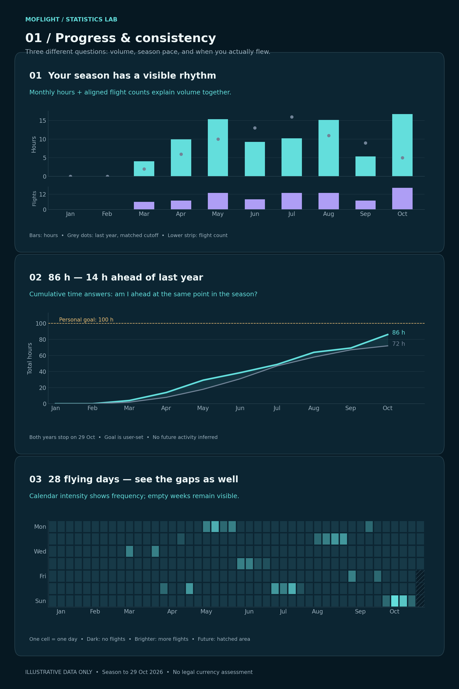
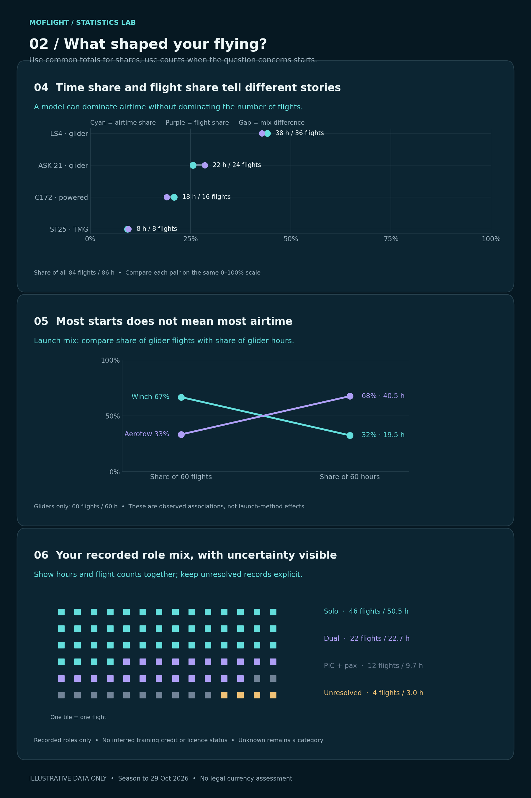
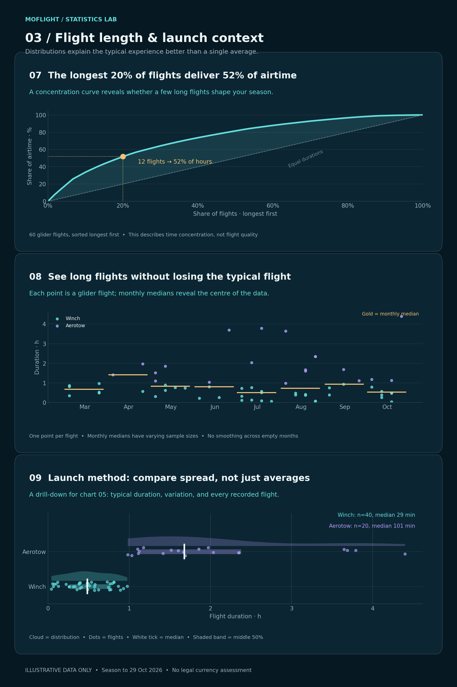
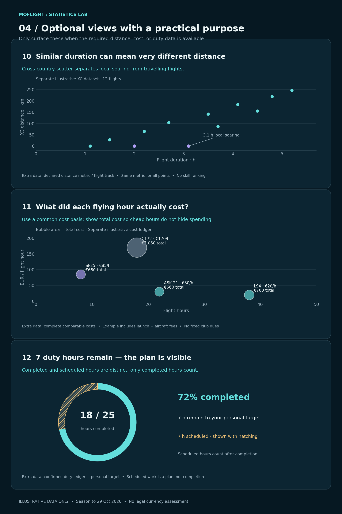

# MoFlight statistics — implementation handover

Date: 29 October 2026. Status: user-approved design direction; implementation pending.

## 1. Assignment and boundaries

Implement the statistics experience described here in the existing MoFlight app. The user approved this route after reviewing all 12 chart concepts. Use the reference images to understand visual encoding and information hierarchy. They are presentation sheets, not full app screens: do not copy their large dimensions, English explanatory paragraphs, laboratory branding, or synthetic headlines into production.

Repository: https://github.com/MomoRC-tech/MoFlight-App-framework
Expected stack from project context: React Native, Expo, TypeScript, offline SQLite and local files. Verify the current repository before choosing component names, routes, dependencies or data adapters. This handover was produced without inspecting the current codebase; it makes no claim about existing implementation, available fields or installed chart libraries.

Preserve the approved compact Micro Bento + Flighty visual language, existing features, header, sync/profile controls, tabs and navigation. Integrate statistics into the existing navigation; do not redesign the start screen. User-facing copy should follow the app's language, expected German. Keep technical documentation in English.

Existing project preference: work locally on main with traceable commits, no PR. Inspect repository instructions and the working tree first, preserve unrelated changes, and do not push or deploy merely because this document requests implementation.

## 2. Approved information architecture

| Location | Chart IDs | Implementation intent |
|---|---|---|
| Start screen / Meine Saison | 02, and 12 if supported | Compact season comparison sparkline and optional small duty indicator within the approved layout. Preserve current metrics and previous-year values. Tap opens the relevant statistics detail. |
| Statistics overview | 01, 03, 04, 08 | Four readable cards: monthly activity, regularity, aircraft mix, duration timeline. One main message per card. |
| Launch detail | 05 → 09 | A launch-share summary opens the distribution view with the same scope and filters. Do not duplicate both large charts on the overview. |
| Further details | 06, 07 | Recorded role mix and airtime concentration. Reachable through a clearly labelled details entry, not hidden behind an unexplained gesture. |
| Conditional details | 10, 11, 12 | Distance, costs and duty only when supported by trustworthy data. Explain unavailable capability in the details area; never invent data. |

Implement all applicable core charts, not just the start-screen indicators. Reuse an existing statistics route if present. Otherwise use an overview with readable cards and detail screens or sheets, integrated into the current navigation rather than adding a new top-level tab by default.

## 3. Visual atlas

Numbers in the four sheets are stable IDs used throughout this specification.

### Progress and consistency: 01–03

### Flying mix: 04–06

### Duration and launch context: 07–09

### Optional relationships and progress: 10–12

All plotted observations, costs, targets, role counts and comparisons are synthetic. The first three sheets illustrate 84 flights, 86 hours and 28 flying days; the glider subset has 60 flights and 60 hours. Chart 10 uses a separate 12-flight XC illustration. Chart 11 uses an illustrative cost ledger. Chart 12 uses an illustrative 25-hour target. None of these values is an actual user requirement or verified record.

The synthetic launch groups were deliberately constructed to make duration differences easy to see. They are not evidence about actual winch or aerotow performance. Do not ship them as benchmarks or silently seed them into the user's database.

## 4. Shared visual and interaction system

Use existing app tokens first. Reference palette if equivalent tokens are missing:

| Role | Reference colour |
|---|---|
| Background | #061822 |
| Card surface | #0C2532 |
| Grid / subtle border | #28424F |
| Primary text | #EDF6F7 |
| Secondary text | #9BB0BD |
| Primary data | #63DEDC |
| Secondary comparison | #AE9EF5 |
| Historical data | #718397 |
| Goal / uncertainty / scheduled | #F1C276 |

Prefer rounded compact cards, restrained grids, direct labels, generous plot width and readable type. Avoid excessive introductory text. Keep meaning consistent within each chart, and explain any colour mapping. Colour alone must never be the only discriminator: use labels, symbols, line styles or hatching. Production themes must maintain contrast.

Each card contains a short title, a computed insight when the data supports it, the chart, and a concise scope or coverage line. Do not hard-code example insights such as “14 h ahead.” For insufficient or ambiguous data, use a factual neutral title.

At phone widths, simplify ticks rather than shrinking all text. Overview charts should generally fit a card around 200–280 dp high, excluding necessary controls; use taller detail views for distributions. These are starting ranges, not rigid constraints. Ensure 44–48 dp touch targets. Dense calendar cells may use nearest-cell selection within a larger interaction area.

Tapping a mark opens a bottom sheet or existing detail surface with values, scope, units and relevant records. Details can link to the existing flight list using matching filters. Touch selection, a dismiss action and screen-reader summaries are required; hover cannot be the only interaction. For dense points, provide a list of overlapping records rather than silently selecting one.

Keep selected period and filters when navigating back. Apply filters consistently to plots, totals, insight text, details and comparison data. Include period/year, aircraft category/model, launch method and recorded role only where meaningful. Changing filters must not unexpectedly reset the selected period.

Support offline reading and calculation. New backend services, AI-generated insights, GPS uploads and paid chart services are not needed for the core experience.

## 5. Shared calculations and data contract

### Adapt the current data, do not invent a parallel domain model

Create a small typed statistics adapter over the existing repository schema. Suggested semantic inputs are:

- Stable flight ID; flight/service date; source and coverage metadata.
- Validated duration in integer seconds or minutes, nullable.
- Aircraft identifier, model, category, each nullable or explicitly unresolved.
- Launch method, meaningful for eligible aircraft and nullable when unknown.
- Recorded role, explicitly unresolved when not reliably classified.
- Optional landing count, distance with metric/provenance, allocated costs with currency and coverage, duty records and personal duty target.

Unknown, not applicable and known zero are distinct. Missing duration does not imply a zero-minute flight. Do not infer roles or legal pilot status from seat count or instructor names without established project rules.

Use a single filtered and deduplicated flight set for each view. Count one flight per stable flight record. Do not confuse flights, starts and landings: one motor flight can have several landings. Label the metric as “Flüge” unless actual starts are explicitly represented. Reuse existing reconciliation and deduplication rules; do not collapse two distinct flights merely because they share a date and duration.

### Numeric definitions

- Total hours = sum of known valid duration seconds / 3600. Aggregate before rounding.
- Flight count = number of eligible distinct flight records, including records with unknown duration if otherwise eligible.
- Flying days = distinct authoritative service dates with at least one eligible flight.
- Median duration = middle sorted valid duration, averaging the two central values for even n. Never substitute mean.
- Quantiles for chart 09: linear interpolation using index (n−1) × p, or an equivalent explicitly documented library method.
- Absolute comparison = current total − previous total. Relative percentage only if previous total > 0; otherwise show “no comparable baseline.”
- Duration display: prefer h:mm / minutes for tooltips and headline values; use labelled decimal hours on numeric axes if clearer. Localise decimal and currency formatting.

If duration is absent, keep the flight in flight-count views and show coverage such as “Flugzeit für 78 von 84 Flügen bekannt.” Time-share and count-share denominators can differ; explain this rather than claiming they represent the same complete population. For field-specific charts, retain an explicit unknown group where possible and disclose exclusions where not.

### Time and comparison rules

Use the app's established authoritative flight date and timezone convention. Do not regroup UTC source dates through the device timezone arbitrarily. Absolute timestamps may be localised for display; the source's intended service date must remain stable. If only times exist, do not guess overnight rollover without the repository's validation rules.

Default to current season/year through the current date. Prior-year comparisons must use the same calendar cutoff and filters. Historical full years can compare full years; custom periods should map to the same prior-year calendar window. Map 29 February to 28 February when needed and document the convention. Show the actual periods being compared.

Monthly buckets are interval totals; cumulative charts use running totals. Clip the current month to the active cutoff. Future days/months are not zero observations. A known complete empty month may show zero; an unimported or uncertain month should show a gap or coverage state. Imported record absence alone is not proof of no activity.

## 6. Detailed chart specifications

### 01 — Monthly activity: aligned hours and flights

**Question:** Did I fly more often, or fly longer?

Two vertically aligned panels share a month axis. Upper panel: current monthly hours as cyan columns, previous-year monthly hours as grey dots at the same month. Lower panel: monthly flight count as purple columns. The panels have separate labelled y-axes and both start at zero. No dual-axis overlay, smoothed month curve or connected prior-year dots is required.

Tooltip: month, covered dates, current/previous hours, difference, current/previous flight counts, known-duration coverage. Selecting a month opens its flight list. Prefer a neutral title unless a clear computed message is available.

Keep both units visible in the combined view; a full-size hours/count toggle alone would lose the explanatory relationship. The compact start-screen representation may be simpler.

### 02 — Season pace: cumulative comparison

**Question:** Am I ahead of last year at the same point?

Plot current cumulative hours and prior-year cumulative hours on one labelled scale. Use a restrained difference fill when positive/negative regions can be distinguished clearly. Reverse the message when behind; avoid implying that more hours is automatically better. Add a dashed user-configured goal only if a real goal exists. Never use the illustrative 100-hour target as a default.

Stop both curves at the matched cutoff. No extrapolation or forecast. Daily cumulative data is preferred if available, with actual time spacing; monthly snapshots are acceptable when that is the available granularity. Add a starting baseline at the period boundary. Empty known-complete periods can remain flat; missing coverage must not become an invented flat trend.

Headline example: “14:00 h mehr als im Vorjahr.” Tooltip includes both totals, date and delta. The start-screen sparkline should retain total, small previous-year value and delta without expanding the approved header.

### 03 — Regularity calendar

**Question:** When did I fly, and where were the long gaps?

Week columns and weekday rows; Monday-first for German locale. One cell per date, intensity = flight count. Use discrete, labelled count levels derived from the displayed data; avoid an unexplained colour scale. No-flight dates, unknown coverage and future dates must be visually distinct. Use hatching or an equivalent pattern for future/unknown states, not just colour.

Show actual distinct flying days. Select a day to see count, total known duration and flights. For an annual view, allow horizontal scroll with a clear affordance or a detail expansion rather than compressing 52 weeks into illegible tap targets. Overview may show a clearly labelled recent window; summary scope must state whether it covers that window or the whole season.

Describe a gap only within known-complete coverage. This is activity information, not licence currency or a proficiency assessment.

### 04 — Aircraft mix: dumbbell comparison

**Question:** Which aircraft account for my time versus my flights?

Each row has a cyan dot for percentage of known airtime and a purple dot for percentage of flights, linked with a thin neutral line. Both use the same labelled percentage axis. The gap is the message. Use 0–100% by default; if a narrower range is needed in detail, make that explicit and apply the same scale to both measures.

Combine category and model in one expandable view: category summaries initially when many models exist; expand a category into its model rows with the denominator explicitly labelled. Do not simultaneously mix parent totals and child rows into a purported single partition. Keep model shares relative to the selected population unless a labelled “within category” mode is chosen. Reconcile unknown aircraft in both measures.

Show hours and flight count next to each row. Tapping filters the existing flight list. Sort deterministically by hours descending, with stable tie-breaker. Do not silently truncate aircraft: use expansion or an explicit Other group that can be opened.

### 05 — Launch mix: slopegraph

**Question:** Does the method I use most also account for most airtime?

Left side = share of eligible glider flights. Right side = share of eligible glider airtime. Common vertical percentage scale; one labelled line per launch method. Winch and aerotow in the reference are examples, not an exhaustive fixed enum. Support self-launch or other mapped methods when meaningful for the selected category.

Display absolute counts/hours and scope. Unknown launch method remains explicit. Not-applicable powered-aircraft records are excluded from a glider-only scope and are not classified as unknown glider launches.

This chart compares two compositions; it is not a time trend or causal analysis. With many launch groups or unreadable crossings, use labelled endpoints and expand the detail view; a paired-dot comparison is an acceptable fallback with the same meaning. Tap opens 09 with the same filters and the selected method highlighted, while retaining comparison groups.

### 06 — Recorded role mosaic

**Question:** How is my flying distributed across recorded roles?

Reference: one square per flight, grouped by role; a side legend gives role, count and known hours. Unknown role stays visible. The synthetic categories “Solo,” “Dual,” “PIC + pax,” and “Unresolved” are visual examples: adapt to the actual mutually exclusive recorded-role mapping. If PIC and solo flags overlap in the source, do not add them as disjoint categories without a documented mapping.

For small/medium samples, exact one-flight tiles are appropriate. For large datasets, use a fixed-size proportional waffle with a clear percentage-based legend and exact counts outside it. Do not call a proportional tile one flight. Tap a role to open its flight list. Do not derive legal training credits from this chart.

### 07 — Airtime concentration curve

**Question:** How much of my airtime comes from a few long flights?

Default glider scope. Sort valid-duration flights longest first. For n flights with positive total duration T, plot x(k)=100k/n and y(k)=100 × sum(longest k durations)/T, including (0,0) and (100,100). A dashed diagonal represents equal duration for every flight, not a goal. Shade the difference subtly.

Highlight k = ceil(0.20n), but label the actual fraction k/n and count accurately. Use “longest 20%” only when it is accurate after rounding; otherwise say “Die längsten k von n Flügen …”. Example insight: “12 von 60 Flügen liefern 52% der Flugzeit.” Never fabricate a partial flight to hit exactly 20%.

If total duration is zero or unknown, do not render a valid-looking curve. This is an advanced detail, not a training quality measure. Tapping a position can show the corresponding longest flights.

### 08 — Flight-duration timeline

**Question:** How did my typical flight and its variation change across the season?

One point per valid-duration flight, x=actual date, y=duration. Default glider scope; use launch-method colours when reliable. Do not combine different aircraft categories into a headline claiming improvement. Allow category/model/launch filters.

Show one short gold median segment per month with observations; do not join medians across months or draw smoothing through empty months. Every median tooltip includes n. Same-date points may use deterministic horizontal jitter within that service date's visual band for separation; preserve the exact date in the tooltip. Provide access to every overlapping flight.

Keep the longest flight visible. An expanded view is preferable to silently clipping outliers. A neutral subtitle “Median und einzelne Flüge” is safer than asserting that longer flights demonstrate progress.

### 09 — Launch-duration raincloud

**Question:** What is typical, and how widely do durations vary for each launch method?

For each launch group, show individual jittered dots, an interquartile band and a white median tick. Add a translucent half-violin density only for sufficiently many non-identical durations. Default threshold: n >= 20; otherwise keep dots and summaries and state the sample count. Never invent a smooth distribution for 2–3 flights.

Use nonnegative duration support and a documented density bandwidth; do not show negative flight times from unconstrained smoothing. For n=1, show the single point; for identical observations, omit density. Use the same duration scale for all groups. Make small sample limitations visible in detail.

Display n and median per group. Explain distribution/median symbols. No “aerotow causes longer flights” wording. Flight purpose, weather, aircraft and pilot population differ. This is the detailed companion to 05.

### 10 — XC distance versus duration (conditional)

**Question:** Was this a long local soaring flight or a travelling flight?

Scatter: duration on x, a single explicitly named cross-country distance measure on y. Do not mix flown track length, declared task distance, scored distance or displacement. Retain metric/provenance in the adapter and tooltip. Compare only compatible records; filter by aircraft as needed.

A known local-flight XC distance can be zero. Missing distance is not zero and must not be plotted on the baseline as a local flight. Disclose the number excluded for missing/incompatible distance. Tooltip links to the flight and optional existing track view. No automatic skill ranking or causal regression.

### 11 — Cost relationship bubble plot (conditional)

**Question:** What did each flying hour cost, and where did I spend the most?

One bubble per aircraft model: x=known hours, y=allocated total comparable cost / those hours, bubble AREA proportional to total allocated cost. Radius must therefore scale with sqrt(cost), not cost. Label model, EUR/hour and total spending. A selected bubble shows included/excluded cost categories and coverage.

The reference includes aircraft and launch fees and excludes fixed club dues. Production must use actual cost data and clearly state the chosen basis; do not presume this scope matches the source. Require a matched set of hours and costs: exclude unmatched records from the rate and disclose coverage. Compare one currency unless an explicit exchange-rate pipeline already exists. Missing cost is not free; zero/unknown hours cannot yield a valid €/h rate. Refunds or negative net totals need a labelled numeric treatment, not imaginary negative bubble area.

This is a descriptive budgeting view. Do not suggest a training aircraft is interchangeable with a different category simply because its cost rate is lower.

### 12 — Duty progress ring (conditional)

**Question:** What is completed, what remains, and what is already planned?

Solid arc = confirmed completed duty / real personal target. A separate hatched segment can show confirmed scheduled hours covering the remainder. Remaining unscheduled hours use a neutral track. Never count scheduled work as completed. Show completed/target, remaining and scheduled numerically.

Use max(target−completed,0) for remaining; cap ring fill at 100% and label any excess separately. Scheduled arc is capped at the remaining target; disclose scheduled total separately when it exceeds that amount. Target zero or absent means no meaningful completion percentage. A 25-hour target is illustrative, not a verified club requirement.

Tap opens existing duty records or a read-only breakdown. Do not add scheduling actions unless already supported by the app.

## 7. Implementation approach

1. Inspect repository instructions, current routes, design tokens, storage queries, data coverage and chart dependencies. Record a concise mapping of source fields and unsupported capabilities. Do not pause for approval of routine implementation choices.
2. Add pure aggregation/selectors and a shared filter/period model. Calculate once from the deduplicated local dataset and reuse outputs across overview, start screen and details. Keep fixtures separate from real data.
3. Build or reuse a shared accessible chart card, marks/tooltips, axes, legends and state handling. Prefer the app's existing chart/SVG stack. If it lacks required primitives, choose an Expo-compatible solution after checking the actual installed versions. Avoid a broad dependency migration or a WebView just to render charts.
4. Implement 01, 02, 03, 04 and 08, then the 05→09 detail flow and 06/07. Integrate compact 02 into the existing start screen without changing its approved geometry unnecessarily.
5. Implement 10/11/12 only where the inspected data supports the definitions. Show clearly unavailable states otherwise and document the precise missing inputs. Do not build a new data-import subsystem merely to make every optional chart appear.
6. Add focused calculation tests and meaningful user-flow validation. Run the repository's required checks and emulator checks. Fix failures related to the change.
7. Add this specification and visual references to a suitable repository docs directory, such as docs/statistics/, following existing conventions. Update the document to reflect actual field mappings, implemented routes, dependencies and limitations.
8. Finish with traceable commits when permitted by repository instructions. Report implemented and verified charts separately from unavailable/untested features. Include changed files, test results, representative screenshots and commit IDs. No PR is requested.

## 8. Acceptance and verification

### Meaningful calculation checks

- Distinct flight IDs reconcile with totals; duplicate imported records are handled by existing canonical rules. A flight with multiple landings still contributes one flight.
- A fixture with durations 10, 20, 30 and 40 minutes totals 100 minutes, median 25 minutes, and has quartiles 17.5 / 32.5 minutes under the stated interpolation method.
- For that fixture, chart 07's cumulative duration shares are 40%, 70%, 90%, 100% at 25%, 50%, 75%, 100% of flights. ceil(20% × 4)=1, so the callout must identify 1 of 4 flights, not claim an exact 20%.
- Unknown duration contributes to the flight count but not the time total; denominator/coverage labels reflect that. Unknown aircraft/launch/role is not silently dropped from compositional totals.
- Prior-year comparisons use the same cutoff, filters and authoritative dates; partial months, leap years and timezone boundaries have explicit test coverage.
- Duty example completed=18, target=25, scheduled=7 yields 72% completed and 7 remaining. scheduled=10 still yields 7 remaining, with only 7 hours represented in the remaining arc and 10 scheduled stated numerically. completed=27 yields 100% ring and 2 hours above target.
- Cost example €760 / 38 hours yields €20/hour; missing or unmatched costs are excluded with coverage, not treated as zero. Bubble area, not radius, reflects spend.
- Distance unknown is excluded with coverage; known zero is visible. Raincloud gracefully handles n=0, n=1, identical durations and small groups.

### Functional and visual checks

- All supported chart IDs are reachable at the documented location. Optional capabilities fail gracefully with explanatory states.
- Changing filters updates values, insights, tooltips, comparisons and linked flight lists together. Navigation preserves state.
- Totals reconcile between start screen, overview, detail and list for identical scopes.
- Loading, complete-empty, insufficient-sample, partial-coverage and unavailable states are distinct. Never show a cheerful fabricated insight in an empty view.
- Readability at a narrow phone width, large text and portrait orientation; long German model names and tooltips do not clip. No horizontal overflow except deliberate calendar/detail scrolling.
- Points and calendar dates can be selected by touch; screen readers receive useful titles, totals and an alternative list/table for dense data. Colour-independent identification works.
- Existing flights, club, AI, sync, profile and start-screen features continue to work. Statistics load offline from the real local store.
- At least one emulator screenshot per major overview/detail family, plus narrow-width and empty-state checks. Clearly identify any environment limitation that prevents running these checks.

## 9. Ready-to-use instruction for a fresh implementation chat

> Implement the approved MoFlight statistics experience from the attached MoFlight_Statistics_Handover.zip. Unpack it, read HANDOVER.md completely and inspect all four visual sheets before editing. Inspect the actual repository and its instructions, then implement the applicable charts and navigation using current data and design tokens. Preserve the approved compact start screen and existing features. Use real offline data; keep illustrations separate. Follow the chart definitions, coverage rules and acceptance checks; integrate optional distance/cost/duty charts only when their required inputs exist. Continue through implementation and verification without asking again about the already-approved design direction. Document any actual blockers and report implemented/verified work separately from unsupported or untested items. Work locally with traceable commits and no PR; do not push or deploy as part of this request.

## 10. What has and has not been completed

Completed in this handover: design direction, 12 chart specifications, four visual sheets, data/interaction rules, rollout order and acceptance criteria.

Not completed here: repository inspection, app code changes, schema verification, dependency selection, runtime/emulator tests or commits. Those are the assignment for the implementation chat.
