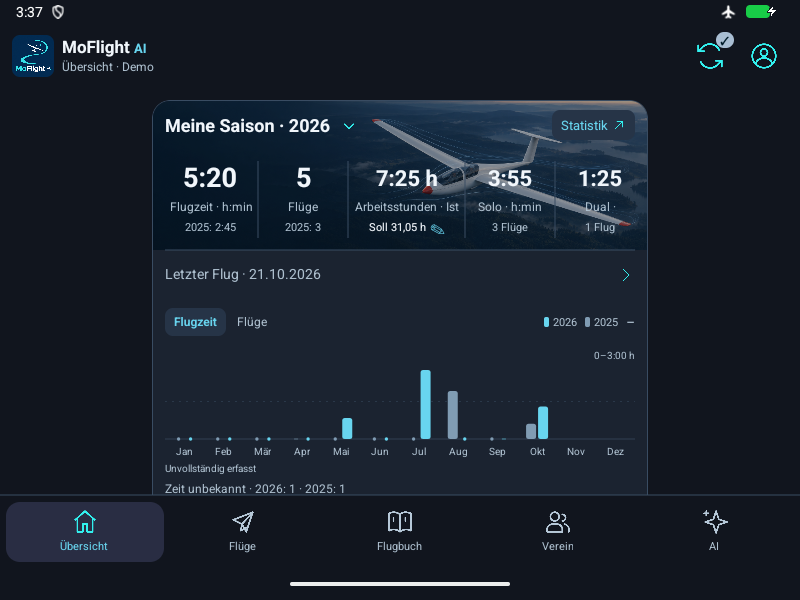

# Compact monthly Start and cool controls — 2 November 2026

Owner-authorized #122 / M1/P1 after #121. Confirmed measures: Flugzeit and Flüge. Replaces only the lower season chart with paired current/prior monthly SVG bars, one shared zero scale, short measure/year/collapse toolbar and direct monthly Statistics route. Retains the restored upper photo/metric strip, year/work target and lean tiles. Reuses same-calendar-cutoff monthly data and preserves unknown/zero/partial/future meanings. Start no longer mounts the full Statistics component or computes its unused summary/selection state.

Shared colors change from lavender/apricot to cyan/cool blue/steel blue with restrained amber. Shared action faces 30dp, chips/measure faces 28dp, touch areas remain 48dp and scale with text. Original assets and semantic Medical statuses remain. Existing chart-preference storage/account key and revision/lifecycle fence stay; Start ignores historical chart kinds but preserves expanded state. Detailed Statistics keeps its curves and shares the same measure styles/monthly-value function. No experiment/navigation/provider/domain-policy/storage-schema/dependency/service change.

39 focused existing/new presentation/model/preference/Start/surface tests pass; two added behavioral tests cover switch/detail/collapse/year and unknown/zero/count/covered-empty distinctions. Existing preference and detailed-month tests reused; no pixel/color assertion or broad suite. Native-rendered SVG/layout questions belong to the affected Release checkpoint below. TypeScript, lint and handbook evidence follows.

Initial committed-source d601021 dark MAIN verifies paired time/count bars, all month labels, cooler palette and smaller faces. MIN verifies scaled readable controls/bars without overlap, but a separate collapse row costs space. Final source combines the year legend/disclosure into one touch area and shortens duplicated unknown-time prose while preserving year/count identity. The same native task exposes a pre-existing Development-only return defect: opening Statistics clears the Cockpit caller. The bounded correction retains that caller until Statistics closes, covered by toolbar/native-Back assertions in the existing preview test. Production navigation is unchanged. Eighteen final affected checks pass (overlap with the earlier 39; do not add counts). Final corrected-source native results follow below; first-run failure remains recorded.

## Corrected-source delivery

Actual final APK source **0a510da5f51779941d5e7f4b763c03b771fd4280**, SHA-256 **3d0ddf3f516a71071df1ae66e87f18be13a2260653debb49080859e65e1a4a02**. Android Release/embedded-source/ABI inspection and final iOS Hermes export pass. Native fingerprint unchanged. TypeScript, affected lint and handbook generation/freshness pass. No broad application suite or unrelated native baseline repeated.

[Native observations](2026-11-02-compact-monthly-native.json) retain initial source d601021 MAIN time/count and MIN captures, including the failed contextual return. The final 0a510da follow-up covers the condensed MIN toolbar/unknown-time line, corrected return and WIDE layout. Parent conclusions and exact limits follow below. Controller elapsed observations, including failure, are recorded under #90 as tooling wall-clock rather than app latency/speedup. Both sessions restore original display/font, offline radios and installation identity without clearing data. The initially stopped synthetic AVD is stopped again after inspection.

[Download APK ZIP](https://github.com/MomoRC-tech/MoFlight-App-framework/releases/download/lab-compact-monthly-2026-11-02-0a510da/MoFlight-Compact-Monthly-0a510da.zip). [Fresh download verification](2026-11-02-compact-monthly-release.json) confirms identical ZIP bytes, exactly APK/sanitized metadata, APK hash and embedded source. Existing rollback/Start/modern-chart releases remain available. Experiment #116 remains selection-pending; no experimental code adopted.

Owner aesthetic acceptance, physical-phone/iOS runtime/light/extended spoken and live-provider/model gates remain separate. No new service, authentication, data-schema/storage or provider processing. Six unrelated dirty historical timing groups remain preserved and excluded from this package's commit.

## Parent native assessment

Final MIN360x900/font1.6/density160: measure, year legend and disclosure now share one row; all twelve month initials remain visible, with no chart/control overlap. Unknown-time counts retain their year association in one short line. The actual monthly Statistics route and contextual return to Cockpit pass. WIDE800x600/font1/density160:496dp visible card stays centered/capped, all twelve abbreviated months and shared-scale paired bars fit; plot/control overlap not observed. WIDE lower tiles were not rechecked. Original upper-strip horizontal overflow is intentional.

Initial MAIN time/count geometry/color behavior is reused from d601021, with its older footer/collapse presentation explicitly distinguished. No final MAIN pixel-fidelity claim; final MIN/WIDE establish the changed toolbar and status presentation. Native controls are inspected, not pixel/contrast instrumented. Work-target editing/keyboard/source refresh and unrelated pages were not retested.

Initial/final controllers used 28/29 actions and 3/3 captures. Active elapsed 174.906/176.234s includes model deliberation/ADB/observer overhead, not app latency. Initial failed return remains in evidence/ledger. Both restore display/network/install identity with no cleanup errors. Ledger freshness and ten focused ledger tests pass; changed-document links and handbook freshness pass. No extra app test is required for this documentation closeout.

[Final MIN layout](assets/2026-11-02-compact-monthly/min-cockpit.png) · [Final return to Cockpit](assets/2026-11-02-compact-monthly/min-returned-cockpit.png). Earlier-source [MAIN time](assets/2026-11-02-compact-monthly/main-time.png) / [MAIN count](assets/2026-11-02-compact-monthly/main-count.png) retain their source-specific footer differences.

## Owner follow-up — bare chart and shorter header

Owner explicitly requests no text beneath the diagram and less vertical space above it. Normal unknown-time/date prose, the incomplete caption and redundant Alle Flüge row are removed; the persistent Flights destination and chart-to-Statistics route remain. The latest-flight identity/date action shares the time/count switch row; the year legend shares the plot-scale line. No normal text follows the month labels. The always-visible 78dp chart no longer needs a collapse preference read/write/error state; saved preferences remain untouched for rollback. Empty/failed/loading guidance remains above the chart; cached latest-flight identity remains available. Upper season photo/metric/year/work-target and lean tiles are retained. Unknown values remain distinct in data/graphics/accessibility/details, without extra visible paragraphs.

Sixteen focused Start checks pass after retaining an existing empty/unconfirmed-data guidance case. No new copy/pixel tests. The shared preview also supports the separately selected Club/Assistant components; final coherent Release/native evidence follows below.
