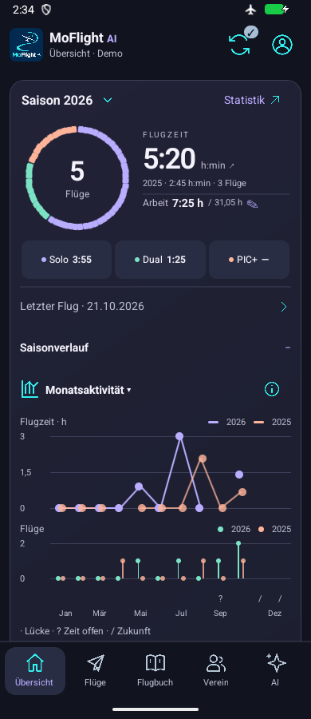
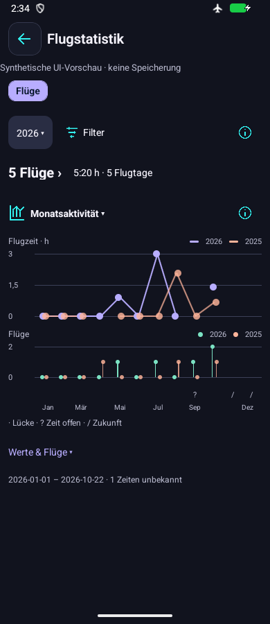

# Expressive compact graphite UI — 2 November 2026

Owner-authorized #119, M1–M4 visual package. Graphite/violet/apricot/mint colors, compact visible controls/cards with retained touch targets, composed role-count orbit/time/work summary, connected seasonal comparisons, denser header/navigation, shorter redundant copy and compact Club/flight/paper surfaces. Original logo and five tabs retained. Isolated #116 source reviewed for composition ideas only, not merged; annual comparison/target ambiguity avoided.

All statistics remain saved-source deterministic values. Missing time/count/roles and incomplete cost coverage remain unknown. Orbit is a distribution; neutral portions remain unresolved. Exact count/time labels and contributor/Back routes remain accessible. No provider, model, account, storage or service changes.

Focused Dashboard/surface/Medical/header/navigation/financial checks89 pass at the intermediate source; TypeScript/lint pass. Old cosmetic separation assertions updated for the selected unified palette, retaining role application and mutation/interaction checks. No tests pin new colors, radii or arc pixels. Completed source-specific native evidence follows below.

Material references: [color roles](https://m3.material.io/styles/color/overview). Site returned a JavaScript shell; requested layout URL404, so no extracted chart recommendations are claimed. Existing public flight/fitness app references: [whole-app review](2026-11-02-whole-app-refactor.md#public-visual-reference-review).

## Completed source and verification

Application **bf2c619c418133fb0dc7ab27eb680c3b1074ceb8**, APK SHA-256 **5ca93bdbbc5f4073dea7aeb3947b0341ebd7bc32353ce2e636c118753e0d922f**. Focused UI/navigation/financial89 and chart/model17 checks pass; TypeScript/lint and ten handbook generator tests/freshness pass. Final Android committed-source Release and iOS export pass. No full host suite or unrelated baseline was repeated for this visual package. Logs stay ignored under `build/graphite-*`.

[Native evidence](2026-11-02-graphite-native.json): actual shared Dashboard/Statistics at MAIN390x900/font1, MIN360x900/font1.6, WIDE800x600/font1, density160/dark. Role orbit/labels, time/work values, chart legends, current/prior traces, count markers and unknown/future distinctions are readable. Wide content stays bounded; short screens scroll. MIN Jan/March labels are close without overlap. MAIN Costs hero/month values retain partial/unknown/payment qualifiers; Club source cards are readable. Top Club heading remains visually unverified: its XML was located but retained preview scroll and capture budget prevented a picture. No additional matrix/rebuild was run for that minor decorative limit.

Two scoped controllers were necessary: the first37 actions/five captures left wide Statistics and secondary surfaces untested; the second34 actions/five captures checks only those missing cases. All ten relevant pictures were independently reviewed by the parent. Display/network/install identity restore without cleanup errors. The originally stopped synthetic emulator is stopped again; no clear/reset, owner/private emulator, login, provider capture, model call or data write. All preview values are fictional. Actual installed source/hash are verified. Controller active durations are qualified tooling observations under Issue90, never an app speedup.

The direct m3.material.io color page returned a JavaScript shell and the requested layout URL404. Google's readable [Material3 implementation and Reply example](https://developer.android.com/develop/ui/compose/designsystems/material3) and [canonical layouts](https://developer.android.com/develop/ui/compose/layouts/adaptive/canonical-layouts) were also consulted. Adaptations: semantic color/type/shape roles on existing React Native primitives, compact readable grouping, capped wide chart/detail surfaces and retained contextual drilldowns. No Compose dependency or automatic device palette is introduced; dark remains master.

## Current implementation reference

These are native **synthetic demo** captures of the shared components, sourcebf2c619; they document implementation rather than physical-device or owner aesthetic acceptance. Original visual references remain preserved.

[Download APK ZIP](https://github.com/MomoRC-tech/MoFlight-App-framework/releases/download/lab-graphite-2026-11-02-bf2c619/MoFlight-Graphite-bf2c619.zip). Actual APK sourcebf2c619 above; only APK/sanitized metadata. Earlier refactor7c42598 and rollbackeeda7a0 remain published. Release download/source/hash inventory verification is recorded in [release evidence](2026-11-02-graphite-release.json).
