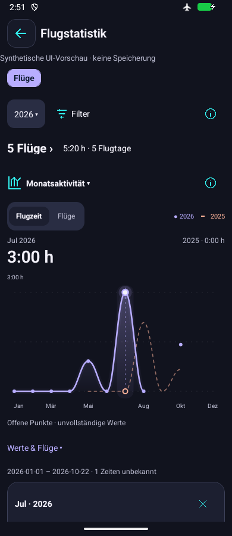

# Modern vector charts — 2 November 2026

Owner-authorized Issue120/M1–M4. Native vector curves/area gradients, smooth role donuts, quiet grid/prior series, focused selection and a single time/count viewport replace the earlier rectangle/point plots. Costs uses the same full-year trend with compact exact-month choices and one selected price. Original palette/logo/navigation remain; all source calculations, scopes and persistence stay unchanged.

One dependency: react-native-svg15.15.4, the exact version in the installed Expo57 bundledNativeModules manifest. [Official Expo SVG guidance](https://docs.expo.dev/versions/latest/sdk/svg/) confirms native Android/iOS SVG primitives/interactivity; latest online recommended15.16.0 differs from this pinned SDK manifest. No paid service or larger chart framework. Library MIT notice is available in About. Material3 color roles were consulted again; m3 text returns a JavaScript shell. Existing [Google Material3/Reply adaptations](2026-11-02-graphite-ui.md#completed-source-and-verification) remain relevant.

Visual interpolation is bounded between observed values and never connects across missing or uncertain points. Tests cover actual cubic controls/extrema, gaps, signed values, known zero, future selection rejection, time/count selection and exact current/prior contributors. Host app coverage uses focused checks; native acceptance follows after a committed-source Release, because adding SVG changes the native module set. Physical/iOS runtime/light/service gates remain distinct.

## Delivered implementation and checks

Actual APK source **8ca43fcf8b435d43683bc7d210380e2595e6a82f**, APK SHA-256 **8bfd6ade843ea286630afc91771606c86065d9ad37580f88bc496134339e0542**. Source commits b0e0d93 (vector engine/dependency), f6825aa (selection cleanup),8ca43fc (native-discovered legend/role/preview Back corrections) are pushed main. Initial SVG integration required native regeneration and built both ABIs; final committed-source Release reuses that unchanged native fingerprint and passes embedded-source/APK inspection. Final iOS export passes; iOS native runtime remains untested.

Host evidence:51 focused chart/geometry/model/presentation/financial/overlay checks pass; later73 affected navigation/presentation checks pass after the native corrections (ten overlap; counts are not additive). TypeScript, full initial lint/final affected-file lint and generated handbook freshness pass. No full application suite or unrelated platform baseline was repeated. Logs are ignored `build/vector-*` files.

[Native evidence and failed observations](2026-11-02-modern-charts-native.json): first MAIN f6825aa confirms true area gradients, rounded arcs, exact selected month/guide and source qualifiers, then exposes count/legend color mismatch, PIC+ midword wrap and Development preview hardware Back escaping to its parent. Corrections use one current-year hue across metrics, short visible role names with full accessible/source descriptions, and explicit shell-to-preview Back delegation, avoiding listener-order dependence. Production account/store keys and ordinary data navigation are unchanged.

Final8ca43fc WIDE800x600/font1/density160 verifies bounded curves/axes, concise role legend, full Costs trend and selected February **0,00 EUR**, distinct from unknown January. Worker called clipped Nov/Dec choices a failure; parent review classifies this as the intended horizontally scrolling control strip, preserving48dp targets on a capped surface. All12 options remain rendered/reachable by scrolling or chart selection; horizontal Nov/Dec gestures themselves were not exercised. Native conflict-state acceptance is not claimed; host component fixtures retain null/zero/conflict distinctions.

The first MIN route attempt was blocked before reaching charts (partially visible Development target, two refused attempts), not accepted. A final focused run only for MIN360x900/font1.6/density160 passes without retries: both metric choices/axes readable, current/prior legend correspondence, and actual July value/marker/guide captured **before** Back. Native Back retains Statistics and clears selected value/guide; parent inspected both frames. MAIN/WIDE passed cases were not repeated. Controllers used35/37/23 actions and7/6/3 captures; original display/network/install identity restored with no cleanup errors. The initially stopped synthetic emulator is stopped again. No clear/reset, private/provider emulator, authentication, provider retrieval, model request or data write.

Controller elapsed observations, including failures, are appended under Issue90 as tooling overhead, not app latency/speedup. Six pre-existing dirty historical ledger groups remain preserved and excluded from this package's commit.

## Native implementation references

All values are fictional. MAIN selected-time rendering below is sourcef6825aa; its vector geometry is reused unchanged in8ca43fc, which corrects the qualifier/legend wording and preview Back. Final-source MIN selection and Costs references establish the corrected source-specific states. These pictures document implementation, not owner aesthetic or physical-device acceptance.

[Final-source enlarged count selection](../assets/ui/2026-11-02-modern-count-min.png) · [Final-source known-zero Costs selection](../assets/ui/2026-11-02-modern-cost-selection.png).

[Download modern-charts APK ZIP](https://github.com/MomoRC-tech/MoFlight-App-framework/releases/download/lab-modern-charts-2026-11-02-8ca43fc/MoFlight-Modern-Charts-8ca43fc.zip). Only intended APK/sanitized metadata; actual source8ca43fc above. [Downloaded release/source/hash/inventory verification](2026-11-02-modern-charts-release.json). Previous graphite/refactor/rollback releases remain available. Broader source/phone/iOS/service/beta gates stay with their existing Issues.
