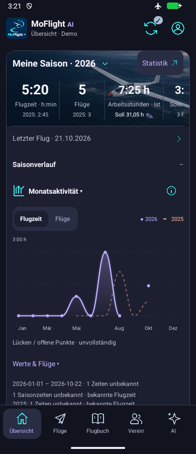

# Start restoration with lean tiles — 2 November 2026

Owner-authorized Issue #121 / M1 / P1, separate from recommendations-only Issue #116. Verified rollback release `rollback-2026-11-02-eeda7a0` targets `eeda7a063fb5266b89cf306d6ad9b937946b0496`.

Restores only Dashboard's classic photo-backed season composition and horizontal time/flights/work/Solo/Dual/PIC+ strip. Original year/target/prior values, latest-flight identity and chart slot remain. Newer time/count drilldowns and 48dp touch floors remain; redundant swipe instruction/unused old styles omitted. Current compact Medical/Paper/duty tiles, shared shell/palette, modern SVG and source/account/Back fixes remain. Latest owner correction excludes fuller tiles. No experimental component/navigation/dependency/data/schema/provider change.

22 focused existing Start/Medical/surface checks, TypeScript and affected-file lint pass. Tests check observable six-metric/target affordances, not colors or pixels. Experiment review ran no tests/builds/servers/devices; following Release/native evidence belongs only to this authorized restoration. Broader chart/detail evidence at `8ca43fc` stays source-specific and reusable.

## Committed-source delivery and acceptance limits

Actual application source **6c898a3b124c59d3d72d16065dffbd4bd9c17673**; APK SHA-256 **7d98c72778333f0f290c89e8270660333529f2d12fee5b15c8c7916c888cb980**. Android Release passes embedded-source/ABI inspection; unchanged native fingerprint reused. iOS Hermes export passes, without iOS native runtime acceptance. Existing source-specific modern-chart evidence is reused for the unchanged renderer; no broad suite or unrelated chart/platform matrix repeated.

Dark synthetic Android MAIN390x900/font1 and MIN360x900/font1.6, density160: parent inspected all four frames. The classic photo card, first visible time/count metrics and latest-flight line render; year selector is visible, and MAIN shows the work-target pencil. Compact Medical/Paper tiles remain side by side at MAIN and stack at MIN, with individual record dates/statuses retained. Club name wraps without overlap at enlarged font. No fuller tiles were imported.

The worker reports MAIN/MIN metric clipping as failures in the [unaltered observations](2026-11-02-start-restoration-native-main.json). Parent source/image review classifies the partial trailing metric as **intentional horizontal ScrollView overflow**, retained from the rollback contract, rather than lost data. It is not a six-column fit claim. Later metrics and the MIN work-target control require horizontal scrolling; those gestures and native editing were not exercised. Existing focused host tests cover the retained controls/calculations. The old swipe-help paragraph stays removed at the owner's lean-copy request. MIN year title wraps to three lines without overlap.

The first bounded run left WIDE untested rather than spend its recovery reserve. A separate [WIDE-only follow-up](2026-11-02-start-restoration-native-wide.json) records the actual 800x600/font1/density160 state; it does not repeat phone states. Parent inspection confirms the season card/metric strip are centered and capped (496dp visible card), without overlap. The second frame shows the unchanged chart; lower WIDE tiles were not reached and are not accepted from that frame. Controllers used 34/16 actions and 4/2 captures, with no action errors. Active elapsed 186.610/116.297 seconds, including the initial partial run, is recorded under #90 as tooling overhead, not app latency or speedup. Original display/font, offline radios and installation identity restore with no cleanup errors. The initially stopped synthetic AVD is stopped again after review; no app data reset, private/provider emulator, typing/saving, provider refresh or model request.

The source-specific scope is implemented and inspected; owner aesthetic acceptance, physical-phone/iOS runtime/light/spoken checks and broader beta gates remain separate. The experimental branch stays clean/stopped and #116 remains selection-pending. Six pre-existing dirty historical performance groups are preserved, excluded from this package's commit.

[Download restored-Start APK ZIP](https://github.com/MomoRC-tech/MoFlight-App-framework/releases/download/lab-start-restored-2026-11-02-6c898a3/MoFlight-Start-Restored-6c898a3.zip). [Fresh published-download verification](2026-11-02-start-restoration-release.json) confirms exact APK/metadata-only inventory, identical ZIP bytes, APK hash and embedded full source SHA. Earlier rollback/modern-chart releases remain available.

## Implementation references — fictional data

[MAIN lean tiles](../assets/ui/2026-11-02-restored-start-main-cockpit-tiles.png) · [MIN season card](../assets/ui/2026-11-02-restored-start-min-cockpit-upper.png) · [MIN stacked lean tiles](../assets/ui/2026-11-02-restored-start-min-cockpit-tiles.png) · [WIDE capped season card](../assets/ui/2026-11-02-restored-start-wide-cockpit-top.png).

Documentation links/handbook freshness, ledger regeneration and ten focused ledger checks pass. No additional application test run was needed for this evidence-only closeout.
