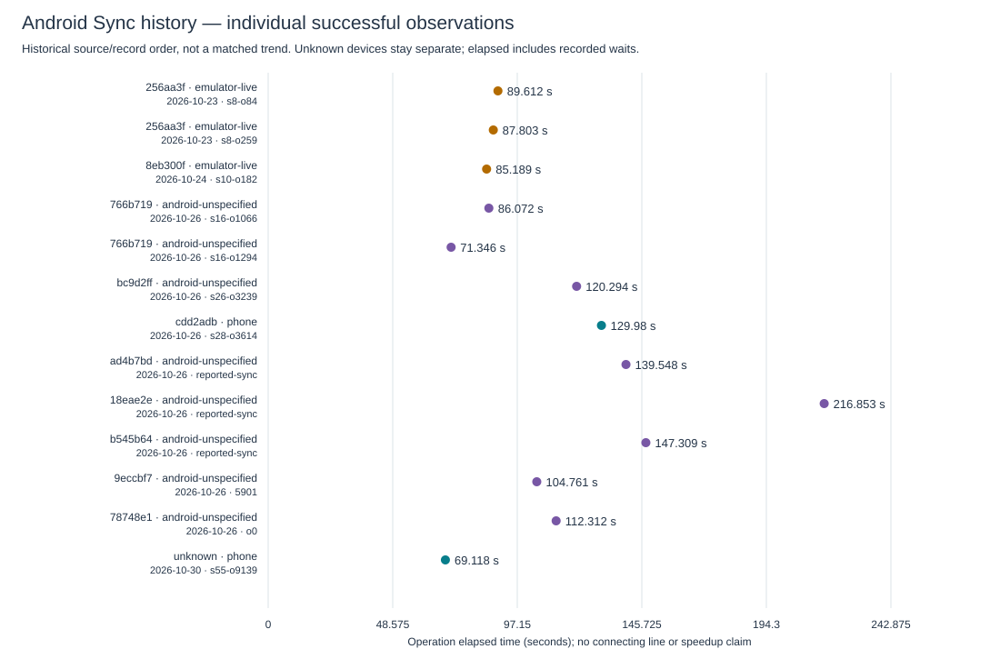
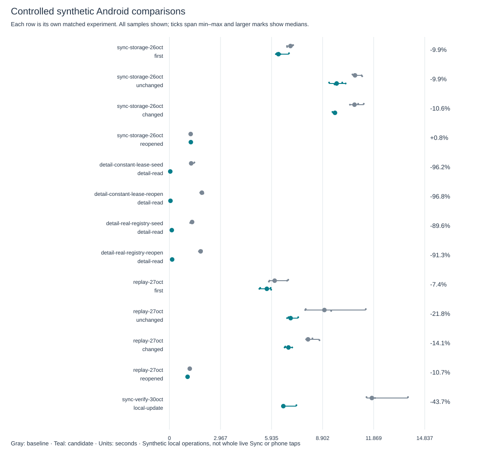
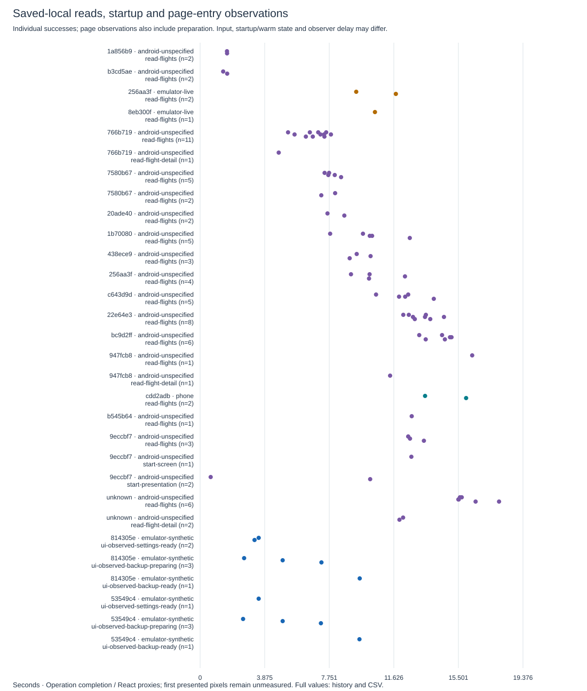

# Runtime performance ledger

Maintained under [#90](https://github.com/MomoRC-tech/MoFlight-App-framework/issues/90), with #41 owning Sync investigation and #45 Start/tab/resume responsiveness. Manuel requested permanent tracking on 29 October 2026. This is the single index for recorded runtime timings; package reports retain their source-specific methods and acceptance evidence.

The ledger currently stores **127 run groups, 761 sample/observation records and 28,016 numeric values**, including elapsed durations, inclusive stages, counters, timing offsets and available render proxies. Records include supporting host runs and derived event/prediction observations; this count is not a number of independent device trials. [Complete sample history](history.md) · [Machine-readable ledger](ledger.json) · [All numeric values (CSV)](measurements.csv).

## Phone and other supplied Android observations

Only the explicitly identified Pixel 6a session is labelled phone. Other supplied Android exports retain unknown device identity; Android API alone does not identify a phone or emulator. Each point is one successful operation; its x coordinate is elapsed time, not a calendar date. Rows follow historical source/record order. Different datasets, receipt history, waits, network and device conditions prevent a causal release-speed comparison. Failed, partial, blocked, interrupted and running operations remain in the complete history/CSV and are excluded from the successful-Sync chart.

## Controlled emulator experiments

| Experiment / operation | Baseline source | Candidate source | Samples each | Baseline median (range), ms | Candidate median (range), ms | Change |
| --- | --- | --- | ---: | ---: | ---: | ---: |
| [sync-storage-26oct](history.md#sync-storage-26oct-baseline) / first | `597712b` | `d6f61cc` | 5 / 5 | 7,034.824 (6,834.473–7,188.896) | 6,334.993 (6,186.29–6,949.197) | -9.9% |
| [sync-storage-26oct](history.md#sync-storage-26oct-baseline) / unchanged | `597712b` | `d6f61cc` | 5 / 5 | 10,785.597 (10,636.324–11,203.469) | 9,719.295 (9,280.026–10,240.955) | -9.9% |
| [sync-storage-26oct](history.md#sync-storage-26oct-baseline) / changed | `597712b` | `d6f61cc` | 5 / 5 | 10,756.457 (10,491.617–11,294.973) | 9,621.548 (9,474.217–9,663.496) | -10.6% |
| [sync-storage-26oct](history.md#sync-storage-26oct-baseline) / reopened | `597712b` | `d6f61cc` | 5 / 5 | 1,234.856 (1,178.142–1,276.008) | 1,244.651 (1,176.128–1,251.861) | +0.8% |
| [detail-constant-lease-seed](history.md#detail-constant-lease-seed-baseline) / detail-read | `9eccbf7` | `9eccbf7` | 5 / 5 | 1,264.198 (1,223.874–1,451.345) | 48.6 (44.371–66.975) | -96.2% |
| [detail-constant-lease-reopen](history.md#detail-constant-lease-reopen-baseline) / detail-read | `9eccbf7` | `9eccbf7` | 5 / 5 | 1,885.913 (1,789.846–1,968.941) | 61.082 (51.047–66.298) | -96.8% |
| [detail-real-registry-seed](history.md#detail-real-registry-seed-baseline) / detail-read | `78748e1` | `78748e1` | 5 / 5 | 1,318.246 (1,204.996–1,341.675) | 137.093 (133.929–149.353) | -89.6% |
| [detail-real-registry-reopen](history.md#detail-real-registry-reopen-baseline) / detail-read | `78748e1` | `78748e1` | 5 / 5 | 1,813.925 (1,713.555–1,883.506) | 157.121 (126.848–191.973) | -91.3% |
| [replay-27oct](history.md#replay-27oct-baseline) / first | `35c0dc5` | `d986ac1` | 5 / 5 | 6,115.178 (5,779.853–6,905.113) | 5,661.718 (5,227.706–5,912.854) | -7.4% |
| [replay-27oct](history.md#replay-27oct-baseline) / unchanged | `35c0dc5` | `d986ac1` | 5 / 5 | 9,007.719 (7,890.5–11,413.225) | 7,044.179 (6,838.538–7,485.004) | -21.8% |
| [replay-27oct](history.md#replay-27oct-baseline) / changed | `35c0dc5` | `d986ac1` | 5 / 5 | 8,055.743 (7,944.196–8,720.122) | 6,917.657 (6,693.297–7,136.587) | -14.1% |
| [replay-27oct](history.md#replay-27oct-baseline) / reopened | `35c0dc5` | `d986ac1` | 5 / 5 | 1,181.764 (1,117.969–1,191.279) | 1,054.728 (1,041.164–1,063.733) | -10.7% |

These percentages belong to separate experiments; do not add them or treat all baselines as successive releases of one workload. The older constant-lease detail proof missed a production lifecycle regression and remains historical synthetic evidence. Its corrected registry proof is a separate experiment, not a speed regression. Layout effects and animation-frame callbacks are render proxies, not proof of presented pixels. Host results are separately indexed and never mixed with device charts.

## Saved-local reads and startup

No median or connecting trend is shown for these unmatched observations. The full history includes failed detail reads, obsolete reads, incomplete operations and individual stage values. Startup/commit markers retain their original timing boundary; a successful marker does not establish a first presented frame.

## Coverage and remaining gaps

- Backfill date: 29 October 2026. All 305 retained raw diagnostic operation snapshots from nine relevant exports were projected; repeated exports of the same installation/session/operation are consolidated. Historical session build contexts are used, never the export's current build for older operations.
- All retained native fixed-input comparison/detail samples, their numeric stages/render proxies, public phone timing projections and disjoint report windows are indexed. Supporting host and held-out local estimator measurements stay separate. Numeric details include overlapping/inclusive measurements and may exceed operation elapsed time.
- Older raw attachments for some supplied reports are unavailable in this workspace. Their documented values are preserved at their stated precision; unknown device, input, APK, sample count or timestamp is not invented. This is a retained-evidence backfill, not a claim to recover every number ever shown in another chat.
- Build times, test-suite/agent/harness total durations and fixture flight-duration facts are not app runtime performance and are excluded. UI-observed completion, polling/observer overhead, heartbeat and memory values are kept separate from operation latency.
- Current-source populated saved-preview/full-validation and cold/warm/tab/resume comparisons, physical-phone optimization retests and presented-frame endpoints remain open under #90/#45/#105. No iOS runtime timing has been measured.

## Record every future measurement

1. In the same work package, retain the original report in ignored private storage. Use `node --import tsx scripts/flight_loading_timing.ts INPUT.json NEW_OUTPUT.json` for the existing timing-only projection. Never publish a raw support report, account/flight content, credentials or arbitrary context.
2. Append a run envelope matching `ledger.json` (or `run-template.json`). Record actual source/APK, device/API/ABI, network/session, input/history size, observer overhead, endpoints, outcomes and recorded date. Unknowns remain explicit. Keep individual sample values, inclusive stages/counters/checkpoint offsets and failures; numeric details use semantic keys. Preserve unavailable fields as limitations rather than zero. Prefer at least five fixed-input samples for a controlled comparison; an observation is still worth recording when only one exists.
3. Use a distinct `comparison.group` only for the same fixture, environment, timing boundary and method, with baseline/candidate variants. Do not average cold/warm/startup/resume or interrupted runs together. Keep host, synthetic emulator, live emulator, phone and unidentified Android separate. Amend evidence for an existing operation instead of counting its duplicate export as a new trial.
4. Run `python scripts/performance_ledger.py --add-run NEW_RUN.json` (new ID required), or edit the ledger for a reviewed paired batch. Then run `python scripts/performance_ledger.py --check` and the focused generator tests. Link the package evidence/result in #90 and commit/push the ledger and generated files with that package. The command is local and makes no device/provider/model/network calls.

Future tracking happens whenever a measurement is supplied or a test runs; this does not schedule autonomous testing or authorize new execution/spending. Existing requirements for comparable populated Start preview/full-validation, tab/resume, foreground live Sync and physical-phone/iOS acceptance remain open. A missing measurement is never a passed gate.

## Verification of this ledger package

29 October 2026, Windows x64 / Python 3.12.10 / Node 24.18.0: all 10 focused ledger tests pass; generation/freshness and 775 local links/anchors pass. The phone operation/stage values and all 40 replay-comparison native samples match committed evidence; reported disjoint windows sum to their operation totals. All three SVG charts parse and were rendered/inspected for readable labels and values. Tests also cover invalid/private raw fields, nonfinite values, incompatible comparisons, stale outputs, safe appending and chart/CSV propagation. Historical report-only rounded values remain labelled. No application tests/builds, APK, device trial or provider/model call was performed for this documentation/tooling package; ledger commit/evidence is linked in #90.
